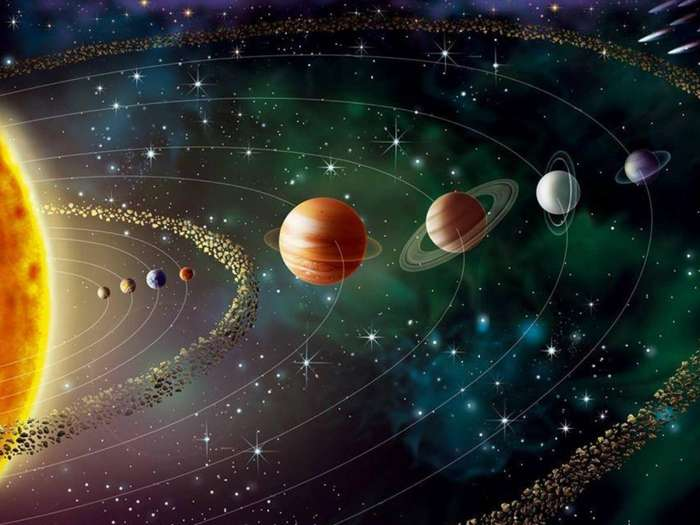

# 1 сарын 7-нд одон орны, онцгой ховор үзэгдэл явагдна

1 сарын 7-с 2 сарын 6-ны хооронд, одон орны маш ховор үзэгдэл явагдна. Нарны аймгийн бүх гариг эрхэс нэг чиглэлийн хөдөлгөөнд орох бөгөөд эртний одон зурхайчид, энэ үеийг дэлхийн хүмүүс, өөрсөддөө ашигтай, үр дүнтэй, ашиглаж болох таатай боломж гэж үздэг байжээ.

Стефани “Уэйв” Форест- нэрд гарсан анхны одон орон судлаач, эрдэмтэн, энэ үзэгдлийн талаар олон лекц, онлайн-сургалт явуулсан байдаг байна. Уэйв: энэ үед, манай нарны аймгийн гариг эрхэс, нэг чиглэлд яг голын урсгал мэт хөдөлдөг бөгөөд үүнийг бид, “директ” хөдөлгөөн гэж нэрлэдэг. Ийм синхрон хөдөлгөөн сансарт маш ховор тохиолддог үзэгдэл гэж тайлбарлаад, хэрэв үүнийг тэнгэр шүтлэгт, бөө мөргөлийн хэлээр бол, Меркурий маш хурдтай, хөдөлгөөний хувьсалтай болж, дээд, дунд, доод ертөнцийг нэг цаг хугацаанд дайран өнгөрөхдөө, эдгээрийн элч, мэдээллийн дамжуулагч хүч болон хувирдаг гэж илэрхийлж болох юм гэж тайлбарласан байна. Энэ үед, Нар, эхэлж буй бүхий л ажил үйлсийг, сансарын хүчээр дэмжиж тэтгэдэг гэж үздэг байна. Нэгдүгээр сарын, ойрын өдрүүд, томоохон шийдвэрүүд гаргах, шийдвэрлэхэд таатай, харин эдгээрийг дараа саруудад шийдвэрлэх явц ихээхэн бэрхшээлтэй байх тул амжиж барьж авахыг сануулж байна. Харин, хоёрдугаар сард, Юпитер, Ураны байрлалд орсноор, онцгой өөрчлөлтүүдийн сар болно.
