# 100 жилийн өмнөх хүмүүс одоо үеийг хэрхэн төсөөлж байсныг харуулах зургууд

Ирээдүй үргэлжид хүн төрөлхтөний сонирхолыг татсаар ирсэн. Өмнөх үеийнхэн маань, одоогийн бидний амьдарч байгаа үеийг хэрхэн төсөөлж байсныг харуулсан зургуудыг сонирхуулъя. Үнэнтэй тун дөхүү санагдна.

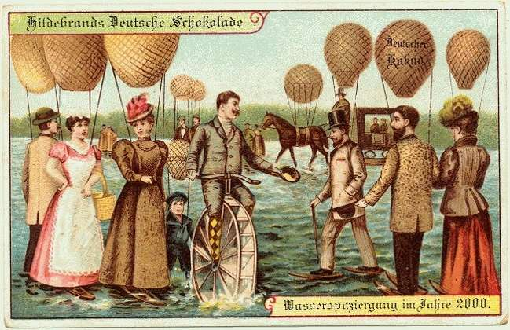

1. 1900 онд германы шоколадный үйлдвэр 2000 онд дэлхий ертөнц ямар байхыг харуулсан ил захидлууд гаргажээ. Тэдний төсөөлснөөр, 2000 онд хүмүүсийн хувьд усан дээгүүр явах нь асуудал биш болно гэж үзэж байжээ

---

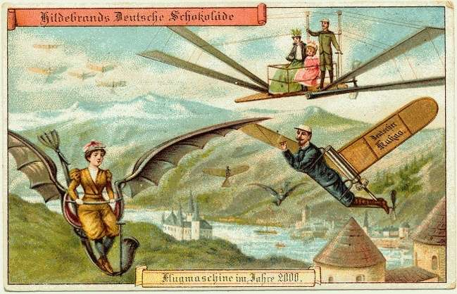

2. Хүн бүр өөр өөрийн далавчтай болох байж

---

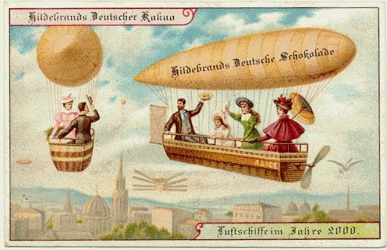

3. Нийтийн тээврийн хэрэгсэл ийм байх ёстой байж. Хувцасны загвар өөрчилөгднө гэж боддоггүй байсан бололтой

---

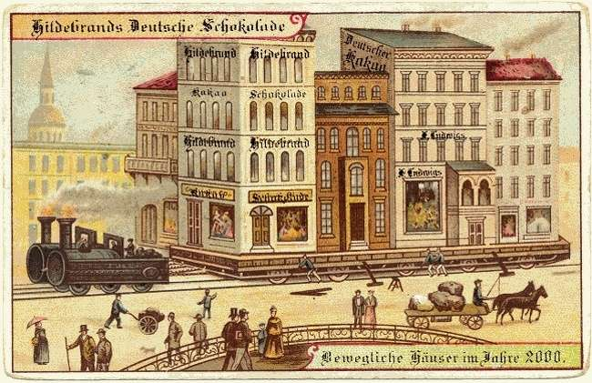

4. Барилга байшинг ийн хөдөлгөж шилжүүлдэг байх талаар орчин үеийнхэн маань бодох ёстой болох нь

---

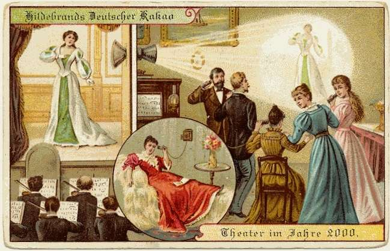

5. Нэг газар болж буй зүйлийг өөр газарт үздэг болно. Телевиз, онлайныг санагдуулж байгаа биз?

---

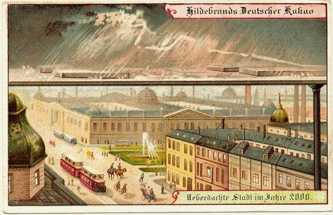

6. Хотыг нийтэд нь бүрхсэн дээвэр. Ямар ч цаг агаарын нөхцөл хүмүүст мэдрэгдэхгүй. Үүнийг эзэмших ч юу л бол?

---

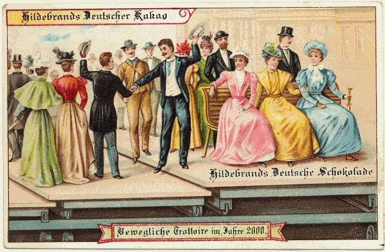

7. Хөдөлгөөнт замууд. Ийм болоогүй байгаа. Гэхдээ зарим онгоцны буудлууд дээр ашиглагддаг.

---

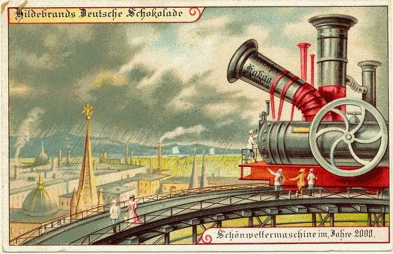

8. Цаг уурыг зохицуулах төхөөрөмж. Харин бид, үүлийг хөөж сарниулж чаддаг болсон

---

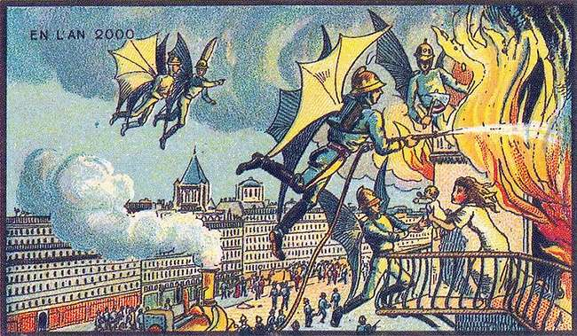

9. Нисдэг гал сөнөөгчид

---

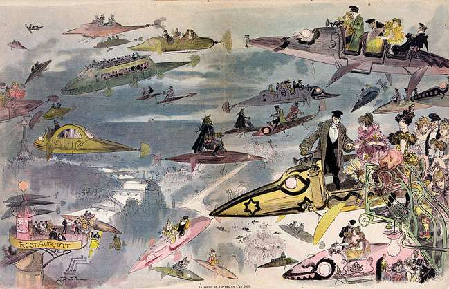

10. Дуурийн театраас тарсан хүмүүс харьж байгаа нь гэнэ. Ийм нисдэг төхөөрөмж гараагүй, тэгээд ч тэр үеийнхэн шиг дуурь үзэхээ больжээ.

---

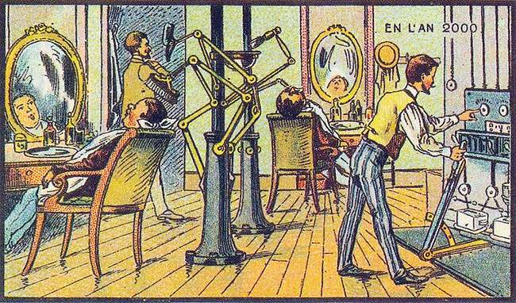

11. Автомат үсчин. Одоо ч үсчингүүд гараар үс засдаг нь хэвээрээ

---

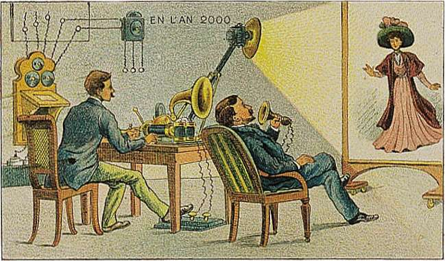

12. Skype мөн мессэнджер бололтой

---

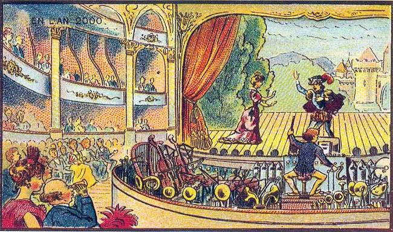

13. Робот оркестр. Үгүй ээ. Ядахдаа хөгжим, хүний сэтгэлээр амилсан амьд байх ёстой

---

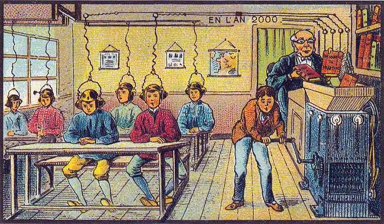

14. Мэдлэгийг шууд тархинд шахаж чаддаг болно гэж төсөөлдөг байжээ. Ккк

---

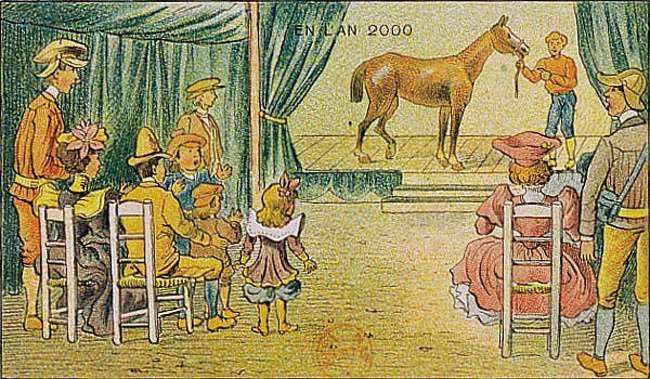

15. Хөгжлийн явцад амьтад устаж, амьд морь үзүүлэн болно гэжээ. Дэлхийн томоохон хотуудад өсч буй хүүхдүүд, харамсалтай нь үнэхээр морь үзэхгүй өсч байгаа нь үнэн юм.
