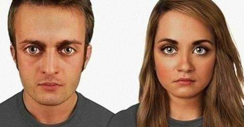
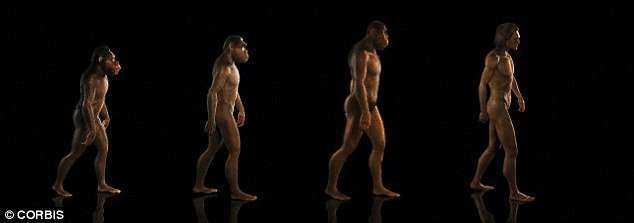
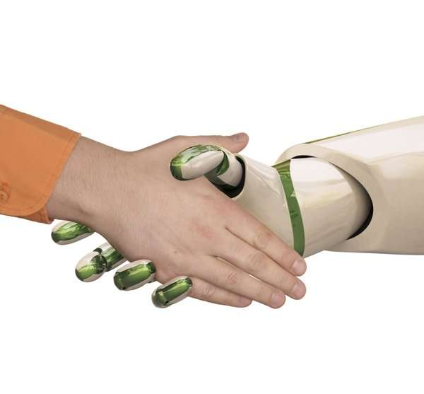

# 1000 жилийн дараах хүмүүсийн дүр төрхийг, эрдэмтэд  тогтоож байна

Хүн төрөлхтөн, хувьслын онолоор, сармагчнаас ,өнөөгийн” сахлаа хуссан оффисын ажилтан” болж хувиртлаа мянга мянган жилийн урт удаан хугацааг туулсан билээ. Түүнчлэн энэхүү хувьслын онол одоо ч явагдаж буй нь гарцаагүй бөгөөд үүн дээр тулгуурлан, эрдэмтэд төрөл бүрийн судалгаа шинжилгээ явуулан, хүн төрөлхтөн 1000 жилийн дараа ямар дүр төрхтэй болохыг тодорхойлохоор ажиллаж байна.

---

Канадын судалгааны төвийн эрдэмтэд, 2050 онд хүмүүс, робот, машинтай нэгдэх , төстэй болох асуудал гарах ба хүмүүсийн “ нүд ердийн бус том” болох аж. Мөн “ нас уртасч”, эрдэмтэд хүний зүс царайг “төгс зөв төрх”-тэй болгох аргыг генийн түвшинд хийх аргыг нээсэн байх ажээ. 2050 онд, хүмүүсийн чөлөөт цаг уртасч, ажилтан шаардлагагүй “Ажил” эрхлэх нь.

Ойрын 50 жилд, хүмүүсийн эрхэлдэг олонхи ажлуудыг роботууд гүйцэтгэж эхлэснээр, “робот мэс засалч”-д “тархины хүчин чадлыг нэмэгдүүлэх” эсвэл “хуучирсан био эрхтэнүүдээ солиулах” зэргээр ханддаг болох гэнэ.
