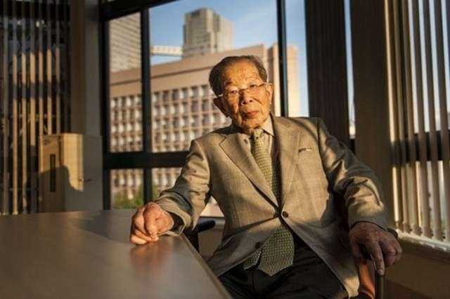
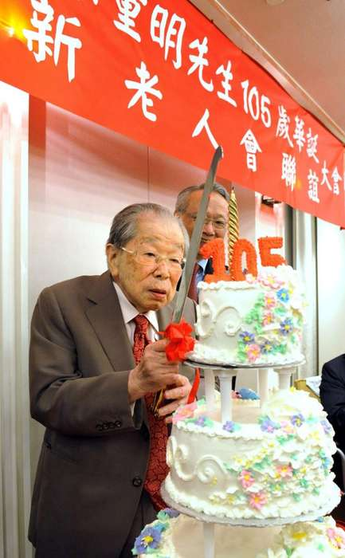

# 106 насалсан япон эмчийн 5 алтан дүрэм

Японы орчин үеийн анагаах ухааны эх суурийг тавигч, мөн Япон улсыг урт настнуудын орон болгосон эмч Сигеаки Хинохара, өөрийн нээсэн эрүүл урт наслах аргуудыг үр дүнтэй ашиглан өөрийн амьдрал дээр нотолсон хүн гэж үнэлэгддэг. Гэгээн Лукийн Олон Улсын их сургууль, түүний нэрэмжит эмнэлгийн хүндэт гишүүн, доктор Сигеаки Хинохара эрүүл урт наслалтын талаар дараах зөвлөгөөнүүдийг өгсөн байдаг. Тэрээр, тэтгэвэрт эрт гарахыг дэмждэггүй, ядахдаа 65 наснаас гарах нь зохилтой гэж үздэг хүн байв. Японы иргэдийн дундач наслалт 68 байхад, 65 настай тэтгэвэрт гардаг байсан. Гэтэл, 2015 оны байдлаар дундач наслалт 84 болсон атал тэтгэврийн насыг хойшлуулахгүй байна гэж олонтаа өгүүлдэг байжээ. Тэр, 2017 оны 7 сарын 17-нд, 106 насандаа таалал төгсөх өдрөө ч, өвчитнүүдээ эмчилж, өвчины түүх хөтлөн, өвчитөн хүлээн авах тэмдэглэгээгээ 5 жилээр төлөвлөн, өдөрт 18 цагаар ажиллаж байсан ажээ. Түүнээс ярилцлага авсан сэтгүүлч эмэгтэй Джудит Кавагучи, түүний тухай -“Тэр, амьдралын хамгийн гол зүйл бол, аливаад өөрийн хувь нэмэр оруулах гэж үздэг. Бусдад туслах чин эрмэлзэлтэй, өглөө үүрийн жингээс үдэш орой хүртэл ямар нэг ашиг тустай зүйл хийх бүтээхийг мөрдлөг болгодог хүн. Яг энэ эрмэлзэл нь түүнийг хөдөлгөх, амьдрах хүч нь болж өгдөг. Үргэлж зорилгоо, өдрөөр, долоо хоногоор, 5 жилээр урьдчилан төлөвлөж гүйцэтгэдэг гайхалтай хүн” гэж бичжээ. Ингээд түүний алтан дүрмүүдийг танилцуулъя:

-Эрүүл зөв хооллолт, нойрсолтод их анхаараад байх шаардлага байхгүй. Та нар, бага насандаа идэх, унтахаа мартаад сонирхолтой зүйлдээ анхаарч, тоглож хөгжилдөөд явж байдаг байснаа мартаагүй биз дээ. Энэ хандлагаа өсч том болсон ч хадгалан үлдвэл сайнсан. Хэзээ хооллох вэ, хэзээ хир хугацаагаар унтах вэ гэх мэтээр сэтгэл санаа, бие мах бодоо бүү шаналга.\
-Урт наслая гэвэл илүүдэл жингээс сэргийл. Бага идэж, ажил үйлстээ өөрийгөө зориул. Өлсдөггүй юм.\
-Эмч нарын зааварт бүү авт. Эмч таныг, хагалгаанд ор гэвэл, уг эмчээсээ, яг ийм тохиолдолд тэр өөрийн эхнэр эсвэл хүүхдэдээ хагалгаа хийх байсан эсэх талаар асуу. Эмч нар бүх өвчинийг эмчилж чадахгүй. Бие мах бодоо зүсүүлж зовохоос өөр, ямар нэг арга эрэлхийлэх талаар сайтар судал. Би, харин хөгжим, амьтадын нөлөөллийг эмчилгээний илүү үр дүнтэй гэж тооцдог.\
-Өвдөлтийг намдаая гэвэл сонирхолтой зүйл хий. Өвдөлт бол оньсого, харин сонирхолтой зүйл түүнийг мартуулах гайхалтай арга. Хүүхдийн шүд өвдөхөд, түүнтэй тоглоод эхлэхэд тэр, тэр дороо мартна. Туршаад үзээрэй. Эмнэлгүүд уг нь, өвчитнүүдийн хэрэгцээ сонирхолыг хангах иймэрхүү кабинетуудтай байх ёстой. Эрүүл, өвчтэй бүх хүн сонирхолыг нь татсан зугаанд дуртай байдаг. Энэ бол, өвчинг мартагнуулах эмчилгээний хүчтэй арга юм. Манай Гэгээн Лукийн эмнэлэгт хөгжимийн эмчилгээ, арт буюу зураг зуруулах эмчилгээ, бүр өвчитнүүдийг сатааруулах, хайр татсан хөөрхөн тэжээвэр амьтад ч байдаг. Их үр дүнтэй шүү.\
-Шатаар зөвхөн явган өгсч бай. Ачаагаа ч өөрөө барьж өгс. Би бүр шатны гишгүүрийг алгасан өгсч, булчин шөрмөсөө ажиллуулдаг.\
106 настай эмчийн энэхүү зөвлөгөө үнэхээр гайхалтай.
