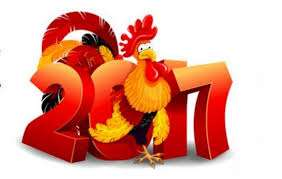

# 12 сарын 31-нд юу хийж болохгүй вэ?

Шинэ он гарах гэж байна. Энэхүү шинэ оныг угтах баярыг улс, үндэстнүүд баяр хөөрөөр дүүрэн угтаж, шинэ он маань, аз жаргал, аз, амжилт, эд баялагаар дүүрэн жил байгаасай гэсэн хүсэл, итгэл найдвар тээн тэмдэглэдэг билээ. Тиймээс энэ баярыг тойрсон, үндэстэн бүрийн янз бүрийн зан үйл, ёс заншлууд байдаг. Эдгээрт шүүмжлэлтэй хандах нэгэн байв ч, мөн хүлээж авах хүмүүс ч байдаг. Гэхдээ, энэхүү хандлагуудыг тайван орхиод, АЗ ХИЙМОРЬ хэмээх, тогтворгүй боловч гайхалтай нэгэн зүйлийг барьж авах гээд үзвэл...? Тэгээд ч, энэхүү зан үйл, ёс заншлууд, ганцхан зууныг дамжин ирж, уламжлагдаагүй, урт удаан замыг туулан хадгалагдан ирсэн нь үнэний хувь агуулна бус уу? Зарим зүйлсийг ухаанаар биш зүрхээрээ хүлээж авах нь дээр гэдэг. Таны зүрх сэтгэл шийдэх биз ээ. 12 сарын 31-нд хийж болохгүй зүйлс:

-шинэ оныг өртэй, хоосон түрийвчтэй угтаж болохгүй\
-он солигдож байх үед, угаалга цэвэрлэгээ хийж болохгүй, ер нь ямар нэг ажил хийгээгүй нь дээр\
-гэр орноо цэвэрлээгүй, замбараагүй байлгаж болохгүй, хог гаргаж болохгүй\
-энэ өдөр товч хадаж болдоггүй \
-гутал худалдаж авах болон засуулж болохгүй нь\
-хэрүүл маргаан хийж болохгүй, хараалын үг хэлж болохгүй\
-шинэ оныг ганцаараа угтдаггүй\
-ширээ хоосон байж болохгүй\
-хоол хүнсээ бэлтгэх үедээ хуруугаа зүсэхээс болгоомжил\
-ширээний ард, дан эмэгтэйчүүд дангаараа, шинэ он угтахыг таагүй гэдэг\
-аяга таваг хагалахаас, ямар нэг зүйл эвдэрэхээс болгоомжил\
-энэ шөнө, үс, хумс тайрдаггүй, мөн толгойгоо угааж болохгүй\
-хуучин муу хувцастай он угтдаггүй\
-хар хувцас өмсөх таагүй\
-он солигдох мөчид хүслээ шивнэн гуйхгүй байж болохгүй, мөн хүслээ хэлэх үедээ, “битгий” бүү” гэсэн үгнүүд оруулж болохгүй. Хүссэн зүйлээ хүнд хэлж болохгүй\
-асаасан лаагаа унтрааж болохгүй, дуустал нь асаадаг\
-улирч буй оны тухай харамсалтай зүйл бодож болохгүй\
-ойр дотныхноо үнсэхгүй, мөн бэлэг бэлэглэхгүй байж болохгүй\
-он солигдох мөчид, уйлж гуниглаж болохгүй\
-хамгийн гол нь ирж буй шинэ оноо угтахгүй байж болохгүй

Энэхүү зөвлөгөөнүүдийг дагах эсэхийг таны, зүрх сэтгэлд даатгая. Магадгүй, та өөртөө таарсан заримыг нь ч атугай сонгож, шинэ оноосоо, аз хийморь, аз жаргал, элбэг дэлбэгийг хүлээж болох юм. Зөв шийдвэрийг сонгох сонголт, туршлагаар дамжин ирдэг, харин туршлага нь, буруу сонголтоос үүдэлтэй байдаг шүү. Та бүхэндээ, хүсэл бүхэн тань биелэх сайхан жилийг ерөөе.
