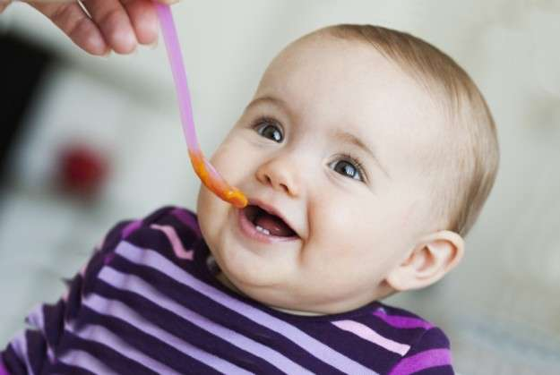

# 2  нас хүрээгүй хүүхдэд өгч болохгүй хориглогддог 5 хүнс

Хүүхэд 6 сар хүрснээр, хоол зажилж, амтыг нь мэдэрч, идэж чаддаг болдог бөгөөд хүссэн зүйлээ нэхэж хөөрхөн гараа сарвайлган болох болохгүйг нь мэдэхгүй нэхэхэд, өгөхгүй байх нь хэцүү байдалд томчууд орж байдаг. Гэтэл дараах таван зүйлийг огт өгч болдоггүй гэнэ.

#### 1. Давс

Хүүхдийг ой хүрэхээс өмнө давсгүй хоол хүнс өгч байх хэрэгтэй бөгөөд энэ үед бөөрний үйл ажиллагаа нь тогтворжоогүй байдаг байна. Давсыг хоол амтлагчид, цагаан гаа, яншуй зэргээр орлуулж өгч байх ёстой аж.

#### 2. Сахар

Америкийн зүрх судасны эмгэг судлалын нийгэмлэгээс, 2 хүртэлх насны хүүхдэд сахар нэмсэн хоол хүнс өгөхийг хориглосон бөгөөд чихэрлэг ундаа, цаастай чихрийг хамгийн мууд тооцсон байна.

#### 3. Зөгийн бал

Ой хүртэлх насны хүүхдэд, зөгийн бал өгөх нь аюултай болохыг Английн Үндэсний эрүүл мэндийн хүрээлэн анхааруулж, зөгийн балын агууламж дах Clostridium botulinium бактери нялх хүүхдийн бие организмд өвчлөл үүсгэнэ гэсэн байна.

#### 4. Поп корн, усан үзэм, цэлцгэнүүр чихэр, самар, зефир

Нялцгар наалдамхай эсвэл хатуу, бүхэл амтлаг зүйлс хүүхдийн бүрэн хөгжөөгүй залгиур хоолойг бөглөх, хоолойд наалдах аюултай байдаг. Бутрамхай, шүдгүйгээр жижиглэгдэж залгигдах хоол хүнс өгөхийг эрхэмлэх хэрэгтэй.

#### 5. Түүхий, дутуу чанасан хүнс

Бүрэн чанаж боловсруулсан хоол хүнс, хортой бактериас цэвэрлэгдсэн байдаг. Хүүхдийн ходоод гэдэс хямрах амархан байдгаас аль болох сайтар чанаж зөөлрүүлсэн хүнс өгч байх хэрэгтэй байдаг байна.
