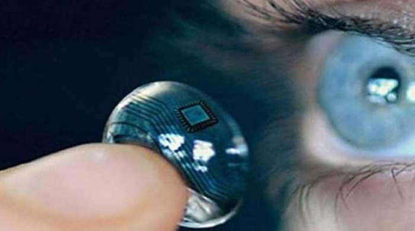

# 2017 оноос нүдний шил хэрэгцээнээс гарч, нүдний эмгэгийн хагалгаа байхгүй болно

Ирээдүй, өнөөдөр анагаах ухаанд хурдтай орж ирж байна. Дэлхийн сая сая хүмүүс, харааны эмгэгээ хагалгаа хийлгэхгүйгээр эсвэл нүдний шил, линз зүүхгүйгээр эмчлүүлж болдог болох нь.

Доктор Гарт Уэбб, цоо шинэ, бараг төгс линз зохион бүтээснээ зарлаж байна. Энэхүү хагалгаа нь өвчин намдаагч хэрэглэхгүй, эмнэлэгт хэвтэх шаардлагагүйгээр, эмнэлэгт хийгдэх боломжтой бөгөөд нүдэнд нэг төрлийн уусмал хийхэд, 10 секундын дараа, нүдтэй нэгдэж, нүдний хараа төгс болох юм байна. Зохиогч маань уг бүтээлээ, энэ нь маш найдвартайгаас гадна гайхалтай үр дүнтэй гэдгийг баталсанаа ярьжээ. Энэ линз ямарч хүндрэл учруулахгүй, нүдний эвэрлэг эдийг огтхон ч гэмтээдэггүйгээрээ давуу талтай аж. Тун удахгүй туршигдах гэж байгаа бөгөөд доктор Уэбб, -“энэхүү бионик линзийг хийхэд 8 жил зарцуулсан, 2017 оноос хүмүүст хүрэх болно” гээд, линзийг, 25-с дээш насныханд суулгаж болно гэж нэмж хэлжээ. Учир нь 25 нас хүртэл хүний нүдний бүтэц бүрэн хэмжээнд хөгжөөгүй, өсөлтийн үедээ байдагтай холбоотой байдаг байна.
