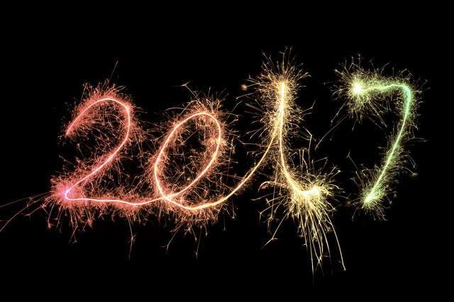

# 2017 оны ордуудын зурхай

Ордуудын зурхайд, гарч буй тахиа жилийг нарны билэг тэмдэг гэж үздэг бөгөөд нар гармагц донгоддог тахиа жил олон сайхан зүйл авчирна гэсэн өөдрөг хүлээлтээр угтаж байна. Тахиа жилийг дорнын орнууд нарны дулаан цацрагтай холбон үздэг бол япончууд гэгээрэх үүрийн туяатай, хятадууд сайн хүсэл, нэр төр, үнэнч байдал, сайхан сэтгэл, эр зориг гэсэн 5 сайн үйлсийн нэгдэл гэж үздэг байна.

#### Хонь

2017 он таны хувьд: Бүх зүйл бүтнэ. “Амьдрал бол тэмцэл” гэсэн үе тань дуусч байна.\
**Ажил хэрэг**\
Албан тушаал ахина, Таны амжилтад хүн бүр баярлахгүй, тэднийг бүү тоо, зөвхөн урагшаа хар\
**Мөнгө санхүү**\
Зоос бүрийг хэмнэж, өөртөө таашаал цэнгэл төрүүлэхүйц зүйлсээс татгалзан, байнга зардлаа хянадаг үе өнгөрч. Мөнгөнд хандах хандлагаа эргэн харах цаг нь болсон. Санхүүгийн хувьд хөл дээрээ зогсох боломжтой, дуусгалгүй орхисон төсөл ашиг авчирна.\
**Хайр дурлал, Гэр бүл**\
Нас, гэр бүлийн байдлаас үл хамааран та хайр дурлалд умбана. Романтик болзоо, цэцэг, сайхан харилцаагаар дүүрэн байна. Харилцаагаа,аз жаргалаа хайрла. Хонины ордын зарим хүмүүс энэ жил ээж эсвэл аав болж магадгүй.

---

#### Үхэр

2017 он таны хувьд: Бүх зүйл хүссэнээр. Аьдралын чинь олон адармаатай зүйл ард чинь үлджээ. .\
**Ажил хэрэг.** \
Сүүлийн 3 жилд төлөвлөсөн төслүүдээ хэрэгжүүлэх боломж гарч ирнэ. Амьсгаа авч, амрах цаг гарна. Шийдвэр гаргахын тулд уян хатан байж, гарах арга зам, буулт хийх хувилбаруудыг бодож үзээрэй. Гадаад харилцаа эхлүүлэхэд нэн тааламжтай.\
**Мөнгө санхүү.** \
Зардал их гарна, үүнд бэлэн байгаарай. Энэ нь түр хугацааных. Удахгүй хэвийн болно. Өрөө төлж байж мөнгөндөө тааруулан даруухан бай. Үнэхээр мөнгө үрмээр байвал удаан эдэлгээтэй урт хугацааны зүйл ав. \
**Хайр дурлал, гэр бүл.** \
Ганц бие хүмүүсийн хувьд жаргалтай байна. Гэр бүлтэй хүмүүсийн хувьд харилцаа халуун дулаан, гэр бүлийн тал дээр зохицуулах үүрэгтэй байх нь. Хүүхдүүд тань сурлагаараа баярлуулж, шинэ авъяас нь илэрнэ.

---

#### ИХЭР

2017 он таны хувьд: Жаргалтай өөрчлөлтүүд. Өөрийгөө сонсож, ид шидэд итгэ. \
**Ажил хэрэг**\
Ажил хэрэг хэвийн голдрилоор үргэлжлэх нь нэгэн хэвийн мэт санагдаж, өөр зүйл хайна. Энэ ч зөв алхам болно. Хөгжим, урлаг гээд дуртай зүйлээ хиймээр санагдавч хэрхэн мөнгө олох аргыг шийдэх хэрэгтэй. \
**Мөнгө санхүү**\
Өв хөрөнгө өвлөх, томоохон хожил хожих одтой жил. Азандаа тайвширч болохгүй. Мөнгөндөө хэмнэлттэй байж, жижиг сажиг зүйлд зардал гаргахгүй байхыг хичээгээрэй. Хурдан ашиг олох зорилгоор том хэмжээний хөрөнгө оруулалт хийхгүй байвал зохино. Энэ нь алдагдал дагуулах магадлалтай. \
**Хайр дурлал, гэр бүл**\
Бүх насныхны хайр дурлал сэргэн мандана. Гэр бүлийн хосууд хэдийнэ мартсан халуухан мэдрэмжээ сэргээнэ. Ганц бие ихрийнхэн анхны хайрттайгаа учирч ухаангүй дурлана. Найрсаг үгс, сээтэгнэл, дурлалын тоглоом зэрэг нь нэг хэвийн уйтгарт өдрүүдэд шинэ тод өнгийг нэмнэ. Хэн ч энэ онд ганцаардахгүй.

---

#### МЭЛХИЙ

2017 он таны хувьд: Ажил хэргээ гүйцээх цаг. Өсөж дэвжихэд тань туслах сайн найз нөхөдтэй болно. \
**Ажил хэрэг**\
Энэ жил ажилгүй сууна гэж байхгүй. Таны туршлага чадвар томоохон компаниудад эрэлт хэрэгцээтэй байх болно. Гэхдээ таны амжилт найз нөхдийн төдийгүй атаачдын тоог ч нэмнэ. Тэвчиж сурсан зангаараа тэвчээртэй байгаарай. Маш хялбархан хүрсэн мэт санагдах ажлын амжилт ялалт ч үнэн хэрэгтээ тасралтгүй, чармайж хөдөлмөрлөсний үр дүн гэдгийг мартаж болохгүй. \
**Мөнгө санхүү**\
Зоос бүрийг маш их хөдөлмөрөөр олно. Өөрийнхөө мөнгөөр бүхнийг болгохыг хичээ, өр зээл тавих хэрэггүй. Мөнгөний талаар санаа зовниж, бодох нь бага байх тусам мөнгө өөрөө тань дээр ирнэ. \
**Хайр дурлал гэр бүл**\
Гэр бүлтэй мэлхийнхний хувьд хөрсөн, хурцадсан, эргэлзээ төрүүлсэн асуудлууд намжиж таатай уур амьсгал, халамжаар дүүрэн байна. Ганц бие мэлхийнүүдийн хувьд үйл явдал эрчимтэй өрнөж, ирээдүйн ханьтайгаа учрана.

---

#### АРСЛАН

2017 он таны хувьд: Амжилтын давалгаан дээр зогсож байна. Өөрөө гарт орж ирэх, олон аятайхан зүйлст бүү балмагдаарай. \
**Ажил хэрэг**\
Энэ он хүндхэн ч , сонирхолтой байна. Албан тушаалын шатаар аажмаар ахих эхлэл тавигдана. Таны чадвар өндрөөр үнэлэгдэж, хамт олондоо үнэлэгдэж, шагнал урамшуулал авна. \
**Мөнгө санхүү**\
Мөнгө санхүүгийн тал дээр амжилттай, одтой яваагаа бусдад гайхуулсны хэрэггүй, томоохон өр зээл тавих хэрэггүй. Гэртээ их хэмжээний мөнгө хадгалах хэрэггүй, хянуур бай. Анхааралтай байхгүй бол “хавханд” орж мэдэхээр байна. Сайтар бодож, нарийн төлөвлөж гаргасан шийдвэр, санхүүгийн нөхцөл байдлыг дээшлүүлнэ. Таны уйгагүй хөдөлмөр он удаан жилийн санхүүгийн баталгааны суурийг тавина. \
**Хайр дурлал, гэр бүл**\
Хайр дурлалын хувьд онцгой өөрчлөлт гарахгүй ч хардалтаас болж асуудлыг хурцатгах хэрэггүй. Таныг чин сэтгэлээсээ хайрладаг хүмүүс л таны энэ араншинг тэсч чадна. Өөрийгөө үе үе өөрчил, ингэснээр хайртай хүнтэйгээ харилцах харилцаа улам сонирхолтой болно. Хань ижлээсээ нууж явсан “залуу насны алдаа” илэрч болзошгүй, энэ тухайгаа ханьдаа хэлэх хэрэгтэй. Хайртай хүн чинь бусдаас биш харин танаас энэ тухай сонссон нь дээр.

---

#### ОХИН

2017 он таны хувьд: Асар их боловч, хүндхэн олдох аз жаргал. Аливаа зүйлийг өөртөө ашигтай эргүүлэхэд суралцах хэрэгтэй. \
**Ажил хэрэг**\
Ажил хэргээ нээх, байр сууриа бэхжүүлэх, албан тушаалын шатаар ахихад тохиромжтой цаг. Орлого өсөх ч анхаарлаа сулруулж болохгүй. Хамт олонтойгоо харилцах харилцаанд хүндрэл гарч мэднэ, Тиймээс зайгаа барьж, хэт нээлттэй байлгүй ажилла, амжилтаа гайхуулах шаардлагагүй. \
**Мөнгө санхүү**\
Энэ он санхүүгийн тал дээр тогтвортой, ялангуяа нэгдүгээр сард санхүүгийн нөхцөл байдлаа бэхжүүлж чадсан бол цаашлаад энэ тал дээр санаа зовнихгүй байж болно. Өөрийн ажил хэрэгтээ хөрөнгө оруул, ингэснээр орлого сайжирна. \
**Хайр дурлал**\
Хайр дурлал таны хувьд 2-т тавигдаж мэднэ. Оны эхнээс гарч ирэх маргаан таныг залхааж эхлэнэ. Хайртай хүнтэйгээ ойлголцох үед дахиад л өөр шалтгаан гарч ирнэ. Үүнд маш бат бөх харилцаа ч хэлмэгдэнэ. Асуудлыг бүү дэврүүл. Гэхдээ танаас л бүх зүйл хамаарна. Гэр бүл найз нөхөд тань зөвөлгөө өгөх ч та үгэнд нь орохгүйн улмаас зөрчилдөөн үүсч мэднэ. Амьдралыг бодитоор харж, бусдын ярьж байгааг сонс.

---

#### ЖИНЛҮҮР

2017 он таны хувьд: Миний гэр - миний цайз. Олон сайхан боломжуудыг ашиглаарай. \
**Ажил Хэрэг**\
2017 онд ажил хэрэгтэй холбоотой ихээхэн ирээдүй байна. Тууштай байж, зорилгынхоо төлөө зоригтой алх. Даруу зан гаргаж, хэн нэгнийг урдаа оруулах нь хэнд ч хэрэггүй. Өөрийгөө харуулахын тулд багахан боломжийг ч бүү алд. Бүү залхуур, ажлыг хэзээ ч битгий хойшлуул. Намар гэхэд таатай үр дүн нь гарч эхэлнэ. Хөдөлмөрийн гараагаа дөнгөж эхэлж байгаа хүмүүст ч энэ он таатай байна. \
**Мөнгө**\
Нэг зүйл дээр аз таарвал, хоёр дахь, гурав дахь дээр ч аз таарна. Ажил хэргээс олсон мөнгөнөөс гадна хууль ёсоор бэлэглэсэн, өвлөн авсан орлого өссөнөөс үүдэн материаллаг байдал бэхжих магадлалтай.Энэ онд та амьсгаа авч, маргаашийн өдөртөө итгэлтэй байх болно. Та чиглэлээ зөв сонгож, энэ асуудал дээр идэвх зүтгэлтэй хандсанаар мөнгө аяндаа ороод л ирнэ. \
**Хайр дурлал**\
Гэр бүл дотор тав тухтай уур амьсгал бий болж, хань ижилтэйгээ хамтран ажил эрхэлж, хамтын ажиллагаагаа хөгжүүлэх нь та хоёрын дундах харилцааг бэхжүүлнэ. Ганц бие жинлүүрийнхэн заяаны ханьтайгаа учирна. Харилцаа жамаараа тайван үргэлжлэх боломж олго. Яараад хэрэггүй. Харилцаа эхэлмэгц маргаан гарвал сонголтоо эргэж хар. Заяаны ханьтайгаа учирсан бол маргалдаан үүсэхгүй.

---

#### ХИЛЭНЦ

2017 он таны хувьд: Бүх зүйл сайхан болно! Өөдрөг сэтгэлтэй хилэнцийнхний өмнө сайхан ирээдүй нээгдэж байна. \
**Ажил хэрэг**\
Ажлын амжилт танаас шалтгаална. Удаан тээнэгэлзэлгүйгээр ажлаа эхэл. Бүтээлч санаагаа ажил хэрэг болгох цаг нь ирсэн. Зун гэхэд албан тушаал ахина. Намар гайхалтай үр дүн мэдрэнэ. \
**Мөнгө**\
Таны мөнгө санхүү тогтвортой өсөх болно. Олон зүйлд анхаарлаа сарниулалгүй нэг зүйлд төвлөрснөөр орлого нэмэгдсээр байна. Олсон орлогоо тогтоож, амьдралаа сайхан, аз жаргалтай болгохын тулд төрөлхийн авьяасаа гаргах хэрэгтэй болно\
**Хайр дурлал**\
Таны амьдралыг өөрчлөх учрал хүлээж байна. Энэ нь таны гэр бүл болон гэрлэлтийн талаарх бодлыг өөрчилнө. Танд яг хэрэгтэй тэр л хүнийг алдахгүй байх нь чухал. Гэр бүлтэй хилэнцийнхний хувьд үл ойлголцол, тунирхлаас болж гэр бүлийн уур амьсгалыг эвдэрч болзошгүй ч бүх зүйл хэвийн байдалдаа эргэн орно.

---

#### НУМ

2017 он таны хувьд: Зөвхөн урагшаа хар\
**Ажил хэрэг**\
Та үнэхээр өөрчлөлтийг хүсч байвал тэдгээрийг сайн төлөвлө. Шинэ зорилт, хариуцлагыг зоригтойгоор барьж ав, хүндрэлтэй асуудлаас бүү ай. Юунд ч харамсахгүй.Таны итгэж найдаж хандсан түнш үнэн хэрэгтээ ажлыг тань баллах нэгэн ч байж мэднэ. Шинэ харилцаанд хянуур бай. \
**Мөнгө**\
Санхүү таатай, мөнгөгүйдэх асуудалтай тулгарахгүй. Оны эхээр хуучин өртэй холбоотой асуудал гарч ирнэ. Жилийн хоёрдугаар хагаст өөрт тань эсвэл өөр хүнд материаллаг тусламж хэрэгтэй болох тул хуримтлал үүсгэх нь чухал. \
**Хайр дурлал**\
Түр зуурын харилцаа удаан үргэлжлэхгүй. Өөрсдөө хэт их санаачилга гарган, зүрх сэтгэлээ өгснөөр бүтэлгүйтэж, улмаар сэтгэлээр унах магадлалтай. Гэр бүлтэй нумынхны хувьд байдлыг шалгасан он болно. Аливаа шийдвэр гаргахдаа сайтар тунгааж үзээрэй.

---

#### Матар

2017 он таны хувьд: Сонголтын үе . Ертөнцийг үзэх үзэл тань шинээр бүрэлдэж бүхнийг өөрөөр харахдаа баяртай байх болно.\
**Ажил хэрэг**\
Мэргэжлийн ажил таны хувьд нэн тэргүүний үүрэгтэй хэвээр байна. Хариуцлагатай, ачаалал ихтэй, тууштай ажилласнаар зорилгодоо хүрч чадна. Урт хугацааны хэлэлцээр, томоохон гэрээ хийх боломж нь цаашдын амжилтын найдвартай суурь болно.\
**Мөнгө, санхүү**\
Санхүүгийн хувьд гайхалтай жил болно. Энэ бүхний цаана таны хөдөлмөр байна. Мөнгө зээлж, зээлдүүлж, бооцоо тавих зэрэг нь ашиг авч ирэхгүй. Үнэнч хөдөлмөрөөр олсон мөнгөндөө л найдаарай.Танилын хүрээ өргөжиж, шинэ холбоо ашигтай байна. \
**Хайр дурлал**\
Ганц бие матрынханы хувьд төсөөлч ч чадахгүй өөрчлөлтүүд гарна. Энэ өөрчлөлтүүд нь сүүлийн жилд танд дутагдаж байсан тэр л зүйл гэдгийг ойлгоно. Гэр бүлтэй хүмүүсийн хувьд хамт байх цагаа нэмэгдүүл, нэг нэгнээ илүү сайн мэдэж дотнос.

---

#### БУМБА/ХУМХ

2017 он таны хувьд: Мөрөөдөл биелнэ. Хүнд бэрх зүйлээс зайлсхийдэг чанараа дар.\
**Ажил Хэрэг**\
Сүүлийн үед хуримтлагдаад байсан зөрөлдөөнийг арилгаж чадна. Та өөрийн бизнес эсвэл бие даасан ажлаа эхлүүлэхээр шийднэ. Гэвч хуучин түншүүдтэйгээ бараг л харилцаагүй болох тул хуучин зам дээр шинэ зүйл эхлүүлэх гэж оролдсоны хэрэггүй. Удирдах албан тушаал хашиж байгаа хүмүүст илүү таатай байна. \
**Мөнгө**\
Ажил мэргэжилдээ идэвх зүтгэлтэй байвал санхүүгийн тал дээрээ санаа зовних шалтаг шалтгаан гарахгүй. Хуримтлуулсан мөнгө тань байр орон сууцаа сайжруулах эсвэл гэр оронтой холбоотой томоохон худалдан авалт хийх шаардлагатай болсон намрын үед ихээхэн хэрэг болно. \
**Хайр дурлал**\
Ахуйн асуудлууд, ажил дээрээ хэт ачаалалтай байсны улмаас романтик, хувийн амьдрал хойш тавигдаж магадгүй. Гэхдээ хайраас хаашаа ч зугтах аргагүй шүү дээ. Таныг зорих хайр дурлал маш их хүч, таатай сэтгэл хөдлөл, уулыг ч эргүүлэх эрч хүчийг өгнө.

---

#### ЗАГАС

2017 он таны хувьд: Үлгэр биеллээ олно. 10 жил үргэлжилсэн зогсонги байдал дууслаа.\
**Ажил хэрэг**\
Ажил мэргэжлийн хувьд оны эхний хагас маш чухал, бэлтгэл үе байх болно. Ачаалал ихсэх хэдий ч та хялбархан давж гарна. Хүмүүстэй хамтрах, мөнгөний ажил эхэлж мэднэ. \
**Мөнгө**\
Энэ онд ямар ч асуудалгүй элбэг хангалуун байна. Бодлогогүй зарлага гаргахаас зайлсхий. Ойр дотныхон,болон бусад хүмүүс танд туслах ч таны ажлыг хэн ч тан шиг хийхгүй гэдгийг санаарай. Тиймээс хичээл зүтгэлтэй ажилласнаар санхүү улам бэхжинэ. \
**Хайр дурлал**\
Карьер өсөхөд чухал үйл явдлууд гарах ч хайр дурлалын сэдэв Загасныхнаас холдохгүй. Ялангуяа хавар сэтгэл хөдлөл хил хязгаараа давж, хосын харилцаа шинэ өнгө төрхтэй болно. Хэт сэтгэл хөдлөлдөө автаж болохгүй.
