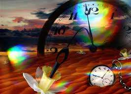

# 3 цаг

Нэг удаа, 3 ухаантан мэргэд, өнгөрсөн, одоо, ирээдүй цагийн аль нь илүү чухал болох талаар маргалдаж гэнэ.

-Өнгөрсөн цаг л хүнийг хэн болох, юунд хүрэхийг бүтээдэг. Би бүх чаддаг зүйлсээ өнгөрсөн цаг үед суралцсан, гэж эхний хүн хэлэв.\
-Үгүй, хүнийг ирээдүй цаг л төлөвшүүлдэг. Би өнөөдөр, хичнээн их мэдлэг чадвартай байсан ч, ирээдүй надаас юу шаардахыг мэдэхгүй. Хүний амьдрал бол, ирээдүйд хэн болохыг хүсч байна, түүндээ хүрэхийн тулд эрмэлзэх үйлдэл юм гэж хоёрдох хүн хэлэв. \
-Та хоёр нэг зүйлийг анзаарахгүй байна. Өнгөрсөн ба ирээдүй бол зөвхөн бидний бодол сэтгэхүйд л байдаг зүйл, өнгөрсөн цаг улиран одсон тул одоо бодитоор байхгүй, ирээдүй мөн ирээгүй тул бодитоор байхгүй. Бүх үйлдэл зөвхөн одоо цагт, зөвхөн одоод явагдаж, зөвхөн өнөөдрийн үйлдэл, ирээдүй рүү ямар байдалтай орох, мөн өнгөрсөн амьдралдаа цэг тавих эсэхийг тодорхойлдог юм гэж гуравдах хүн хэлжээ.
