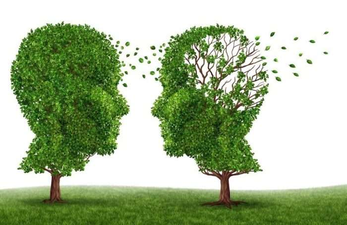

# 30-д насныханд, 40-с дээш насныхны өгөх 9 зөвлөгөө

“Хэрэв, цаг хугацааг буцааж болдог байсан бол би, бүхнийг шинээр эхлэн, зөв хоол хүнс хэрэглэхэд гойд анхааран, спортоор зогсоо зайгүй хичээллэхсэн”. Зохиолч Марк Мэнсон, 37 наснаас дээш насны уншигчиддаа, 30-40 насны хооронд олж авсан амьдралын туршлагаа хуваалцах хүсэлт тавин судалгаа явуулснаар олон хүмүүсийн мэргэн оюуны нийтлэг туршлагад тулгуурласан дараах зөвлөгөөнүүдийг нийтлэн, олны хүртээл болгож байна.

1. Хойшлуулалгүй, яг одоо эрүүл мэнддээ санаа тавьж эхэл. Та нарын оюун ухаан, өөрсдийгөө, бие мах бодынхоо бодит наснаас 10-15 жил залуу гэж тооцож байдаг. Эрүүл мэнд чинь, санаснаас чинь асар хурдан, анзаарж ч амжихааргүй түргэн өтөлдөг. Үүнийг удаашруулах 10 жил та нарт байна\
2. Өөртөө муу, таагүй ханддаг хүмүүстэй хэрхэвч бүү харьц. Үгүй гэж хэлж, аливааг таслан зогсоож сур. Муу ханддаг хүмүүсийг бүү тэвч. Ямар нэг ашиг сонирхолын талаас бодож, тэдгээр хүмүүсийг бүү тэвч. Тэдний сэтгэл хөдлөлийн байдлаар шалтаглан бүү тэвч. Өөрийн үр хүүхдүүд болон өөрийн сайн сайхны тулд ч бай муу хандлага харьцааг бүү тэвч. Бусдыг гомдоохгүйн тулд, эсвэл тэр өөрчлөгднө, өөртөө сайн хандуулж сургана, нэг бол түүнд таалагдахын тулд зүтгэнэ гэсэн найдлагад хязгаарлагдсан амьдрал юу ч өгөхгүй. 20-д насныхны хувьд, хорвоо нээлттэй юм шиг санагдан, туршлагагүйгээсээ хэн нэгэнд татагдан зууралдаж байдаг. Харин 30 насанд, сайн харилцаа асар их зүтгэлээр олддог гэдгийг мэдсэн байдаг, тиймээс, хорвоо ертөнц дээр өөрийг чинь амьдралын замд дэмжих хүмүүс байдаг гэдгийг санаж муу харилцаатай хүмүүст цаг хугацаагаа бүү үр\
3. Ойр орчины хүмүүстээ сайн ханд. 30-40 насны хооронд, төрөл төрөгсөд насан өөд болох, гэр бүлийн хүн хуурах, нас барах, хүүхдүүд төрөх, найз нөхдийн чинь гэр бүл салах хагацах гээд олон гуниг зовлон тохиолдож байдаг. Хүнд хэцүү үед нь, хүнийг буруушаах, зөвлөхийн оронд зөвхөн сонсож, хамт байх л хамгийн үнэтэй тус байдаг.\
4. Чи, хорвоо дээрхи бүх зүйлд хүрч чадахгүй, харин бүх зүйлс үнэхээр сайхан байна гэсэн итгэл үнэмшлийг л өөртөө хэвшүүлж сур. Амьдрал нэгийг гээж, нөгөөг олох зарчим дээр тогтддог. 20-д насанд сонгосон ажил мэргэжил, амьдралын зам алдаа мадагтай байх магадлал их байдаг тул, алдаа ололтоо жил жилээр бодож тунгаа\
5. Эрсдэлээс бүү ай, чамд өөрчлөгдөх өргөн боломж байгаа. Хүн, 30 нас хүрэх үедээ, сонгосон замаа барихыг эрмэлзэх ёстой гэсэн бодолтой байдаг ч, мөн бүх зүйлийг эхнээс нь эхлэх хэзээ ч оройтохгүй гэдэг бодлыг мөн тээх ёстойгоо мэддэг бай. Нийгэм, олон нийт хүнээс, 30 насандаа, ажил алба, гэр бүл, санхүүгийн тодорхой байдалд хүрсэн байхыг шаардаж байдаг. Гэтэл судалгаанд хамрагдагсадын дийлэнхи хэсэг, олон нийтийн хүлээлтэд хайрцаглагдан, бүхнийг эхнээс нь эхлэх, эрсдлээс айхгүй бүхнийг хийх асуудалд хөндлөнгөөс оролцохыг бүү зөвшөөрөөрэй гэж зөвлөжээ.\
6. Чи үргэлж өөрийгөө өсгөж, хөгжүүлж байх ёстой. Та нарт, эргээд хэзээ ч нөхөгдөхгүй хоёрхон хөрөнгө байгаа: чиний бие, чиний оюун ухаан. Ихэнхи хүмүүс, 20-д наснаасаа өөрийгөө хөгжүүлэхээ больдог. Чи, тэдгээр хүмүүсийн нэг биш, суралцахаа үргэлжлүүлэн, гол нь оюун сэтгэхүйгээ хөгжүүлэхэд, мөн эрүүл мэндээ сайжруулахад үргэлж анхаардаг байвал, чи, 40 нас хүрэхдээ, өөрийнхөө үеийнхнээс түрүүлэн урд нь алхах, тэрхүү насыг гэрэл гэгээт он жилүүд болгон хувиргах чадвартай хөрөнгөлөг хүн байх болно. Энэ үедээ хүрэх зорилго чинь тодорхой: сайн хүн, сайн шударга хамтрагч, сайн ухаалаг эцэг эх, сайн үнэнч найз, сайн зүтгэлтэй ажилтан, сайн түшигт хань болох буюу хувь хүний өсөлт чинь юм.\
7. Хэн ч хэн нэгнийхээ хийж буй зүйлийг ойлгодоггүй. Үүнд дасах хэрэгтэй. Хэрэв, оюун санаа, сэтгэл хөдлөл, оршихуй чинь гацчихаагүй бол, өөрийнхөө 5 жилийн дараах байдлыг урьдчилан хэлж чадахгүй гэдгээ мэдэж байгаа. Ирээдүй хэзээ ч хүссэнээр явдаггүй. Тиймээс, урьдчилан тооцоолсондоо хүрээгүйдээ, эсвэл одоогийн өрнөж буй үйл явдлуудаас болж бүү шанал. Бүх зүйл хүссэн ч, хүсээгүй ч өөрчлөгддөг. Амьдралынхаа чиглэлийг хянах гэж өөрийгөө бүү зовоо\
8. Төрлөх гэр бүлдээ санаа тавь буюу тэд таны хайрыг хүлээх эрхтэй. Төрлөх гэр бүлийнхэнтэйгээ ойр дотно бай. Чи, хичнээн том болсон ч эцэг эхийнхээ хувьд үргэлж хүүхдээрээ байдаг. Чи өсч, та нарын харилцаа өөрчлөгдөх нь дамжиггүй. Гэлээ ч энэхүү нандин харилцаа ямар байх нь зөвхөн чамаас шалтгаалж байдаг гэдгийг санаж яв. Бүгд л өтөлж, бүгд л үхдэг. Байгаа энэхүү цаг хугацааг ашиглан зөв сайхан харилцаж, төрлөх гэр бүлийнхээ дурсамж дүүрэн эевэргүү дулааныг хүртэн амьдрахыг хичээгээрэй\
9. Өөртөө сайн хандаж, өөрийгөө хүндэл. Бага зэрэг хувиа хичээн, өдөр бүр өөртөө нэг сайн зүйл, өөр бас сайн зүйлсийг сар бүр, бүр түүнээс ч илүү сайхан зүйлийг жил бүр өөртөө хийж байгаарай. Өөрийг чинь ойлгож халамжлах, өөр шиг чинь чамайг хайрлах хүн чамаас өөр байхгүй гэдгийг мэдэж ав. Амьдрал амаргүй, тиймээс яг одооноос өөрийгөө хайрлаж сур. Дараа нь суралцах улам хэцүү болно. Энэ нь, өөрийн зорилгодоо үнэнч байх, шийдвэрээ өөрийн бодол сэтгэлээр гаргадаг байх, хамааралгүй байх орчинг бүрдүүлэх явдал юм.\
Эцэст нь, “Хүү минь, чамд 40 нас таалагдна, яагаад гэвэл, 20 настайдаа чи, өөрийгөө бүх юмыг мэддэг гэж боддог, 30 насандаа чи, энэ бол тийм биш гэж ойлгоно, харин 40 нас хүрэхээрээ, чи, ухаажиж, бүх зүйлсийг байгаагаар нь хүлээж авдаг болж ашгүй жаахан амсхийдэг юм” гэж хэлж байсан аавынхаа үгийг, би өөрийнхөө 58 насандаа, бүрэн хүлээн зөвшөөрч суунам. –Мартин, 58 настай.
