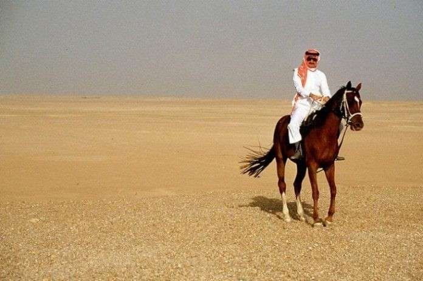
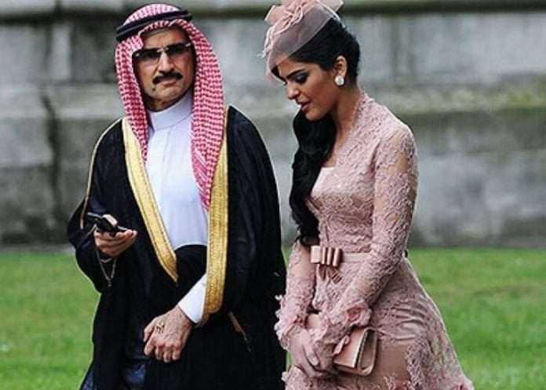

# 32 тэрбум долларын хандив!!! Дэлхий дээр урд нь, хэн ч ийм өндөр, өгөөмөр хандив өргөж байгаагүй

Саудын Арабын ханхүү, Аль-Авид бин Талал бин Абдулаз аль-Сауд, дэлхийн буяны байгууллагад, өөрийн бүх хөрөнгө 32 тэрбум долларыг хандивлажээ.

Forbes сэтгүүлийн дүгнэлтээр, аль-Валид нь, Саудын Арабын баячуудын, дээгүүрт бичигддэг хүмүүсийн нэг гэнэ. Тэрээр, хандив өргөхдөө, “энэ бол миний хүн төрөлхтөний өмнө хүлээсэн үүрэг юм”гэж хэлсэн бөгөөд ойрын хэдэн жилийн турш, байгалийн гамшигтай тэмцэх, сургууль, асрамжийн газар барих, хүнд өвчнүүдтэй тэмцэх, эмэгтэйчүүдийн амьдралд туслах, үндэстэн ястны хоорондын зөрчилдөөнийг шийдэх, дэлхийн алслагдсан бүсүүдийн оршин суугчдын аж амьдралд туслах зэрэг зориулалтаар, үе шаттайгаар зарцуулагдах болно гэж мэдэгдсэн байна.
