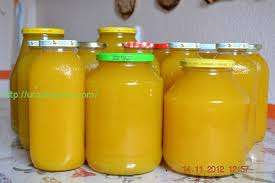

# 4 ширхэг апельсинаар, 9 литр сок хийх арга

Шинэ жил дөхлөө. Уух ундаагаа өрсдөө хийцгээж, магтаалын үг авах, хялбархан аргыг танд хүргэж байна.

4 ширхэг апельсинаа хальслахгүйгээр, сайтар угаана. Хаттал арчаад, 2 цаг орчим хөргөгчнийхөө, хөлдөөх хэсэгт хийж /шөнөжин бол бүр сайн/ орхино. Дараа нь түүнийгээ 2-3 см орчим болохоор хутгаар хэрчиж, махны машин эсвэл холигчоор жижиглэнэ. Үүн дээрээ, 3 литр буцалсан халуун ус хийж 10 минут орчим байлгаад, 5 давхар марль эсвэл цайны шүүрээр шүүнэ /бага багаар нь цайны шүүрээр шүүх илүү хялбар/. Шүүсэн сокон дээрээ 6 литр ус, 1 кг элсэн чихэр хийж бэлэн болно. Үлдсэн шахдасыг нь багахан сахар нэмж 15 минут буцалгаад варенье хийдэг.

Үнэхээр амттай, хялбар, ашигтай, арвин ундаа шүү! Хүн болгонд таалагддаг. Амжилт хүсье!
