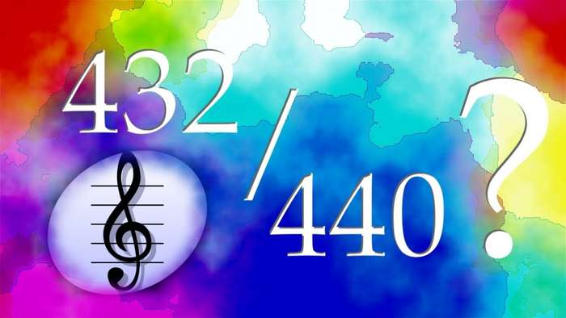
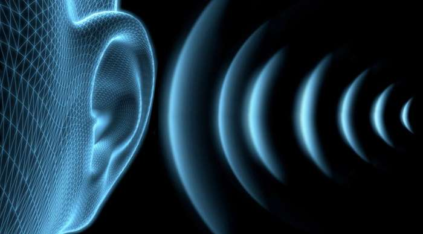

# 432 герц давтамжит авианы нууц буюу түүндэх давтамж  чичиргээний  нууц хүч

432 герцийн давтамж нь ертөнцтэй хамгийн зохилдлогоонд байх тоон хувилбар, мөн дуу авианы тохируулга гэж ufosightingshotspot.blogspot.com үзэж байна.

432 герц дээр тохирсон хөгжим аяз, хүмүүсд сайн нөлөөтэй, эмчлэх чадвартай гэж үздэг нь байгалийн, өнгө авианы тоон хэлбэр дээр суурилсан жинхэнэ цэвэр дууны өнгөтэй холбоотой. Эртний Грек Египтийн хөгжмийн зэмсгүүд бараг бүгд 432 герц дээр тохируулагдсан байдаг. Домогт Орфейн зэмсгүүд ч 432 герц дээр байдаг. Гэтэл яагаад өнөөдөр өнгө авиа 440 герц дээр тохируулагддаг юм бол. Одоогийн энэ 440 герцийн тохиргоо ямар ч түвшинд, огторгуйн ямар ч хөдөлгөөн, ритм, байгалийн чичирхийлэлд таардагггүй. 1940-д оны үед АНУ 432 герцийг 440 герц болгон сольсон гэнэ. 1953 онд ISO-16 стандарт авсан аж. Үүнийг Рокфеллерын сангийнхан хүмүүсийн ухамсрыг хянах зорилготой хийсэн зүйл гэж үздэг. 440 герцийн давтамжтай аялгуу хүний эрчмийн төвтэй таарахгүйгээс гадна үүнийг хөгжмийн үйлдвэрлэл хүмүүсийн сэтгэл санаанд уур хилэн төрүүлэх, сэтгэл хөдлөлийн гажуудалд хүргэх, үүгээрээ бие мах бодын өвчлөлд хүргэх зорилготой ашигладаг гэж үздэг. Манай гаригийн үүслийн үндэсийн түлхүүр давтамж чичирхийлэл нь элс, агаар ус зэрэгт нөлөөлж бүтцийг өөрчлөх чадвартай байдаг.Тэгвэл 70% нь уснаас тогтох хүний бие энэхүү 440 герцийн өнгө авианд өөрчлөгдөх нь ойлгомжтой юм. Дээр үед нотны “ля” 432 герцэд байдаг байсан бол одоо 440 герц.1953 онд 23000 хөгжимчид 440 герцийн тохиргоог эсэргүүцээд чадаагүй аж. 440 герцээр солих асуудлыг хамгийн анх Дж.К.Диген, АНУ-н далайн цэргийн албан хаагч гаргаж тавьсан бөгөөд дайны үеийн мэдээ, мэдээлэл ухуулгыг 440 герц дээр явуулж эхэлжээ. 1936 онд нацизмын олныг хамруулан удирдах нууц удирдагч, сайд П.И.Геббельс ашигласныг дэлхий нийт мэддэг. Дуу авианы давтамж хүний тархинд хүчтэй нөлөөлж, хүмүүсийг олноор нь хамруулах, нацизмыг сурталчлахад хэрхэн ашигласныг хүн төрөлхтөн мартаагүй. Үүнийг хүний төрөлх дуу авиа хүлээн авах тохиргоог алдуулж нэг өнгө дээшлүүлэхэд хүний тархи байнгын цочролд ордог бөгөөд сэтгэхүй өсөхөө больж, сэтгэхүйн өөрчлөлтөд хүрэх, дуугаа хураах гажуудалд хүрэх зэрэг нь хүмүүсийг удирдахад хялбар болгодог байна. 432 герцийн өнгө авиа аядуу тайван, дулаан дотно байдаг бөгөөд хүн зүрхээрээ сонсдог.

432 герцийг 440 герцэд солигдож буйг харуулсан тусгай туршилт

<iframe src="https://www.youtube.com/embed/Sg11EENtaJ4" width="640" height="360" allowfullscreen></iframe>
