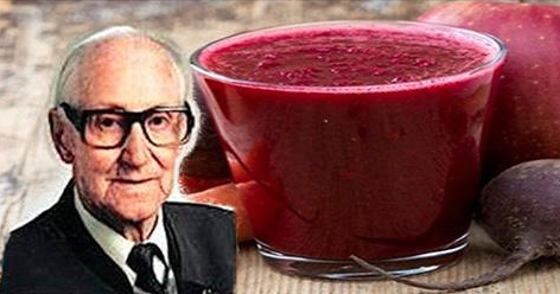
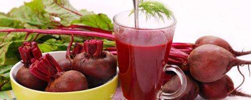
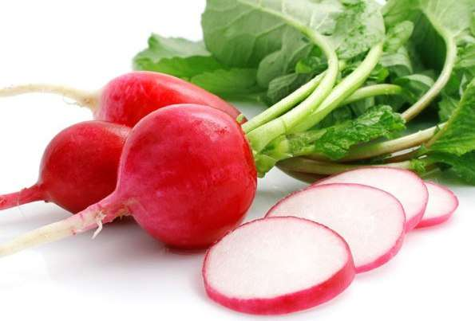
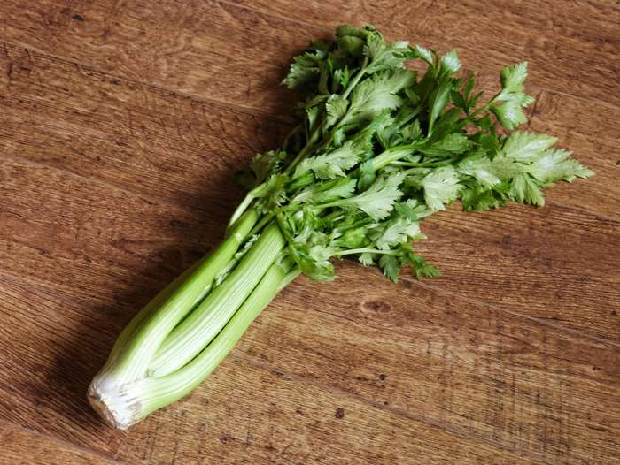

# 45000 хүний амийг аварсан австри эмчийн жор буюу хорт хавдарын эд эсүүдийг 42 хоногийн хугацаанд устгадаг бэлдмэл

Австрийн эмч Рудольф Бройс, өөрийн амьдралаа, рак буюу хорт хавдарыг байгалийн гаралтай бүтээгдэхүүнээр эмчлэх аргыг эрж хайхад зориулжээ.

Тэр, хүрэн манжин дээр суурилсан цай, шүүсийг 42 хоногийн турш хэрэглэн олон мянган хүнийг эмчилсэн бөгөөд энэ эмчилгээний үед, хавдарын эд эс, хатангиршиж үхдэг ба биеийн байдал сайжирч эрүүлждэг байна. Энэ бэлдмэл буюу шүүсийг бэлтгэхэд, зөвхөн органик хүнсний ногоонууд ордог:\
Хүрэн манжин /55%/\
Лууван /20%/\
Сельдерейн үндэс (Цоохор майлз) /20%/ \
Төмс /3%/\
Редис (Улаан лууван буюу гол нь цагаан гадна тал нь улаан) /2%/\
Эдгээрийг хамтад нь холигчоор жижиглэн 42 хоногийн турш хэрэглэнэ. Өдөрт, 120-200гр хэрэглэхээр бэлтгэж, 5-6 удаа хувааж идэх, мөн хүрэн манжингийн салат завсарт нь хэрэглэвэл сайн. Муу үр дагавар гардаггүй. Хүрэн манжинг хавдар, лейкемия өвчнүүдийг эмчлэхэд үр дүнтэйг олон арван судалгаагаар баталсан байдаг.

---

Редис (Улаан лууван)

---

Сельдерей (Цоохор майлз)

Энэ ногоог ердийн үед ч хоол хүнсэндээ өргөнөөр хэрэглэх нь эрүүл мэндээ хамгаалахад тустай.
