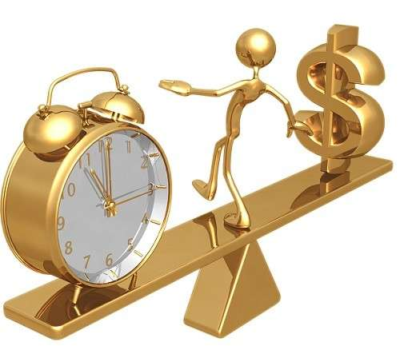
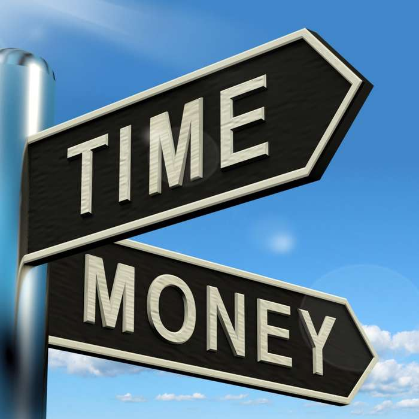

# 86400$  ба 86400 секунд

Өглөө бүр танд, өдрийн турш зарцуулж дуусгахгүй бол үлдэгдлийг нь буцаагаад авна гэсэн нөхцөлтэйгээр 86400$ өгдөг байсан бол, та, доллар бүрийг өөрийнхөө дуртай зүйлс болон ойр дотныхон, бүр танихгүй хүмүүст ч хамаагүй бэлэг сэлт авч, тарааж дуусгах гэж их л зүтгэж, зарцуулж амжаагүй доллартаа ихэд харамсан буцаах байх даа.

Энэ бүхний дараа, чухам юу хэлэх гээд байна вэ гэвэл, бидэнд өдөр бүр 86400-г өгч байдаг Цаг хугацааны банк гэж байдгийг хэлэхийг хүссэн юм. Бид өглөө бүр, сэрээд, 86400 секундыг зээлдэн авч, орой тэр нөөц дуусч байдаг. Ашиглаж, зарцуулж чадаагүй цаг хугацаа мөн л, буцаах мөнгөтэй адил алга болдог. Өглөө бүр, энэ банк бидэнд цаг хугацааг өгч, дахин дахин өгч л байдаг. Гэвч энэ банкны, нэгэн гашуун дүрэм бий: энэ банк, урьдчилан сануулахгүйгээр, нэг л өдөр дансаа хааснаар, амьдрал маань зогсдог.

Тиймээс, амьдралын маань нэг секунд, нэг доллараас үнэтэй биз дээ?
