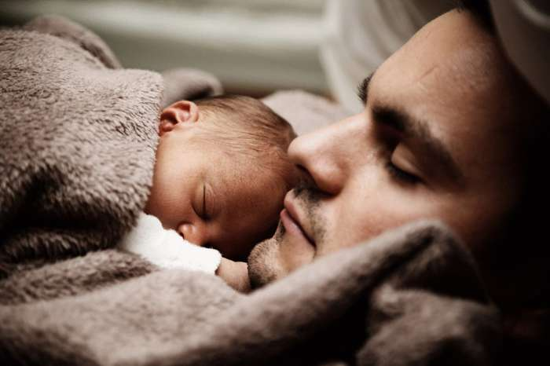

# Аавууд

Орчин үед, эмэгтэйчүүдийн биеэ даасан байдлыг үнэлэх, дэмжих бодлого, хүйсийн эрх тэгш харьцаа, эмэгтэй хүнийг эрхэмлэсэн давуу эрх гэх зэрэг зүйлээс улбаатай эцэг хүний үүрэг роль үгүйсгэгдэх хандлага газар авч, эцэг хүний оролцоогүйгээр бүгдийг шийдэх боломжтой гэсэн бодолтой эмэгтэйчүүд олшрох байдал анзаарагдах болж байна. Үүний зэрэгцээ эмэгтэйчүүд, эр нөхрүүддээ хэт өндөр шаардлага тавих болжээ. Тэд, эхнэрээ хүүхэдтэй болмогц, гэдсэндэх хүүхдээ хайрлах ёстой, төрснөөс нь эхлэн асарч, түүнээсээ сэтгэл ханамж, таашаал авах ёстой, мөн хүүхдээ гармагц сайн дураараа хоёр дугаар шатны хүн болох ёстой, бүхнийг ойлгох ёстой, хэн нэгэн “халамжит” нөхөртэй адилхан байх ёстой, зөвхөн гэр бүлийнхээ төлөө амьдрах ёстой гэх мэт эрэгтэй хүний ой тойнд байгаагүй эрэгтэй хүний “эр” чанарт сөргөлдсөн, сэтгэл санаа, сэтгэхүйг нь хөндсөн шаардлагуудтай тулгардаг. Гэр бүл дэх, эцэг хүн, ээжээс маш их ялгаатай. Дараах зүйлийг уншаад эмэгтэй, эрэгтэй хэн маань ч тэр, нэгийг бодно биз ээ.

-эрэгтэй хүн эхнэрээ хүүхэдтэй болсныг мэдээд маш их баярлах боловч, хүүхэд төрөх хүртэлх 9 сарын хугацааг бараг ойлголтгүй өнгөрүүлдэг\
. -эрэгтэй хүн, нярай хүүхэд шөнө уйлдаг, өвднө, нойргүй хононо гэдгийг огт мэдээгүй байдаг тул анхны хүүхэд дээрээ жинхэнэ хүнд шалгууртай тулгардаг\
-эрэгтэй хүн, хүүхдээ төрмөгц, эхнэрийнхээ номер нэг хүн хэвээрээ байна гэсэн бүрэн итгэлтэй байдаг. Тэдний хувьд, эхнэрийнх нь хүүхэддээ санаа тавьж, гэр орны ажилаа амжуулахгүй байгаа нь юу ч биш ганцхан тэр, тэр чигтээ дан ганц түүнийх биш болсон нь, мөн түүнийгээ засахыг оролдохгүй байгаа нь, үүнийг асуудал гэж үзэхгүй байгаа нь, мөн түүнийг буруутгадаг нь хүндээр тусдаг\
-эрэгтэй хүн, эцэг болоход огт бэлтгэгдээгүй байдаг. Охид, бага байхын айл гэр болж тоглох, холбогдох зүйлсийг унших, ээж, эгч нартайгаа ярилцах зэргээр харьцангуй бэлтгэгдсэн байдаг. Амьдрал ахуйн талаар охидод л заахаас хөвгүүдтэй аятайхан ярилцах ч ховор байдаг. Тиймээс тэдэнд, хүүхдээ төрмөгц дасах, өөрчлөгдөх хугацаа хэрэгтэй байдаг. Тэд газар унасан соскыг нь аваад, шууд хүүхдийнхээ аманд хийх, памперсыг нь буруу харуулж өмсгөх зэрэг алдаа гаргаж буруутан, хямардаг\
-хүүхэддээ таараагүй, гарын дор таарсан хувцас өмсүүлэх юу ч биш. Тэд үүнд ач холбогдол өгөхөө мэддэггүй, анзаарах ч үгүй\
-тэд, хүүхдэдээ шөлний оронд йогурт өгнө. Энэ нь залхуурсандаа эсвэл хариуцлагагүйдээ биш, хүүхэд йогуртад илүү дуртай гэснээс нь л болдог. Үүнээс болж хүүхэд өвдчихнө гэсэн бодол байдаггүй, мэдэхгүй\
-Эрэгтэй хүн, хүүхдийнхээ ирээдүйд маш их ач холбогдол өгдөг учраас хүүхдэд хатуу хандах нь бий. Тэгээд ч тэр, өөрийг нь хүмүүжүүлж байсан, эрэгтэй хүүхдийг хүмүүжүүлэх тэр л арга барилыг мэддэг.\
-аавууд хүүхэдтэйгээ тоглохдоо гарамгай байдаг. ээжийнх нь толгойнд ч орохгүй зүйлийг зохиож чадна. Тэгээд, энэхүү тоглоомоосоо жинхэнэ баяр хөөрийг хүүхэдтэйгээ авч чаддаг\
-эрэгтэй хүн, хүүхдийнхээ, тэврэлт үнсэлт, аавтайгаа хамт байгаагаа зурсан зургийг харж хязгааргүй баярладаг боловч, үүнийгээ ихэвчлэн нуудаг. Заяагдмал чанар нь, энэхүү эмзэг газрыг нь нуучихдаг. Яагаад гэвэл тэр, хүүхдээ хамгаалахын тулд дайтаж ч чадна. Эмзэг мэдрэмжийг нь ашиглах вий гэж айдаг\
-эрэгтэй хүний хувьд, гэр бүл маш чухал. Гэхдээ энэ нь амьдралынх нь утга учир болох юм бол доройтдог. Учир нь, түүний зорилго гадаад ертөнцийг өөрчлөх хэмжээнд чөлөөтэй байвал, эрэгтэй хүний сэтгэхүй эрүүл байдаг. Үүнийг гэр бүлийнхээ эрх ашгийн төлөө хийдэг гэдэг нь тодорхой бөгөөд тэд маш их ажиллах, заваар хомс байх нь ердийн зүйл гэдгийг ойлгох хэрэгтэй байдаг
