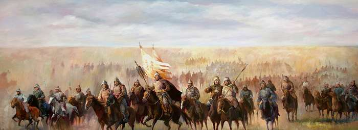
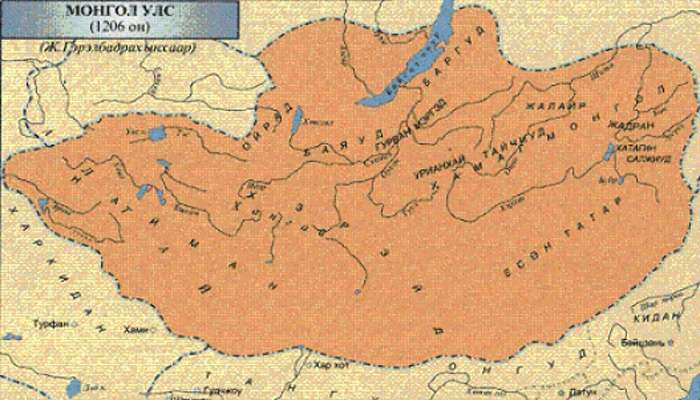

# Агуу Их Хааныхаа тухай товчхон

Чингис хаан гэхээр мэдэхгүй хүн монголд битгий хэл дэлхийд ч байхгүй билээ. Өнөөдөр монголчууд, Чингис хааныхаа нэрээр дэлхийн хаана ч явсан танигдаж явдагтаа бахархаж яваа. Гэтэл аугаа хааныхаа нэрээр нэрлээгүй зүйл үгүй, Чингис, Чингис гэхээс биш, аугаа хааныхаа тухай тэр болгон мэддэг болов уу.

Монголын Эзэнт Гүрний Аугаа Хаан Эзэн Чингис, 1155 он мөн 1162 он ч гэдэг, Онон голын хөвөө, Дэлүүн болдогт төрж 1227 онд нас эцэслэжээ. Монголын тархай бутархай овог аймгуудыг нэгтгэн, хятад, Дундад ази, Кавказ, Зүүн европыг хамарсан, Ази Европын ихэнхи нутаг дэвсгэрийг эзэлсэн хүн төрөлхтөний түүхэнд байгаагүй асар том газар нутагтай Монголын Эзэнт гүрнийг байгуулж, 1206-1227 онд төр барьсан,түүхэнд хосгүй Аугаа хаан юм. Бөртэ, Хулан, Есүгэн, Есүй гэсэн 4 хатадтай байсан. Зүчи, Цагаадай, Өгөдэй, Тулуй, Хүлүгэн, Харачар, Чахур, Хархад хэмээх хөвгүүдтэй, Хожин-Бэхи, Сэцээхэн, Алангаа, Тэмүүлэн, Алдуун, Дайр-Усун гэдэг охидтой байжээ.\
**Гол түүхэн үйл явдлууд:**\
1186 - 1205 он, татар, хэрээд, найман, мэргэдүүдийг бут цохиж нэгтгэв\
1206 он- Их хуралдай, “Чингис хаан” цол өргөмжлөв\
1207-1210 он- Тангадыг дайлах тулаан\
1215 он- Бээжинг эрхшээлдээ оруулав\
1219-1223 он Дундад азийг эзлэв\
1227он- тангадыг буулгаж авав\
1227 оны 8 сар Чингис хаан нас нөгчижээ

Наад захын ийм зүйл нийтээрээ мэдэх нь, гадна дотны хүмүүстэй яриа хөөрөөний үед тустай болов уу гэж хүргэж, Их Хааныхаа тухай хэт товч, орчин үеийн хэв маягаар бичсэндээ хүлцэл өье.
