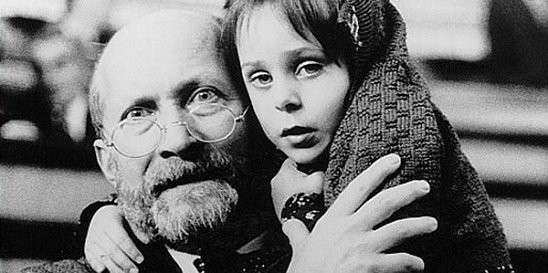
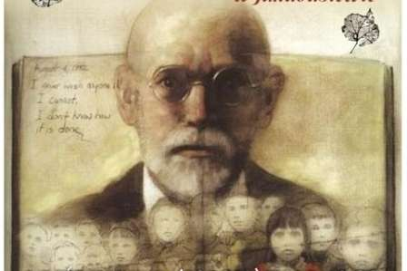

# Агуу сурган хүмүүжүүлэгчийн сургаал

Энэхүү, хүүхдүүдийн төлөө амьдралаас 3 удаа татгалзаж, хорих лагерын хийн зууханд хүүхдүүдтэйгээ хамт амь эрсэдсэн польшийн сурган хүмүүжүүлэгч, зохиолч, эмч, нийгмийн зүтгэлтэнг Януш Корчак гэдэг. Тэрээр, ажиллаж байсан асрах газрын хүүхдүүдийг нь, хорих лагер руу ачих үед, цагаачлах боломж, оргох боломж, мөн бичсэн номыг нь уншсан немц офицер түүнийг сулласан гуравдах боломжоос татгалзан хүүхдүүдтэйгээ хамт ачигдан хийн зууханд хамт амь үрэгдсэн ажээ. Түүний хүүхэд хүмүүжүүлэх арга мөнхрөн үлдсэн бөгөөд хүүхдэд амьнаасаа илүү хайртай байсан агуу сэтгэлт хүний сургаалыг сэтгэлдээ мөн мөнхлөөрэй.

-Хүүхдээ өөртэйгээ адил эсвэл өөрийнхөө хүссэн шиг болгох гэж бүү зүтгэ. Харин түүнд өөрийгөө бий болгоход нь тусал\
-Хүүхдээсээ, түүний төлөө хийсэн зүйлсийнхээ төлөөс битгий нэх. Та өнөөдөр түүнд амь, амьдрал өгсөн бол, тэр маргааш мөн өөрийн хүүхэддээ амь, амьдралыг өгөх болно. Энэ бол эцэс төгсгөлгүй талархлын журмаар явагдах ёстой юм\
-Хүүхдэдээ, бүү гомдол цөхрөлөө халдаа. Өтөл насандаа өөрөө үзнэ. Юу тарьна түүнийгээ хураана гэдгийг хэзээд сана\
-Хүүхэддээ таарч байгаа бэрхшээлтэй асуудлыг хялбар гэж бүү бод, тэдний хувьд тэр асуудлууд нь, туршлагагүй учраас тэдэнд, илүү хүнд байгаа гэдгийг ойлго\
-Хүүхэдтэй харьцах асуудлыг хамгийн чухалд тооц. Хэзээ ч битгий доромж ханд. Түүнд, хэн ч болж болох ирээдүй байгаа\
-Хүүхдийнхээ төлөө хийж чадахгүй байгаа зүйлийнхээ төлөө өөрийгөө бүү зовоо. Бүх боломжит зүйлсийг л хийхгүй бол хэзээд хийх зүйл маань дутуу байдаг гэдгийг сана. Тиймээс, энэ бол боломжоор хомс зүйл\
-Хүүхэд бол таны, цус махны тасархай, амьдралыг тань эзэмдсэн дарамт биш, харин амьдрал танд, дотор нь бүтээлч сэтгэлгээний галыг бадраах, мөн хадгалуулахаар өгсөн үнэлшгүй үнэтэй аяга юм. Хүүхэд маань, эцэг эхийн хайран дунд өсөх, “бидний” хүүхэд боловч, мөн, бидэнд хадгалуулсан сэтгэл санаа, оюун гэдэг талаас илүү хүлээж авч байгаарай\
-Бусдын хүүхдийг хайрлаж сур. Бусдын хүүхдэд, өөрийнхөө хүүхдэд хүсэхээргүй зүйлийг хэзээ ч битгий хийгээрэй\
-Хүүхдээ хэн ч байсан хайрла. Тэр, бүтэлгүй, авъяасгүй, эсвэл насанд хүрчихсэн байсан ч хайрлаарай. Хүүхэд тань хамт байгаа нь л баяр юм. Харилцахдаа үргэлж баярлаж харьцаж байгаарай
