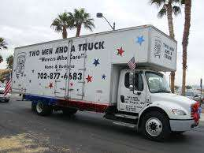

# Агуу зүйлд хүргэсэн, салалт, дампуурал, шатсан үсний тухай гурван түүх

Хувийн амьдрал болон бизнест тохиолдсон хүнд бэрх асуудлууд, ашиг орлого, амжилт дагуулсан жинхэнэ хувь тавилангийн бэлэг болсон тухай түүхүүд, ямар ч зүйл санамсаргүй болдоггүй, хувь тавилан хүмүүсийг сорьж, цохилтод оруулах ч гар хумхин суугаагүй тохиолдолд, илүү дээр сайн зүйлсийг бэлэг болгон бэлтгэж байдгийг сануулна. Тэгээд ч үүнтэй адил төстэй тохиолдлууд бидэнд үргэлж таарч байдаггүй гэж үү? Үүнийг бид, “Сохорсон биш завшив” гэж ярьцгаадаг даа.

1. Мэри Эллений хувьд амьдралын хамгийн бараан үе тохиож нөхрөөсөө салж гурван хүүтэйгээ хоцорч, хөвгүүдээ тэжээх хоол ч үгүй хэцүү байдалд орж хүнд байдлаас яаралтай гарах асуудал тулгарсан үед нь, хөвгүүд нь нэгэн санааг гаргасан бөгөөд энэ нь, эцгээс нь үлдсэн хуучин ачааны машинаар ачаа зөөх санаа байв. Энэ бизнес өнөөдөр Two Men & A Truck гэж нэрлэгддэг өндөр ашиг орлоготой бизнес болсон аж. “Хөвгүүд маань ачаа зөөж эхэлэхэд, би нэг лого санаачлан машиных нь хаалган дээр, гурван хүний дүрс зурж өгсөн юм. Хөвгүүд маань үйлчлүүлэгчээс цагийн 25 доллар авдаг байсан” гэж Мэри Эллен дурсдаг. Хөвгүүд амралтын өдрүүд болон хичээлийнхээ дараа ажилладаг байсан бөгөөд, өдрийн орлогынхоо 10 долларыг далд хийж бусдыг нь зар, түлш, засвар, өдөр тутмын хэрэглээнд зарцуулдаг байжээ. Тэд 2 жил энэ бизнесээ явуулж байгаад колледжид элсэцгээж суралцахаар явцгаасан бөгөөд явсаных нь дараа гэрийнх нь утсаар байнга захиалга ирээд байсан учираас Мэри өөрөө үргэлжлүүлэхээр шийдэж, хуучин машин худалдан авч, тавилга угсрах, ачаа зөөх хоёр залуу хөлслөн үйл ажиллагаагаа явуулж эхэлжээ. Захиалга маш их байсан учираас, Two Men & A Track жилийн дотор 4 ачааны машин, 10 ажилтантай болж өргөжиснөөс гадна салбаруудаа өөр хотуудад нээж эхэлжээ. 1999 оны сүүлээр, АНУ, Канадад 82 салбартай, тэдгээрийн 17-нь жилийн сая гаран долларын эргэлттэй хүчирхэг компани болсон байна. Нөхрөөсөө салсаны харгайгаар гэх үү? ачаар гэх үү?\
2. Сэм Уолтоны Ben Franklin дэлгүүр, Ньюпортод жинхэнэ амжилттай, ашиг орлоготой ажиллаж байв. Гэтэл, гэнэт аянга ниргэх мэт байдалд орж, Ben Franklin дэлгүүрийн эзэн түрээсээ цуцлав. Сэм энэ үед, дэлгүүрийг хэн удирдах нь гол биш, харин нэрэнд нь утга учир байна гэдгийг ойлгосон гэдэг. Ингээд Бентонвиль хэмээх жижиг хот руу нүүж, тэнд “5 ба 10 цент” гэдэг дэлгүүр нээжээ. Тэр бүхнийг тэгээс эхэлж, сэтгэл санаагаар унаж гүйцсэн байсан гэдэг. Гэхдээ Сэм, энэхүү хувь тавилангийн цохилтод ороогүй бол өнөөдөр Wal-Mart хэмээх алдартай сүлжээ дэлгүүр хэзээ ч бий болохгүй байсан биз... Сэмийн худалдаа наймааны авъяас, мэдрэмж нэг зүйлийг олж харсан бөгөөд, тэр нь, өөр бусад дэлгүүрүүдийн бараагаа зарж байгаад зад хямдруулан дуусгадаг туршлагыг эсрэгээр ашиглахаар шийдсэнд, мөн асар олон төрлийн барааг дэлгэж тавьсан тавиурууд дээрээс худалдан авагчид таалагдсан бараагаа өөрсдөө үзэж сонгох үйлчилгээг шинээр нэвтрүүлсэнд байлаа. Ийнхүү Америк болоод дэлхийн хэмжээнд анхны өөртөө үйлчилэх супермаркет нээгдсэн аж.\
3. Коко Шанель бизнесээ эхлэх үедээ мэргэжлийн оёдолчин байгаагүй бөгөөд үнэтэй даавуу материалаар тэр үед, хувцас оёхыг нь зөвшөөрдөггүй байжээ. Ийнхүү тэр хямдхан джерси даавуугаар өөрийнхөө сонгодог загваруудаа оёж эхлэн, өөрийнхөө боломжгүй зүйлсээ давуу тал болгон ашиглаж чадсан гэдэг. Тэр бүр загвар зурах, эсгэх чадваргүй байсан ба моделууд дээрээ хавчаар, хайчны тусламжтай хүссэн загвараа гарган авч оёдог байсан аж. Мөн түүний богино тайрмал үсний загвар, бодож төлөвлөсөн зүйл нь байгаагүй, харин ажилынх нь үед гарсан азгүй тохиолдлоос болж гарсан гэнэ. Хий алдагдаж гал гарахад, үсээ шатаачихсан бөгөөд түүнийгээ тэгшилж тайран, оролцохгүй байж болохгүй нэгэн арга хэмжээнд ихэмсэг бардам алхлан ирж оролцсон бөгөөд ийнхүү Шанелийн загваруудад тохирсон шинэ үс засалт болон мөнхөрсөн аж.
