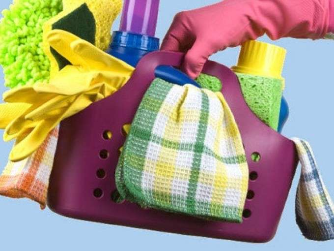
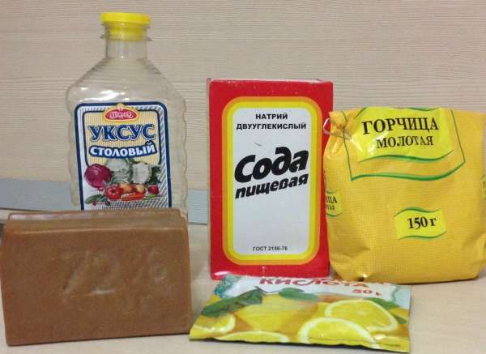

# Ахуйн хэрэглээний химийн бүтээгдэхүүнүүдийг гарын дорх хоргүй зүйлсээр орлуулан хэрэглэх аргууд

Мэлхийг усанд аажмаар халаавал, халууныг мэдрэхгүй дассаар чанагддаг байдал туршилтаар нотлогдсон байдаг. Үүний адил, ахуйн хэрэглээний химийн бодисууд хүний бие организмд аажмаар үйлчилж нас богиносгох, өвчин өвчилөлд хүргэдэг болохыг экологичид нотолсоор байгаа билээ. Францын эрдэмтэд, хүн өдөр тутам сав суулга угаах бодис хэргэлснээр, жилд 280 грамм бодис иддэг болохыг тогтоожээ. Ийнхүү өдөр тутам насаа богиносгох үйлдлийг сайн дураараа хийхгүйн тулд, их бага хэмжээгээр биед орсон ч хоргүй, гарын дорх дараах зүйлсийг дангаар болон хольж бэлтгэн сав суулга угаах химийн орц найрлагатай бодисуудыг орлуулах аргуудыг санал болгож байна. Эдгээрт, сода, цагаан цуу, алимны цуу, нунтаг горчица, химийн найрлагагүй барааны саван, лимоны хүчил, бура ордог. Сода тосыг задлах, толбо арилгах, ариутгах, горчичный нунтаг нян устгах, цэвэрлэх, тос задлах, цагаан цуу цайруулах, тос задлах, нянгүйжүүлэх, савны өнгөр арилгах, химийн найрлагагүй цэвэр байгалийн гаралтай барааны саван харшлын эсрэг, нян устгах, тосгүйжүүлэх, бура буюу ширгэсэн нуурын давс угааж цэвэрлэх үйлчилэлүүдтэй бөгөөд эдгээр нь сав суулга угаах зориулалтын бүтээгдэхүүнүүдээс дутахгүй үйлчилэл үзүүлдэг байна. 1 хоолны халбага горчичный нунтагийг 1 стакан усанд, 1 хоолны халбага содыг 1 литр усанд, 2 халбага цагаан цууг 1 литр усанд, 5гр. буюу нэг жижиг уут лимоны хүчлийг 1 литр усанд тус тус найруулан уусмал маягаар бэлтгэж аяга сав угаахдаа хэрэглэнэ. Барааны саванг XVII зууны үеэс сав суулга угаахад хэрэглэж ирсэн нь, түүний шүлтлэг чанар, мөн ямар ч бохирдсон сав суулгыг угааж цэвэрлэж, ариутгадаг чадвартай нь холбоотой юм. Горчиц буюу гичийн нунтагаар сав суулга сайн угаагдахаас гадна, угаалгын бодисны оронд хэрэглэж болдог байна. Ялангуяа ноосон эдлэлийг угаах үр дүнтэй, угаах усандаа 4-6 халбага хийж хутгаад 20 минут орчим дэвтээгээд гараар угааж сайтар зайлдаг. 90-100 г лимоны хүчлийг угаалгын машиндаа хийж, /сард 1 удаа/ хий эргүүлэхэд угаалгын машин цэвэрлэгддэг. Цагаан цууг 1:1 –ээр устай найруулан уусмал болгож шүршдэг тагтай саванд юүлж, түүгээрээ шил, толь арчих, угаалгын өрөө, ер нь ямар ч гадаргууг цэвэрлэх хэрэгсэл болгон ашиглах үр дүнтэй. Мөн 25 грамм барааны саванг үрүүлээр үрж жижиглээд, халуун усанд уустал хутган 1.5 хоолны халбага соод, 1.5 хоолны халбага горчиц нэмж сайтар хутгаад угаалга цэвэрлэгээний, хоргүй бодис бэлтгэж болно.
