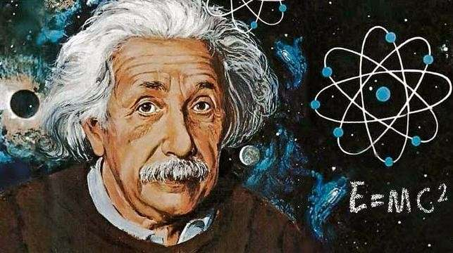
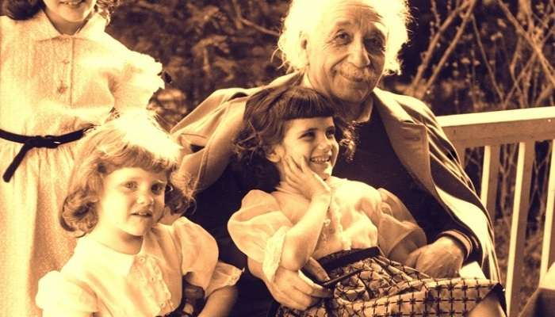

# Альберт Эйнштейний, Бурханы тухай нууц захидал

Охин минь!

Энэ захидалд бичсэн зүйлсийг, нийгмийн сэтгэлгээ хангалттай хөгжиж, хүлээж авч чаддаг болох хүртэл, чи, олон арван жил хадгалах хэрэгтэй болно.

Би Харьцангуйн онолыг нээсэн эхний үед, цөөхөн хүмүүс л намайг ойлгодог байсан. Одоо би, чиний өмнө дэлгэн тавих, хүн төрөлхтөнд дамжуулуулах энэхүү зүйл, мөн л үл ойлголт, шүүмжлэл, эргэлзээ, үл итгэлийг төрүүлэх зүйл юм. Энэ нь, одоо шинжлэх ухаан албан ёсны тайлбарыг нь олохгүй байгаа, нэгэн асар том Хүчний тухай ойлголт юм. Энэ Хүч, Ертөнц дөх бүхий л үзэгдэлүүдийг удирдаж байдаг гайхамшигт зүйл бөгөөд энэ бол Ертөнцийн Хүч-Хайр юм. Эрдэмтэд, ертөнцийн нэгдмэл онолыг эрж хайх үедээ, энэхүү үл үзэгдэх, хамгийн хүчирхэг Хүчийг орхигдуулж байдаг нь харамсалтай. ХАЙР бол, хэн түүнийг өгч, авч чадаж байна, түүнийг гэрэлтүүлэгч гэрэл гэгээ. ХАЙР бол таталцал, учир нь тэр хүмүүсийг таталцуулж байдаг. ХАЙР бол, хүч, тэрээр, бидэнд байгаа сайн чанаруудыг өсгөж, хүн төрөлхтөнийг явцгүй, харалган сохор аминч үзлээс хамгаалж байдаг. ХАЙР-ын төлөө хүмүүс амьдарч мөн үхэж байдаг. ХАЙР бол Бурхан, Бурхан бол Хайр. Энэ Хүч олон зүйлийг тайлбарлаж, амьдралд утга учир өгдөг бөгөөд бид асар удаан хугацааны турш үгүйсгэн ирсэн, мөн бидний айдаг солигдмол хүч юм. ХАЙР-ыг ойлгохын тулд би, хамгийн илэрхий тэгшитгэлд орлуулж үзсэн. Хэрэв Е=mc2 гэвэл, бид, хорвоо ертөнцийг төгсжүүлэх энергийг, гэрлийн хурдыг квадратад үржүүлсэн Хайраар дамжуулан авч, Хайр нь Агуу Хүч, хязгааргүй хүч гэсэн дүгнэлтэд хүрнэ. Зөвхөн ХАЙР-аар дамжуулан бид, амьдралын утга учирыг олж, эв эеийг сахиулж, оюун ухаант эсвэл мэдрэмжит ямарваа зүйлийг хадгалж хамгаалж, соёл иргэншлийг мөхлөөс сэргийлж чадна. Мөн, бид, шунал, аминч үзэл, үзэн ядалт, атаа хорсол гэсэн дэлхий ертөнцийг маань хоосруулах зүйлсийг нэг мөсөн устгах хүчин чадалтай, “ХАЙР-ын тэсрэх бөмбөг” хэмээх хүчирхэг хэрэгсэл хийхэд хараахан бэлэн болоогүй байж магад. Гэхдээ, хүмүүс, хувь хүн бүр, өөртөө, багахан боловч хүчирхэг ХАЙР-ын генератор тээж, тэрхүү энерги нь суллагдахаа хүлээж байдгийг мэддэггүй. Бид, хувь хүний энэхүү энергийг өгч, авч сурах үедээ, хайрт Lieserl минь, Хайр бүхнийг ялдаг, бүхнийг даван туулах чадвартай гэдгийг нотолж чадна, учир нь Хайр бол, амьдралын квинтэссенц юм. 

Би, амьдралын минь турш, чиний төлөө чимээгүйхэн, зүрхэн дотор минь цохилох тэрхүү зүйлийг илэрхийлж чадахгүй байгаадаа харамснам. Магадгүй, ийнхүү уучлал эрэх минь хэт оройтсон байж болох ч, цаг хугацаа мөн харьцангуй зүйл юм. Би, би чамд хайртай гэж хэлэх ёстой, би чиний хүчээр, чи надад ирсэнээр Хайр гэдэг ойлголтын, хамгийн үнэн, эцсийн, тодорхой хариултыг олж авсан!

Чиний эцэг Альберт Эйнштейн

