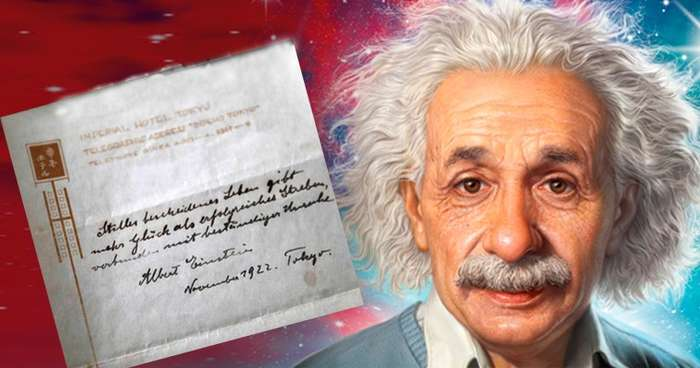
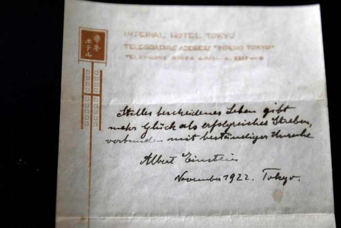

# Альберт Эйнштейны “Аз жаргалын онол”

Суут эрдэмтэн Альберт Эйнштейн, хүмүүсийн ертөнцийг үзэх үзэл, Ертөнцийн тухай ойлголтыг өөрчилсөн, өөрийн гэсэн, аз жаргалтай амьдралын тухай ойлголт, “рецепт”-тэй байсан гэдэг. Түүний физикийн онолууд, цаг хугацааны явцад батлагдсаар байгаа бөгөөд 100 жилийн өмнө түүний ярьдаг байсан, гравитацийн долгионыг 2016 онд эрдэмтэд олж илрүүлжээ. Авъяаслаг, сод хүн, бүх зүйлд авъяаслаг байдаг аж. Тэр, 1922 онд Токио хотод айлчилах үедээ, түүнтэй уулзсан төлөөлөгчид, зочид буудлын хуудас цаасан дээр, хоёр өгүүлбэрээс бүрдсэн, “Аз жаргалын онол”-оо бичиж өгсөн байдаг.

“Амар амгалан, тайван, эгэл амьдрал нь, амжилтад тэмүүлсэн, санаа зовинол ихтэй амьдралаас хамаагүй илүү аз жаргалыг хүнд өгдөг” гэж маш гоёмсгоор бичээд, дараагийн хуудсан дээр, “Хаана хүсэл зориг байна, тэнд аргууд” байдаг гэж бичжээ. Эрдэмтний, хоёр хуудас хоёр өгүүлбэрээс бүрдсэн энэхүү зөвлөгөө, саяхан, эрдэмтэн мэргэжилтнүүд, олон нийтийн хэвлэл мэдээллийн хэрэгслийн анхааралд өртөж, мөн Израильд болсон дуудлага худалдаан дээр 1.56 сая доллараар худалдагджээ. Энэ нь, түүнийг хувь хүн талаас авч үзэх, судлах, бишрэх сонирхол огт буурдаггүй болохыг илтгэн харуулжээ. Түүний, энэхүү хоёр өгүүлбэрээр илэрхийлсэн амьдралын тухай тодорхойлолтыг, дорно дахин болоод барууны гүн ухааны үзлийг нэгтгэж, Дорнын гүн ухааны, өнөөдрийн саад бэрхшээлийг даван туулах нь, амжилтад хүрэх зам буюу “”мөнхийн аялагч” гэж нэрлэгддэг онол, Эртний римийн сэтгэгч Сенекийн, амьдралын хамгийн том саад бол “хүлээлт” буюу цаг хугацаагаа түгшүүр, найдвар дунд өнгөрүүлэх гэсэн онолуудыг хоёрхон өгүүлбэрээр илэрхийлж өгсөн гэж үзэж байна. Мөн тэрээр, -“Ихэнхи хүмүүс, аз завшаан хэмээх одоо цагт байдаггүй зүйлийн гарт байгаа зүйлийг ашиглахын тулд, өөрийн гарт буй зүйлсээ ашиглахгүй өнгөрүүлдэгт харамсдаг”, “Чи хаашаа ч явсан, зөвхөн өөрийгөө л авч явдаг” гэсэн мэргэн сургамжийг дурсамждаа бичиж үлдээсэн байдаг.\
Энэ бүхнээс, өөртөө тавих дараах асуулт, уриалга гарч ирж байгаа юм.\
-Та хаашаа харж байна? Та, хааш гараа сунгана вэ? Ирж буй цаг тодорхойгүй байдаг. Одоо цагтаа, одоогоор амьдар!
