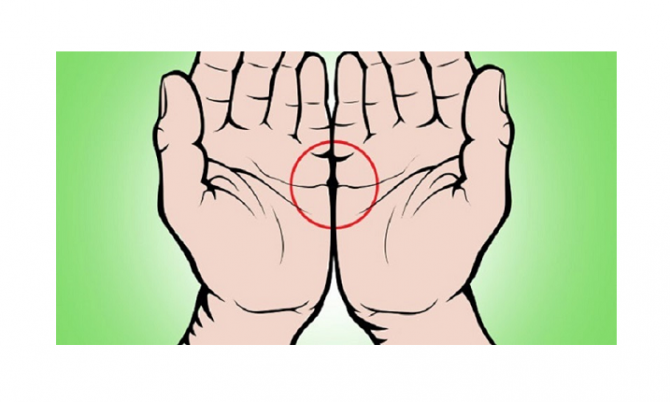

# Алганы мэрэг

Хүмүүс төрөлхөөсөө, тайлагдахгүй, тайлбарлагдахгүй зүйлийг сонирхох чанартай, хувь тавилан, амьдралаа урьдчилан мэдэх, өөрийгөө танихыг хүсч эрэл хайгуул хийж байдаг. Тиймээс, зурхай, мэргэ төлөг, зөн совинд итгэдэгээс олон зууныг дамжин өнөөг хүртэл энэ зүйл байсаар байдаг биз ээ. Алганы хээний мэргийг зурхайн адил эртний мэргэ гэдэг бөгөөд алганы хээ зураасны хэлбэр байршлаар тайлбарлагддаг. Хоёр алганы зүрхний шугамын байршлаар үздэг нэгэн мэргийг толилуулъя. Итгэх эсэхийг тань мэргэн оюунд тань даатгая.

Алганы зүрхний шугам, алганы дээд хэсэгт байрлах зураас юм. Хоёр алгаа зэрэгцүүлэн, чигчий хуруунуудынхаа өндрийг нэг түвшинд байхаар тааруулан харахад, зүрхний шугам хоорондоо харалдаа байх, эсвэл аль нэг алганых дээр, доор байгааг харах ёстой.

---

-Зүрхний шугам, зүүн алганых, баруун алганыхаас доор байвал, хүн, илүү хөгжсөн зөн совинтой, наснаасаа илүү ухаантай, романтик байдаг гэнэ.\
-Харин, баруун алганы зүрхний шугам, зүүнийхээс доор байвал, зорилгодоо үнэнч, жижиг зүйлд баярлаж чаддаг, барагтай бол аливаад бууж өгдөггүй, жинхэнэ тэмцэгч байдаг.\
-Хэрэв, уг зураасууд харалдаа таарч байвал, амьдралын томоохон өөрчлөлтүүдийг таалдаггүй, хүмүүжил, хувийн сахилга батыг эрхэмлэдэг, аливаад бодолтой ханддаг, ямар ч тохиолдолд тайван байж чаддаг хүн.\
Аль алинд нь таагүй зүйл алга, ердийн хүмүүсийн зан чанарыг зааж байна. Гэхдээ үүнийг мэдэж авах нь, өөрийн төрөлх чанараа мэдэж давуу тал болгон ашиглах боломж өгөхөөс гадна, сонирхолтой нь, алганы хээ мөн амьдралын явцад өөрчлөгдөж байдаг гэж эрдэмтэд үздэг ажээ.
