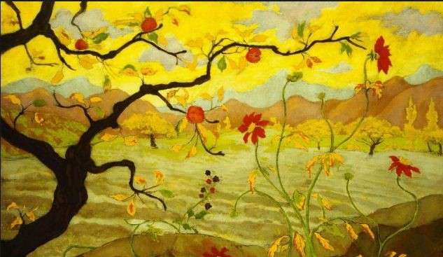

# Алимны модны эрхэм түүх

Ойн захад нэгэн сайхан алимны мод ургаж байжээ. Тэр модон дээр нэг жаалхүү өдөр бүр ирж, гишүү мөчирөөр нь авиран, алимыг нь түүж идэн хүрэх газрынхаа мөчирт зүүгдэн тоглодог байв. Алимны мод ч үүнд нь их дуртай хүүг ирэхэд их аз жаргалтай болдог байжээ. Нэг өдөр хүү уйтгар гунигтай ирэв. Алимны мод түүнд “чи яагаад гуниглачихав? Хөгжилдөж тоглооч” гэтэл хүү “би ингэж тоглохооргүй том болсон. Би өөр зүйлээр тоглох ёстой. Даан ч надад мөнгө алга” гэхэд алимны мод санаа зовонгуйгаар, “надад даан ч мөнгө алга, харин чи миний алимнуудыг түүж аваад, хотод зарвал мөнгөтэй болно” гэхэд хүү алимыг нь түүн авч явжээ. Үүний дараа хүү удаанаар ирсэнгүй алимны мод гуниглан хүлээдэг байв. Гэтэл хүү нэгэн өглөө том сайхан залуу болчихоод ирэв. Алимны мод “чи надыг хөгжөөн тоглооч” гэхэд хүү, “би тоглох завгүй болсон би гэр бүлтэй, одоо надад байшин хэрэгтэй байна. Чи надад тусалж чадахуу” гэжээ. Алимны мод, “ надад байшин байхгүй л дээ. Харин чи миний мөчир гишүүг авч байшин барьдаа” гэхэд хүү бүх гишүүг нь авч явжээ. Алимны мод тусалж чадсандаа ихэд баяртай үлдэв. Нилээд хугацаа өнгөрч, нэгэн өдөр хүү хижээл насны эр болчихсон ирэв. Алимны мод баярлан “чи надтай тоглохоор ирэв үү” гэхэд хүү “би одоо хөгшин болсон, нэг л уйтгартай байна, би холын хол явмаар байна. Даан ч надад завь алга, чи надад тусалж чадах уу” гэж асуухад, алимны мод ”чи намайг хөрөөдөөд ав. Түүгээрээ завь хийж, холын хол явдаа, аз жаргалтай бай даа хүү минь” гэхэд хүү түүнийг хөрөөдөн авч явжээ. Олон жил өнгөрч нэг өдөр, хүү настай өвгөн болчихсон ирэв. Алимны мод түүнд “Уучлаарай хүү минь, надад одоо алим, гишүү мөчир, авирах мод алга даа” гэхэд хүү “Зүгээр дээ, одоо надад алим хазах шүд алга, авирах бие алга, би зүгээр л маш их ядарч байна амрах газар л хэрэгтэй” гэжээ. Алимны мод “тэгвэл миний хөгшин хожуул дээр сууж амардаа” гэхэд, хүү түүн дээр суухад, алимны мод нулимстай нүдээр инээмсэглэж байлаа.\
Энэ бол хүн бүрт хамаатай түүх. Мод бол бидний төрөл төрөгсөд. Бид бага залуу байхдаа эх эцэггүйгээр байж чаддаггүй. Өсөж том болоод өөрийн амьдралыг зохиож тэднийгээ орхидог. Гэлээ ч бидний төрөл төрөгсөд, хэзээ ч бидэнд туслахад бэлэн, үргэлж аз жаргал хүсч байдгийн жишээг энэ түүх харуулна бус уу.
