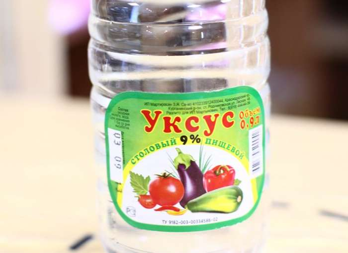

# Алимны цууны ахуйн хэрэглээ

Хямд төсөр үнэтэй, хаа сайгүй зарагдаж байдаг ч, тэр бүр дэлгэрээгүй гэж хэлж болох алимны цууг үр ашигтай хэрэглэх талаар хэдхэн зөвлөгөөг хүргэе.

-эвгүй үнэртэй савны ёроолд, хэрчим талханд алимны цууг шингээгээд хийж хонуулахад үнэр нь арилна\
-бөглөрсөн угаалтуурыг, 2/1 стакан сода хийж араас нь стакан алимны цуу хийж хөөсөрмөгц ус гоожуулна\
-бэлгэнд ирсэн сайхан үнэрт цэцгүүдийг удаан сайхнаар нь байлгахын тулд, цэцэг хийх савтай усандаа хоёр хоолны халбага элсэн чихэр, хоёр хоолны халбага алимны цуу хийхэд удаанаар гоёмсог чанараа хадгална\
-наалдамхай тууз, цавуутай цаас зэргээс эд хогшил дээр үлдсэн мөрийг алимны цуу түрхээд арчихад ул мөргүй арилна\
-гэрийн тэжээвэр амьтдын маажих, урах дуртай эд хогшилын хэсэгт, ус шүршигчид алимны цуу нэмсэн усаар шүрш. Тэд алимны цууны үнэрт дургүй тул дахин ойртохгүй\
-ургамлын нисдэг шавьж, жижиг хар ялаа ихтэй үед, аяганд багахан алимны цуу хийж жижиг нүхнүүд гаргасан гялгар уутаар таглаад тавихад, үнэрээр нь орсон ялаанууд эргэж гарч чадахаа больдгоор нэг төрлийн устгагч болдог
