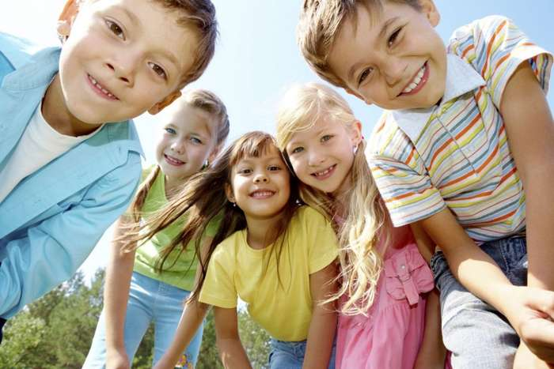
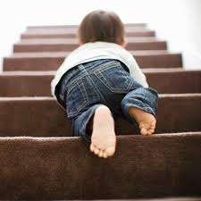

# “Амар” хүүхдүүдэд, амьдрал амар биш байдаг

Томчуул, дуулгавартай, томоотой хүүхдүүдийг “амар” хүүхэд гэж нэрлэцгээж бахархдаг. Тэд 18 нас хүртлээ ийм байж, дараа нь гэнэт амжилттай, орчин цагийнхаа хөлд нийцсэн хурд хөдөлгөөнтэй, эрч хүчтэй хүн болж хувираасай гэж хүсдэг.

Хүүхдийг багаас нь биеэ даасан байдал, санаачлага эрч хүчтэй байхад сургахгүй бол өөрсдийн “амар”-ыг харж хүүхдийнхээ ирээдүйг харахгүй номхон хүүхдүүд өсгөж хүмүүжүүлчихээд, тэднээс амжилттай удирдагч, бизнесмен болохыг шаардах, хүсэх нь зөв гэж үү? Одоо, хуучны-орчин үеийн, дуулгавартай-биеэ даасан, энгийн-эрч хүчтэй гэсэн хоёр төрлийн хүмүүжилтэй хүүхдийг амьдралд алийг нь бэлтгэх вэ гэсэн асуудал тулгарч байна. Уламжлалт аргаар хүмүүжсэн хүүхдүүд мэдээж эцэг эхдээ “амар”, өөрийн үзэл бодлыг хамгаалж багш нартай маргахгүй, гадаа өвдгөө шалбалж өмдөө урахгүй, хичээнгүй, дуулгавартай, номхон. Гэтэл хүүхэд эрч хүчтэй, биеэ даасан, амьдралд хөлөө олоод явах чадвартай байх ёстой, тэр дундаа асар хурдтай хөгжиж байгаа өнөөгийн нийгэмд, өнөө “амар” хүүхдүүд маань хөлөө алддаг. Ирээдүйг нь бодож байна хэмээн дургүй зүйлд нь хүчээр сургах, хүүхэд өөрөө сонголт хийх эрхийг нь хаах, бүх зүйл дээр өөрсдийнхөөрөө байлгах гэж шаардах зэрэг нь биеэ дааж амьдрах чадварыг нь алдагдуулдаг. Нэгэнт л өмнөөс нь шийдвэр гаргаад сургачихаар хүүхэд, үүнд дасдаг. Хөршийн сахилгагүй “чихэнд хонх уядаг” хүүхэд, өөрийн амжилттай бизнестэй, сайхан эхнэртэй, хүүхдүүдтэй болчихсон явахад нь, бид, “тэдний тэр үгүй мөн хэцүү хүүхэд байж билээ, хачин юм аа” гэж гайхацгааж л суух. Үүгээрээ хүүхдийг дур зоргоор нь байлгаасай гэж хэлэхийг хүссэнгүй, харин хүүхдийнхээ үзэл бодлыг хүндэтгэж, сонголтыг нь өөрт нь өгч, бяцхан алдаа хийхийг нь сүр дуулиан болгохгүй өнгөрөөж, аливааг бие дааж хийх, саад бэрхшээлийг бие даан давах, асуудлыг шийдэх гарцаа олоход нь туслахын төлөө бид эцэг эх нь болон заяагдсан.

Бид өнөөдөр, үр хүүхдээ ирээдүйд нь бэлтгэх үүргээ, сайн биелүүлэхийн төлөө бүхнийг хийх ёстой бөгөөд бидний хамгийн чухал үүрэг билээ.
