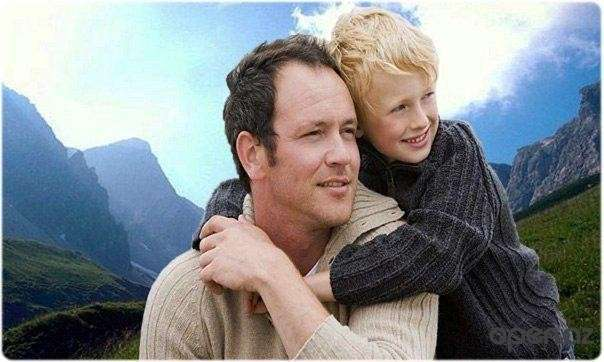

# Амьдрал бол цуурай

Уулын бэлээс дээш, аавтайгаа өгсөж явсан бяцхан хүү хөлөө чулуунд цохичихоод, -ААААА! гэж хашгиртал, хаанаас ч юм мөн АААА! гэх чимээг сонсоод гайхаж, -Чи хэн бэ? Гэж хашгирахад мөн хариуд нь, –Чи хэн бэ?, уур нь хүрч, -Чи хулчгар гэтэл, мөн л –Чи хулчгар гэх сонсогдоход, -Ааваа энэ юу болоод байна аа? гэж асуув. Аав нь инээмсэглэснээ, -Чи сайн сонсож бай даа, гэснээ –Би чамайг хүндэлж байна, гэж хашгирав, хариуд нь –Би чамайг хүндэлж байна, -Чи хамгийн сайн, гэхэд мөн л –Чи хамгийн сайн гэж хариуд нь сонсогдох аж. Гайхсан хүүдээ, аав нь, -Үүнийг цуурай гэдэг, мөн амьдрал гэж нэрлэх нь ч бий. Учир нь, амьдрал цуурайн адил, чи юу хэлж, юу хийж байна, түүнийг чинь мөн буцаан өгч байдаг юм гэж тайлбарлажээ.

