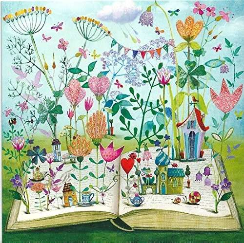

# Амьдрал дараах маш чухал “гоё” жижиг хэсгүүдээс бүтдэг

Амьдрал жижиг сажиг зүйлсээс буюу анхаарч анзаарвал бүгдээс нь аз жаргал, баяр баясгалан, сайн сайхан мэдрэмжийг авч болохоор зүйлс буюу бяцхан баяруудаас бүрддэг гэвэл та итгэх үү? Завгүй байх, яаруу сандруу байх, хурдтай байж нийгэмтэй хөл нийлүүлэхээс өөр аргагүй байх, өдөр тутмын амьдрал ахуйдаа дарагдсан байдалд амьдрах зэрэг нь, ердийн амьдрал ахуйгаасаа тааламж, сэтгэл ханамж авах мэдрэмжийг анхаарах анзаарах сөхөөгүй болгочихдог байна. Гэтэл бидний эргэн тойронд дүүрэн таатай тааламжит, халуун дулаан зүйлс, баяр хөөрийг маань дуудан байдаг. Эдгээрийг олж харж, баярлаж чаддаг байх нь, эрж хайсаар байдаг аз жаргалын мэдрэмжийг дүүргэж өгдөг аж. Багахан амсхийгээд, эргэн тойрноо анхааралтай харцгаая. Дараах бяцхан ч гэсэн тааламж өгдөг зүйлс нийт хүмүүст, адилхан таатай мэдрэмж өгч байдаг байна.

-цэвэрхэн, болвол агаар эсвэл анхилуун үнэртэй цагаан хэрэглэлд хэвтэх үе, ядарсан хөлөө усанд булхах, дараалуулаад сайхан бүрэн найтаах, учиргүй таалагдсан уншиж буй номны уншаагүй хуудас нижгээд үлдсэн байх, бүдрээд уналгүй тогтох, сайхан мэдээ хүлээн авах, хар дарж байгаад сэрж, зүүд байсныг нь мэдэх, хүн баярын мэнд хүргэх, олдохгүй байсан хэрэгтэй зүйлээ мартагдсаных нь дараа олох, хүйтэн оронд хэвтээд хэсэг хугацааны дараа дулаацах, мартагдсан кодоо санамсаргүй хийх, баярын дараах амттангаар дүүрэн хөргөгчөө харах, зам дээрх хурд хэмжигчийн өмнө хурдаа хасч амжих, хогоо хогийн сав руу онож шидэх, дөнгөж худалдаж авсан зүйлээ өмсөх, сэрүүлэгнээс цагийн өмнө сэрж, бостол зөндөө цаг байгааг мэдэж дахин унтах, хүүхэд цагийн танил үнэр таарах, таалагддаг хөгжмөө хаа нэг газар санамсаргүй сонсох, дууссан ооноос нэг удаа хэрэглэх оо шахаж гаргах, дулаахан хөнжилд хэвтчихээд борооны дуслууд дээвэр цонхыг нүдэж буйг чагнах, гарт наалдаж хатсан тарган цавууг хуулах, өдөржин зогсоо байчихаад дараа нь зөөлөн буйдан дээр суух, нулимсаа гартал инээх, халуунд дэрээ сэрүүн талаар нь эргүүлж дэрлэх, танихгүй хүмүүс таны яриаг сонсоод хөгжин инээхийг анзаарах, хийсэн хоолыг амттай хэмээн магтацгаах, бэлэг тараах, яриа хөөрөө нийлэх, азын тоо харах гэх мэт тоо томшгүй дуусашгүй олон тааламжит зүйлээс амьдрал бүрдэж, эдгээрийг анзаараад сурчихвал амьдрал аз жаргалтай болдог аж. Танд, эдгээрээс өөр таатай тааламжтай байдаг зөндөө зүйл байгаа, түүнийгээ анзаараад байгаарай. Тэрхүү зүйлс тань нийлж амьдрал болдог. Аз жаргал тань түүнээс төрдөг юм.
