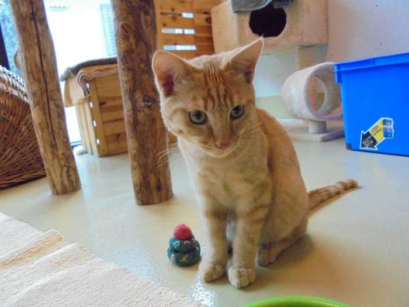

# Амьдрал тийм ч муу зүйл бишийг нотлох, 11 “дулаахан” баримт

Хүн төрөлхтөнд итгэх итгэлийг эргүүлэн өгч буй энэ сайхан “дулаан” баримтуудыг уншихаар, сэтгэл дотроос бүлээцэж, нүд чийглэгдээд байх шиг.

1. Японы Фукусимагийн атомын цахилгаан станцын ослын дараа, 16 мянган хүнийг нүүлгэн шилжүүлэлснээс нэг хүн, зэрлэг араатан амьтад, эзэддээ орхигдсон тэжээвэр амьтдыг хооллож арчилахаар үлдсэн аж. Түүнийг Наото Муцумура гэдэг бөгөөд цахилгаан, усны хангамжгүй үлдсэн уг газартаа хэдэн арван морьд, зуугаад муур, арван хэдэн нохой, тэмээн хяруул тэжээж амьдарч байгаа гэнэ. Түүнд, та радиацын хордлогоос болж 30 жилийн дараа үхнэ шүү дээ гэхэд, -“Ялгаагүй дээ, би тэр насанд хүрч наслахгүй” гэж хариулсан гэнэ.\
2. Билл Гейтс, 2007 оноос хойш 28 тэр бум доллар буяны үйлсэд зориулжээ. Түүний энэхүү сайн үйлс, Gavi төслийн хүрээнд урьдчилан сэргийлэх тарилгад зарцуулсан зэргийг тооцох юм бол, 6 сая хүний амийг аварсан гэж үзэж байна. \
3. Баруун европод орших, 160 км2 газар нутагтай Лихтенштейн хэмээх бяцхан вант улс, хамгийн сүүлд оролцсон дайнд, 80 цэрэг явуулсан бөгөөд буцаж ирэхдээ тэд 81-лээ ирсэн бөгөөд нэг найзтай болж, түүнийгээ дагуулж ирсэн гэнэ. \
4. Хөгжмийн зохиолч, дуучин Билли Джоэл, концертын эхний суудлуудын тасалбарыг худалддаггүй, харин тасалбар авах чадваргүй хүмүүст зориулдаг гэнэ. Гадна үүдний дэргэдээс, эсвэл танхимын алс буланд зогсож буй үзэгчидээс өөрөө урьж өмнөө суулгадгаа, -“Би хамгийн нүүрний эгнээнд баян чинээлэг хүмүүсийн оронд, жинхэнэ шүтэн бишрэгчидээ харах сайхан байдаг” гэж тайлбарладаг байна. \
5. 2005 онд, Шведийн саятан Йохан Элиаш, Бразилийн ширэнгэн ойг хамгаалах зорилгоор, мод бэлтгэлийн компаниас 8 сая доллараар, 162 мянган га газар худалдан авсан байдаг.

---

6. 1995 онд, “Хүүхдийн хүчирхийлэлтэй тэмцэх байкерүүд” гэсэн олон улсын байгууллага байгуулагдсан бөгөөд тэд, хохирогчидыг хамгаалах, шүүх хуралд ирэх, буцах замд хамгаалж хүргэх, гэр орныг сахих зэрэг үйл ажиллагаа явуулдаг.

---

7. Диснейлендээс гарсан саятан Харрис Розен, Флоридын ядуусын хороололд үнэгүй цэцэрлэг нээж, тааруу амьдралтай коллежийн оюутнуудад буцалтгүй тэтгэлэг олгох зэрэг үйл ажиллагаа явуулж эхэлтэл, богинохон хугацааны дотор, тухайн хорооллуудаар гэмт хэрэг буурч, сургуулиа төгсч буй хүүхдүүдийн тоо 25-100% өсссөн сайхан үр дүнд хүрсэн гэнэ.

---

8. Италид, 18 нас хүрмэгц, хүн бүрт соёлын арга хэмжээ үзэж харахад нь зориулж 500 еврогийн тэтгэлэг өгдөг. Үүнд, Италийн засгийн газар жил бүр 290 сая еврог, дундчаар 575 мянган өсвөр насныханд зарцуулдаг байна. \
9. Коста-Рикад, “Эзэнгүй нохдын газар нутаг” гэдэг газар байдаг. Сайн дурынхан энэ газрыг байгуулж, эдгээр нохдыг хооллож асардаг бөгөөд тэнд 970 азтай, аз жаргалтай ноход байдаг. \
10. Германд, амьтдыг шалтгаангүй алахыг хориглодог. Тиймээс амьтдын асрамжийн газар амьтдыг унтуулж амийг нь хороодоггүй. Тирхайм гэх энэхүү асрамжууд тохилогоороо гайхагдаж байдаг бөгөөд уужим саруул, шилэн тусгаарлагчтай өрөөнүүдэд амьтад нь амьдарч, асаж, авирах, тоглох хэрэгслүүдээр тоноглогдсон байдаг ба амьтдынхаа 90%-ийг сайн хүмүүст тарааж өгч чаддаг гэнэ.

---

11. 1977 онд, 9 эмэгтэй нийлж “9 nanas буюу 9 эмээ” гэж нэрлэсэн бүлгэм байгуулж, ядуу зүдүү, амьдралын боломжгүй хүмүүст нууцаар одоог хүртэл тусалж байдаг гэнэ. Энэ 9 эмэгтэй, 30 жилийн турш, үүрээр 4 цагт цуглан зуу зуун талх гурилан бүтээгдэхүүн хийж, түүнийгээ танихгүй хүмүүст хаягаар нь хүргүүлдэг. Мөн түүнээс гадна, ганц бие бага хүүхэдтэй эмэгтэйчүүдэд, байрны мөнгийг нь нууцаар төлж тусалдаг. Энэ сайхан буяны үйлсийг нь, дөнгөж саяхан нөхрүүд нь мэдсэн гэнэ.
