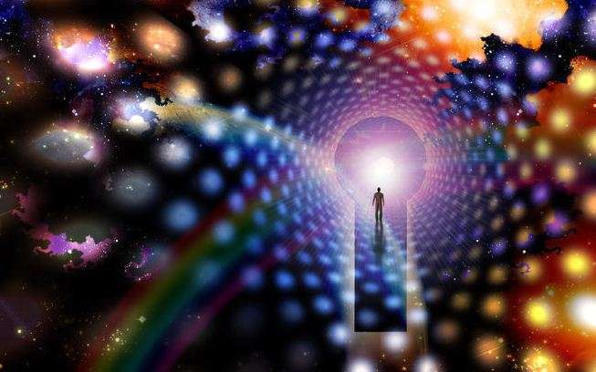

# Амьдралыг аз жаргалтай болгох Буддын 3 сургаал

Буддизмын үзэл санаа нь, хамгийн хүмүүст ойр, хүний сэтгэхүйд хандсан сургаалаар дүүрэн байдаг. Буддын сургаал нь гүн ухаан бөгөөд одоогийн сэтгэл судлалын шинжлэх ухааны судлахууныг илүү гүн гүнзгий судлан, хариултыг нь олж тайлсан төгс сургаал гэж дэлхий нийтээр хүлээн зөвшөөрөөд байгаа билээ. Энэхүү сургаалуудын утга учирыг тунгаан сэтгэл бодолдоо тээн, зөв зам мөрөөр явах нь “жинхэнэ үнэн” аз жаргалд хөтөлдөг.

#### 1. Амьдрал бол зовлон.

Энэ үнэнийг сургадгаас болж, буддын сургаалыг уруу үзэлийн шашин гэдэг боловч, энэ сургаалын цаана гүн гүнзгий утга учир байдаг бөгөөд хүмүүс өөрсдийн амьдралыг өөрсдөө зовлон болгон хувиргадаг тэрхүү жинхэнэ үнэнийг харуулж, зовлонгийн уг шалтгааныг тайлж өгдөгөөрөө гайхалтай үнэн байдаг. Хүмүүс бид, материаллаг сонирхол болон өөрсдийн амьдралаас хүлээх хүлээлтүүдэд хэт автсанаас өөрсөддөө зовлон хурааж, үүсгэж байдаг. Үүнийхээ учир шалтгааныг хэрхэн ойлгож, өдөр тутам хэрхэн ашиглах вэ? Ямар нэг зүйл болохгүй байна гэсэн сэтгэлээс салах нь бухимдлаас салгана. Өвчин, үхэл, өтлөлт, уй гашуу, алдагдалыг амьдралын нэгэн салшгүй хэсэг гэдгийг ойлгосноор гашуун зовлон нимгэрнэ. Амьдралаа байгаагаар нь хүлээж авч суран, амьдрал хөнгөн сайхан, аюулгүй байх ёстой гэсэн үзэл бодлоосоо салснаар шунал, атаа жөтөөнөөс сална. Хөнгөн сайхан амьдралын билэгдэл болгон өдөр тутам хэвлэл мэдээллийн хэрэгслээр харуулж урин дуудах тэрхүү, одууд, алдар нэртэй хүмүүсийн амьдрал мөн л ялгаагүй өвчин, үхэл, өтлөлт, уйтгар гуниг, алдагдалд өртөж байдаг. Энэ бол амьдралын зайлшгүй үнэн юм. Мөн амьдрал дах зовлон, таагүй зүйлс, төгс бус зүйлсийг өөрийн тааллаар хүлээж, тэрхүү таалалд нийцээгүй тохиолдолд зовдог тэрхүү чанараасаа салахыг хичээх хэрэгтэй болдог. Ямар нэг тодорхой, бодолдоо төсөөлсөн зүйлээ хүлээх биш, харин өөрийн зүрх сэтгэлээ тодорхой бус учралуудад нээлттэй байлгаж сурах хэрэгтэй. Ертөнцийн эдгээр зовлон бидний эрх мэдлээс давсан зүйл, хорвоогийн жам гэдэгийг ойлгосноор амьдрал хөнгөрдөг байна.

#### 2. Амьдрал бол тогтворгүй зүйл.

Үнэхээр амьдрал үргэлж өөрчилөгдөж байдаг. Бид, эргээд өнгөрсөнд очиж чадахгүй, юуг ч эргэн давтаж эсвэл засаж чадахгүй. Бидний эд эс үргэлж шинэчлэгдэж, бодол санаа маань байнга өөрчилөгдөж, өдөр шөнө солигдон мөнхийн өөрчилөлт дунд амьдардаг. Өдөр бүр, цаг бүр, хором бүр өөр өөр байдаг. Хүнд бэрх, хэцүү үеийг, энэхүү амьдралын өөрчилөгдөмтгий чанар тайтгаруулах увидастай. Тиймээс энэхүү тогтворгүй чанар, амьдралын бүхий л зүйл өөрчилөгдөн өнгөрөхийг заадгаас аливааг хүлээж авахдаа энэ талаас нь харж бай. Аз жаргалтай үед ч энэ чанар үйлчилж байдгийг мартаж болохгүй. Үүнийг ойлгосноор амьдралын хүлээснээс чөлөөлөгддөг. Энэ үзэл санааг Будда хэлэхээс 100 жилийн өмнө, Эртний Грекийн гүн ухаантан Гераклит анх, -“Нэг голын урсгал усанд хоёрдохоо орж болдоггүй” гэж арай өөрөөр илэрхийлж байжээ. Амьдрал мөн ийм байдаг. Үүнийг сэтгэл зүрхээрээ ойлгоход, бүх зүйл хөнгөрч, өөрт байгаа жижиг сажиг таатай зүйлс, бүр өмсөх дуртай гуталнаас эхлэн эрүүл бие, эрүүл саруул оюун ухаанаа хүртэл үнэлж эхэлдэг. Таатай хором бүрээ үнэлж баярлан, таагүй хормуудаа хэзээ ч төгснө, өнгөрнө хэмээн сэтгэж зовохоо больдог.

#### 3. Хүн өөрчлөгдөмтгий.

Бид, бидний дотор ямар нэг үл өөрчилөгдөх мөн чанар байгаа, түүнийгээ нээхсэн гэж, өөрийгөө таних эрмэлзлэлтэй амьдардаг. Гэтэл, өнөөх амьдралын тогтворгүй чанарын хууль мөн л үйлчилж, бид үргэлж өөрчилөгдөж байдаг. Буддизм, хүний мөн чанар, цаг хугацааны турш үргэлж хувиран өөрчилөгддөг, дурын цаг, дурын байршил, газар оронд, хүн өөрийгөө өөрчилөн тэс өөр хүн болох боломж байдаг гэж үздэг. Яг энэ хоромд өөрийгөө ямар байгааг хармаар байна, яг тийм болох хүч хүн бүрт заяагдсан байдаг бөгөөд үүний тулд сэтгэлээ засч, оюун мэдлэгт шамдах хэрэгтэй гэж сургадаг. Мунхаг оюунаас, муу сэтгэл төрж, муу сэтгэлээс муу үйл гарч зовлон үүсдэг гэнэм.
