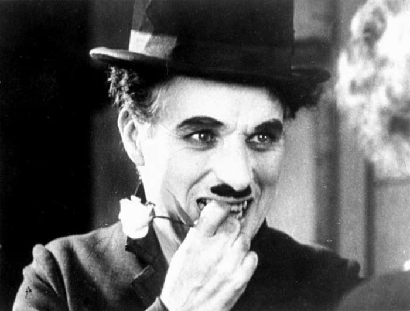

# Амьдралыг  ойлгох нь...

Чарльз Чаплин 70 насныхаа ойн баяр дээр хэлсэн, ухаарал хайрласан алтан үгс

Хүн, өөрийгөө хайрлаж сурах үедээ, уйтгар гуниг бол, түүнд зүгээр л өөрийнхөө хүслээр бус амьдарч буйг нь харуулахын тулд ирж буй нэг дохио юм гэдгийг ойлгодог. Өнөөдөр би “Өөрөөрөө байх” гэж юу болохыг мэднэ ээ. Хүнийг, цаг нь болоогүй, бэлэн болоогүй байхад нь өөрийнхөө хүслийг тулгаж зовоосноор хичнээн их гомдоож байдгийг ойлгосон. Өөр амьдралыг хүсч эрэлхийлэхээ больмогц, эргэн тойрны бүх зүйлс өсөлт хөгжилтөд хичнээн их боломж олгодгийг олж харснаар өөрийгөө хүндлэх хүндлэл ирдгийг ойлгосон. Мөн ямар ч нөхцөл байдалд зөв газар, зөв цагт байхад бүх зүйл зөв болж байдгийг ойлгосон. Үүнийг ухаарах гэдэг. Өөрийнхөө үнэт цаг хугацааг бүтэшгүй зүйлд зарцуулахаа больж, зөвхөн өөрт таатай, аз жаргалтай болгох, дуртай зүйлсээ өөрийн эрхээр хийж, тайван амгалан байхаар амьдрахад өөртөө итгэх итгэл өөрөө ирдэгийг мөн ойлгосон. Өөрт таагүй, хортой зүйлсээс зайлсхийж чаддаг байхын чухлыг ойлгосон. Мөн өөрийгөө үргэлжид зөвд тооцох, зөвтгөхөө болиход алдаа багасдаг болохыг ойлгон, өнгөрснийг эгнэгт орхиж, мөн ирээдүйн төлөө санаа зовинох шаардлагагүй гэдгийг ойлгосон. Би бодол санаа хүнд саад болох боломжтойг, мөн түүнээс болж бүр өвдөж ч болохыг ухаарсан. Харин, бодол санаагаа зүрх сэтгэлтэйгээ холбосноор, оюун бодол минь юугаар ч үнэлшгүй үнэнч холбоотон минь болж байхыг харсан. Өнөөдөр би энэ бүхэн бол Амьдрал гэдгийг ойлгосон.
