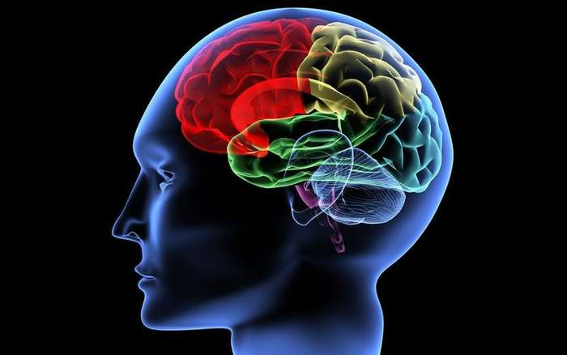
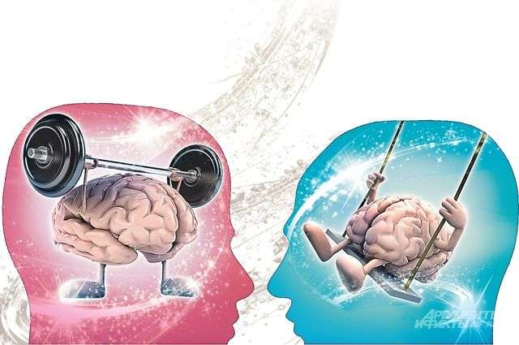

# Амьдралыг өөрчлөх чадвартай, бидний тархины тухай баримтууд

Олон боломжуудаар дүүрэн, хөгжингүй нийгмийн манай эрин зуунд, тархины зохион байгуулалт маш бага судлагдсан зүйлд ордог. Техник технологи, анагаах ухаан, инновацийн аргуудыг ашигласан шинжлэх ухааны судалгаанууд хийгдсээр авч, эрдэмтэн судлаачид тархины талаар тун бага мэдлэгт хүрээд байгаа юм. Гэхдээ одоогийн байдлаар, илэрхий болон нотлогдсон зарим баримтуудыг танилцуулъя. Үүнийг мэдсэнээр, амьдралаа өөрчилж болно гэж үзэж байгаа юм.

#### Тархи төсөөлөл, бодит байдал хоёрыг ялгадаггүй

Бидний “ухаалаг эрхтэн” тархи, бидний төсөөлж байгаа зүйлсийг ч бодит гэж хүлээж авдаг. Тархи хэзээ ч амардаггүй, жишээ нь, нэгэн бүсгүй сэтгэлт залуугаа хагас цаг хүлээгээд ирэхгүй бол, өөрийн эрхгүй бодолд нь орж ирэх, “тэр намайг хаячихаж”, “тэр намайг хуурч байна”, “намайг сонирхохоо больчихож” гэх мэт бодож буй тэдгээр бодлуудыг нь баримжаалал болгон хүлээж авдаг. Тархи тодорхойгүй байдлаас зайлсхийж, түгшүүр догдлолыг бууруулах чадвартай ч, ажиллахаа зогсоодоггүй. Бүсгүйн бодол сэтгэлтэй залуугаа ирэхгүй удах хугацаанд, элдэв таамаглал дунд хөвөрсөөр, -“намайг хаяж байгаа юм болов уу?”, “өөр эмэгтэйтэй болсон байх”, “хамаг юмыг нь бэлдээд тавьчихья”, “цоожоо сольё”, “ээж аавдаа юу гэж хэлнэ ээ”, “харуулна аа, хэнээс салсаныг нь”, “гоё сайхан явж хэнээс салсаныг нь мэдрүүлнэ ээ” гэх мэт бодлууд нь, -“би санаад байна”, “бид хоёр чинь хичнээн удаан үерхэж байгаа билээ”, “хайрт минь хүрээд ирээ ч дээ” гэсэн бодлуудтай нь холилдон, хар сэр, хайр үзэн ядалтыг хослуулсан эдгээр бодлуудаараа бараг бүхэл бүтэн амьдрал туулах мэт үйлдлийг тархиндаа ачаална. Гэтэл, сэтгэлт залуу нь чухлаас чухал хурал зөвлөгөөнд орсон эсвэл утсаа машиндаа түгжчихээд авч чадахгүй байх ч юмуу тохиолдлууд гарсан байгаад хоцорч ирэх тохиолдолд бүсгүй тархиа болох болохгүй бодлоор хичнээн их гашилгав? Ямар ч тохиолдолд, аливааг сайнаар бодож төсөөлөх хэрэгтэй гэнэ.

#### Тархийг өөрчилж болно

Хэдий чинээ их шинэ мэдээлэл авна, тархинд, төдий чинээ ихээр нейрон холбоосууд үүсч байдаг байна. Бидний урсгалаар олж авч буй мэдээллүүд, тодорхой нэг түвшинд дүр зураг, санамж маягаар хадгалагддаг. Харин системтэйгээр, “өгөгдлүүдийн сан”-г дүүргэж өгөх нь илүү их дүр зураг, санамжтай болох боломжоор хангадаг. Тийм учраас, эрдэмтэдийн, бодох сэтгэх хурд нь илүү, маш сайн ой тогтоолттой байдаг аж. Тэдний тархины саарал эд, ердийн үед ч, бодож боловсруулдаг шинж чанартай нь уялдаатай шинэчлэгдэж байдаг бөгөөд тархины үйл ажиллагааг маш өндөр үр дүнтэй ажиллахад хүргэдэг. Тиймээс ямар ч зүйлд, системтэй суралцаж байхыг хичээх хэрэгтэй.

#### Тархи биднээс тусгаар салангид ажилладаг

Ихэнхи үед, тархи, бидний хүсэл, дур зоргоос хамаарахгүйгээр, байгаа мэдээллүүдээ боловсруулж байдаг. Бид, ажил дээрээ, эсвэл ярилцах үедээ, тархийг хэсэгхэн хугацаанд хянадагаас биш, бусад үед бид тархины ажиллагааг удирдаж чаддаггүй. Нөхцөл байдлын өөрчлөлт эсвэл шинэ мэдээлэл оруулаагүй цагт, тархи хуучин материалуудтай ажилладаг. Жишээ нь, өчигдөр санаа сэтгэлийн уналтад таагүй зүйлсийг бодож өнгөрүүлсэн бол өнөөдөр ч тийм байх боломжийг дагуулна гэсэн үг аж. Тиймээс, бодлуудаа хянаж, хэрэгцээтэй чиглэлдээ хөтлөхийн тулд холбоотой мэдээллүүдээр “өгөдлийн сан”-гаа дүүргэж байхыг хичээгээрэй. Үргэлжид, сайн сайхан, таатай зүйлсийг бодохыг мөн хичээх хэрэгтэй байдаг байна.
