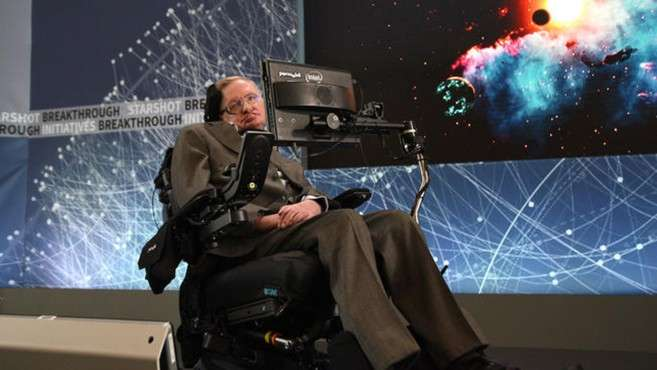

# Амьдралыг өөрөөр харах, Стивен Хокингийн 4 зөвлөгөө

Стивен Хокингийн өвчин эхлэх үед, эмч нар хэдхэн жилийн настай гэж байсан ч, тэр урт удаан амьдарч, тэрхүү хугацаагаа Ертөнцийн утга учирыг олох, нээхэд зориулсан гэдэг. Тэрээр, олон хүмүүсийн хувьд, бүхнийг сөрөн хүссэн зүйлдээ хүрч болдогийг харуулсан үлгэр дуурайл болон мөнхөрсөн билээ. Тэр, амьдралыг хайрлан хүндэлдэг, харин ертөнцийн зүй тогтолд хамаатай, өөрчилөх боломжит зүйлсэд хязгаартай ханддаг нэгэн байв. Тэр хэдийгээр хүнд өвчинд нэрвэгдэж тахир дутуу болсон ч, хэзээ ч, шинжилгээ судалгааны ажилаа зогсоож байгаагүй бөгөөд үүнийгээ –“Оюун ухаан, ямар ч өөрчилөлтүүдэд дасан зохицох чадвартай гайхамшигт зүйл” гэж тайлбарладаг байв. Тэр, амьдралд хайртай, шударга, бүтээлч, бүх зүйл, үзэгдэл юмсийг гайхаж шагшран хүлээж авдаг, эдгээрийн учир утга, нууцыг ойлгохыг эрмэлздэг, авъяаслаг, шантаршгүй зүтгэл төгс сод хүн байжээ. Тэрээр, бидэнд дараах 3 зөвлөгөөг үлдээсэн юм.

**Нэгдүгээрт:** Хөл доорхоо бус харин одот тэнгэрийг харахаа бүү март\
**Хоёрдугаарт:** Хэзээ ч бүү бууж өг. Ажил хөдөлмөр л амьдралыг утга учиртай болгодог юм. Түүнгүйгээр амьдрал хоосон.\
**Гуравдугаарт:** Хэрэв та, хайрыг мэдэрсэн, олсон азтан бол, түүнийг байгаа гэдгийг байнга санаж яв. Хамаагүй бүү цац. Цацах ба түгээх нь, хоёр ондоо ойлголт.\
**Дөрөвдүгээрт:** Бүхэнд, бүх зүйлд таларх.\
Хокингийн энэ зөвлөгөөнүүд, зөвхөн доороо дэвхцэхгүй, өргөн сэтгэж, өөрт байгаа дэмий үрэгдэх өндөр магадлалтай нөөц боломжуудаа урагшлахдаа ашиглах, ажилаас шантрахгүй байх, хайр ба түүний мөнхийн дагуул талархлаар дүүрэн амьдрахыг сануулдаг. Түүний, -“Миний, амьдралаас хүлээж байсан хүлээлт, 21 настайд минь тэг болтлоо унасан. Харин үүнээс хойшхи бүх зүйл, надад амьдарлаас зүтгэлийн минь төлөө өгсөн “бонус” юм” гэсэн үг нь, эдгээр шагналынхаа төлөө талархал дүүрэн амьдарсныг нь харуулдаг бөгөөд тэрээр, эдгэшгүй өвчиний онош тогтоогдсоны дараах он жилүүдийнхээ тухай, амьдрал нь хэрхэн орвонгоороо өөрчилөгдсөн болоод “бонус” болон хувирч өөрчилөгдсөн /тэр хийж буй зүйл, хийсэн бүхнийхээ үр дүнг шагнал гэж хүлээн авдаг байжээ/, үүнд үргэлж, хязгааргүй талархаж, талархсаар явдаг гэж бичсэн байдаг.\
Талархал ба талархах сэтгэлийг бид, аз завшаан, азтай тохиолдлуудын төлөө гарч ирдэг хариу үйлдэл гэж ойлгодог. Гэтэл оршихуйдаа, амьдралдаа, амьд сэрүүн байгаадаа талархах нь, амьдралд аз жаргалыг бүрдүүлэх, амжилтад хөтлөх нөхцөл болдог гэдгийг энэхүү сод хүний амьдрал, тод томруун харуулна бус уу. Тиймээс та бол, амжилт дүүрэн амьдрах, талархах мэдрэмж, талархах чадвар бүхий азтай хүн гэдгээ ухамсарлан амьдрах нь зүйтэй юм.
