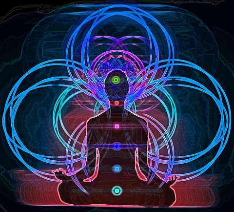

# Амьдралын эрч хүчнээс хумсалдаг 5 “хулгайч”

Хүн бүрт, үр бүтээлтэй ажиллах, аз жаргалтай амьдрах, үр хүүхдээ өсгөх, амжилтад тэмүүлэх эрч хүчийг өгдөг өөр өөрийн энергийн нөөц заяагдсан байдаг. Гэтэл бидний олонхи энэхүү энергээ зохистой ашиглаж чадахгүй алдаж байдаг бөгөөд энергийн “хулгайчидаас” сэргийлэх, өөрийгөө хамгаалах аргатай танилцуулъя.

1. Дэмий зүйл ярих нь үнэт цаг хугацааг алдуулж, амжилт бүтээлийг үгүй хийдэг. Амьдралын эрч хүчээ алдахгүйн тулд, хэрүүл маргаанаас хол байж, дэмий яриа хөөрөөнөөс зайлсхийж байх хэрэгтэй байдаг байна.\
2. Бухимдал, гутрал, сэтгэлээр унах, өөрийгөө үнэлэхгүй байх, уур хилэн, хор шар, хар сэр зэрэг нь, энергийг асар их алдагдуулдаг гэнэ. Сөрөг сэтгэл хөдлөлөө хянаснаар энергээ хадгалж чадна.\
3. Таалагддаггүй ажил эрхлэх. Ийм ажил хэнд ч баяр баясгалан, үр бүтээл өгдөггүй. Эрч хүчгүй болж, зорьсондоо хүрэх сэтгэл ханамж байдаггүйгээс энерги алдагдаж аз жаргалгүй болдог. Өөрийнхөө дуртай зүйлийг эрхэл. Энэ л таныг аварна.\
4. Шүүмжлэлээс айх нь энергийг алдагдуулна. Үүнийгээ хүн өөрөө мэддэггүй. Хүмүүс юу гэх бол гэж айж амьдрах нь амьдралын энергийг тань устгах аюултай. Өөрөө бусдыг шүүмжлэхээ болих хэрэгтэй. Ямар ч шүүмжлэл, амжилтын сэдэл болдоггүй гэдгийг ойлгох хэрэгтэй.\
5. Энергийн вампир гэж байдаг. Зарим хүмүүстэй ойр байх, харилцах үед сэтгэл хоосрох, хүчгүй болох, бие сулрах байдал ажиглагддаг. Энэ бол таны далд ухамсар дохио өгч буй хэрэг. Бие организмаа сонсож сурах, мөн таагүй хүмүүсээс зайгаа барих хэрэгтэй байдаг.\
Өөрийн энергээ зохистой зарцуулж, чиглүүлснээр амьдрал тань өөрчилөгдөж, аз жаргалтай, амжилттай, элбэг хангалуун болгож өгдөг байна.
