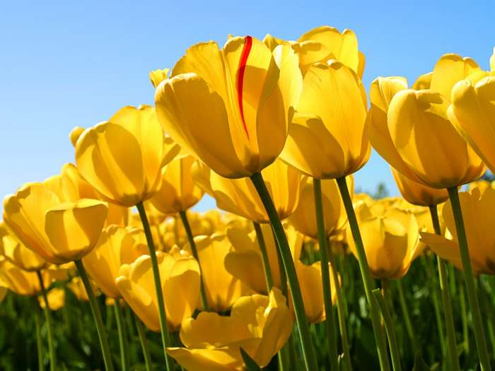

# Амьдралын үнэ цэнэ

...Нэгэн хүн байжээ... Түүний санаж байгаачлан, түүнээс амьдрал огт салаагүй бөгөөд амьдрал нь янз бүр, хүүхэд байхад нь амьдрал, асар том гайхалтай сайхан, үргэлж бэлэг, баяр хөөрөөр дүүрэн, сонирхолтой байв. Эргэн тойронд нь дандаа хайртай хүмүүс, тэр тэдэн рүү тэмүүлэн сарвалзахад бүгд түүнийг өхөөрдөн, хайр энэрлээр хариулна. Өдөр бүр, тэр, анхны үг, анхны алхам, анхны гэсэн тодотголтой олон зүйлийг сурч гүйж, тоглон, зүггүйтэж амьдрал түүний толгойг илнэ, хааяа бөгсөнд нь алгадна. Мөн амьдрал, түүнд, өсч томрохын хирээр сургууль, анхны багш, анхны дүн, шалгалт, анхны хайр, мэргэжил, гэр бүл, анхны хүүхэд гэсэн гайхалтай зүйлсийг харамгүй өгч байсан ба амьдрал түүнд, үе үе үхэл гэх зүйлийг таниулна. Үхлийг тэр, эхлээд алсаас мэдрэн, төрөл садныхаа настай хүмүүсийг үүрд явахад гуниглан хүлээж авна. Гэвч амьдрал зогсолтгүй урагшлан, тэр ч амжихаар зүтгэсний хүчинд олон зүйлийг ойлгодог болж амьдралаас сэтгэл ханамж авч сурч эхлэх үед нь үхэл түүнд хамгийн их ойртож, хамгийн дотны хүнээ үхэлд алдаж амьдралыг хичнээн хэврэг нэг л хоромд дуусч болохыг мэдэрч амьдрал нь зогсох шиг болов. Гэвч амьдрал түүнийг зовлонд орхисонгүй. Түүнийг хайртай хүмүүстээ хэрэгтэй болохыг ухааруулав. Үүний дараа, тэр, амьдралын хором бүрийг хайрлаж, түүнийг сайн сайхан, утга учираар дүүргэх ёстойг ойлгож, улмаар ухаарлаар дүүрч байлаа. Тэр үр хүүхдээ өсгөн, туршлагажин, хүндлэл хүлээсэн хүн болж амьдралыг таньсаар байх бөлгөө. Үхэл үе үе, өөрийгөө сануулна. Үхлийн авч явсныг, амьдрал нөхөх нэгэн үнэнг ухаарах үедээ түүнийг жаахан байхад түүнд хэрэгтэй байсан хүмүүс цөөрч, харин өөрийнх нь байгаа нь хэрэгтэй болсон үе ирсэнийг ойлгов.Тэр, урт удаан аз жаргалтай амьдарчээ. Тэр, амьдралд хайртай байж, амьдралыг жаргалтай, зовлонтой нь хүлээж авч сурсан бөгөөд амьдралыг яаруулахаа больж, мөн үхлээс айхаа больсон байлаа. ...Нэгэн хүн байжээ..
