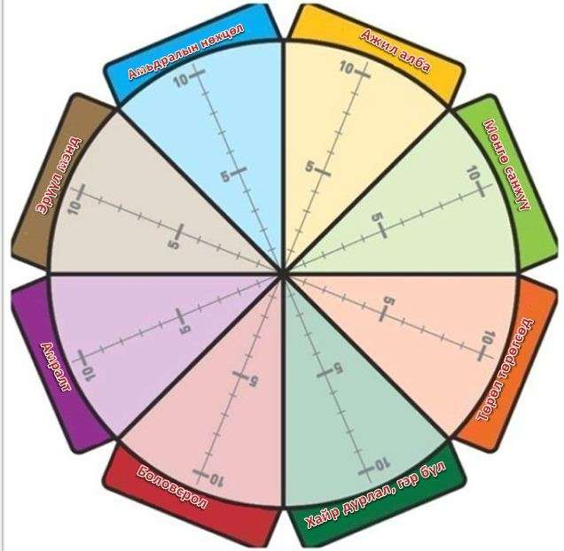

# “Амьдралын тойрог” буюу 1 минутын арга

Энэ аргыг “Амьдралын тойрог” гэж нэрлэдэг бөгөөд, энэ арга, амьдралынхаа замд, яг юунд зорьж, яг ямархуу явж буйг тань харуулж, алдаа оноогоо анзаарах, түүнийг засах, мөн, нөхцөл байдлаа “өсгөх” сэдэл төрүүлж өгдөг. Хүний амьдрал, мөнгө санхүү, эрүүл мэнд, хайр дурлал, гэр бүл, амралт гэсэн олон зорилтот зүйлсээс бүрдэж байдаг бөгөөд хүн, эдгээрийг тэнцвэртэй, тогтвортой байлган, амьдралаа урсгалаар бус, өөрийн хүссэнээр, өөрийн гараар цогцлоох эрхэм үүргийг үүрч байдаг тиймээс, энэ аргыг, сард нэг удаа хэрэглэж, өөрийнхөө амьдрал, байр сууриа тодорхойлон, аль тал нь хоцрогдож байгааг харж дүгнэх боломжийг ашиглаарай. Хэт ажиллах нь, амрахаас өөр аргагүй байдалд оруулдаг, эрүүл мэндээ хайхрахгүй байх нь, өвдөж эмнэлгээр явахаас аргагүй байдалд хүргэдэг гэх мэт зүйлүүдийг мэдэхгүй хүн үгүй боловч, үүнийгээ анзаарахгүй явсаар тооцож төлөвлөөгүй эрсдэлд өртөж байдаг бөгөөд энэ арга, үүнээс сэргийлдэг.

Хуудас цаас аваад, дараах тойргийг дуурайлган зур. Ингээд, асуудал тус бүрийн тоон тэмдэглэгээтэй шугамууд дээр, тухайн асуудлаа хэрхэн үнэлж буйгаа, 1-10 доторхи тоогоор тэмдэглэ. Таны өмнө, өөрийн тань, хувийн “амьдралын тойрог”, буюу тухайн асуудлуудын, юунд илүү анхаарах ёстой, юу нь боломжийн байна, юуг нь өсгөх хэрэгтэйг харуулах нэгэн “өөрийгөө хөндлөнгөөс харах боломж” нээгдлээ. 10 гэсэн үнэлгээ тавигдах асуудлууд бага байвал бүү санаа зов. 10 үнэлгээ нь тухайн асуудалд дорвитой шинэ өөрчлөлт гарах гэж буйг харуулдаг үнэлгээ юм.
