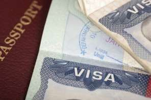

# Америкаар, хэмнэлттэй аялахад тустай зөвлөмжүүд

Америкад, аялах, амьдрахын аль аль нь гаднын жуулчид, ердийн иргэдийн хувьд үнэтэй тусдаг. Хоёр сар орчим, зочид буудал, рестораны үйлчилгээнээс бараг татгалзсан, аль болох хэмнэлттэйгээр явсан аялалд, машин худалдаж авахаар мөнгө зарлагадсан тухайгаа нэгэн танил маань ярьж байж билээ. Тиймээс, америкт юун дээр, ямар үйлчилгээг ашиглаж, хэрхэн хэмнэж болох талаар хэдэн зөвлөгөөг хүргэе.

Америкаар аялахад, томоохон хотуудаас Вашингтон, Сан-Франциско хотууд дайран өнгөрөх, буугаад мордоход таатай, хоноглох газрууд нь, Нью-Йорк зэрэг бусад хотуудаас хямд байдаг.\
Америкад, купоны үйлчилгээ жинхэнэ утгаараа хэрэгжиж байдаг. Купоны тусламжтай олон зүйлийг хямдруулан авах, үйлчилүүлэх боломжтой байдаг нь маш таатай. Хоолны газраас эхлээд, гипноз эмчилгээ хүртэл бүхий л төрлийн купонуудыг ашиглах нь мөнгөө хэмнэнэ. Groupon.com сервисээс купоны үйлчилгээ авч болдог.\
“Хэмнэхийн тулд, худалдан ав” гэсэн бидний хувьд танил бус зарчим, америкт хаа сайгүй үйлчилж байдаг. Тиймээс, америкт 50 гаруй жилийн турш, жил бүр хэвлэгдэн гарч байдаг Entertainment book номыг худалдан авах хэрэгтэй. Энэ номонд, купонууд төрөл бүрийн ангилалаар хэвлэгдсэн байдаг бөгөөд ойролцоогоор 35 долларын үнэтэй байдаг ч, олон зүйл дээр хавьгүй их хэмнэлт эдлэх боломжийг олгодог. Мөн энэ ном, номын хямдралаар хямдардгийг мэдэх хэрэгтэй. Хот бүрт зориулагдан хэвлэгддэгийг анхаарах хэрэгтэй ба удаанаар саатах газартаа, хэвлэл мэдээллийн товчоо, эсвэл сайтаас нь захиалан худалдаж авч болдог.\
Аялагчид, couchsurfing- сервист хандсанаар хэмнэлт гаргаж байсан талаар, олон сэтгэгдлүүд байдаг. Үүнийг шалгаад үзэхэд гэмгүй. Хоноглох газрууд, дэн буудлуудын хөлсийг ихээр хэмнэдэг, мөн хот, газар орноо танилцуулах үйлчилгээ үнэгүй байдаг гэж бичсэн байдаг.\
Хэвлэлийн мухлагуудад байдаг, брошюрууд олон зүйл дээр хэмнэх боломж олгох боломжтой тул анзаарч байх хэрэгтэй.\
Том хотуудад, “хотын пропуск” буюу citi pass-г худалдаж авснаар, мөн олон зүйл дээр хэмэнэнэ.\
Хямд, цадталаа хоолохыг хүсвэл, өглөөний цай, өдрийн хоолны үеэр 8-12 доллар төлөөд ханатлаа идэж болох буфетүүдэд орж бай. Аль ч хотын Mongolian Grill гэсэн хаягтай буфетүүд сайн хоолтой байдаг. /Яагаад монгол гэж нэрлэсний учирыг мэдэхгүй байна. Асууж сонирхоорой./\
Америкчууд төрөл бүрийн спешл офферс, хямдралд тун дуртай улс. Очих саатах газрынхаа, явагдаж буй хямдралын тухай интернэтээс үзэж бай. Үнэгүй үйлчилгээ ч зарлагдсан байдаг. Жишээ нь, Boston discounts, Ney York special offers гээд гуглдэж болно. Үзэсгэлэн, шоу үнэгүй үзэх боломжууд хангалттай байдаг.\
Эцэст нь хэлэхэд, хямдралаас таашаал авах, хэмнэлтээс хуримтлал үүсгэх боломжуудыг ашиглах нь зүйтэй биз ээ.
