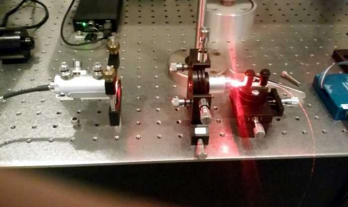

# Америкчууд, хүний боломж чадавхийг дээшлүүлэхэд зориулан гаргаж буй 3 шинэ технологи

Pew Research Center судалгааны төвөөс, америк эрдэмтдийн, хүний амьдралыг өөрчлөх, сайжруулах зориулалтаар дэвшүүлж байгаа, хүний генийн засварлалт, хиймэл нийлэг цус сэлбэлт, тархины имплант тавих технологуудыг хэрхэн хүлээж авч буй талаар 4726 америкчуудыг хамруулсан судалгаа явуулжээ. Эдгээр технологууд, амьдралын чанарыг сайжруулж дээшлүүлнэ гэж тооцож байгаа аж. Гэсэн ч судалгаанд хамрагдагсад, энэ технологуудыг нилээд, сэтгэл зовнисон байдлаар, итгэлгүй хүлээн авч байгаа байдал ажиглагджээ. Үүгээрээ, уг технологуудыг нийгэм хүлээж авах хөрс суурь бүрдээгүй байна гэдгийг харуулав.

-Генийн засварлалтыг, хэдийгээр удам дамжсан өвчнөөс салгах сайн талтай боловч, төрөхөөсөө өмнө, параметрын өгөгдөлтэй, “загварчлагдсан хүүхдүүд” бий болох, мөн шинэ судлагдаагүй генийн өвчлөл үүсэхвий гэсэн болгоомжлолтой байгаа нь оролцогчидын дунд ажиглагдав. Судалгаанд хамрагдагсдын 69%, шинэ технологт эргэлзэж, уг технологи бага судлагдсан гэж үзэж буйгаа илэрхийлсэн байна.\
-Тархины имплант суулгах асуудал нь хүний танин мэдэхүйн чадавхийг сайжруулах, ой санамжийг дээшлүүлэх, их мэдээллийг хүлээн авч боловсруулах чадвартай болгоход хүргэнэ гэж байгаа бөгөөд үүнийг, буцаж авах боломжтой, түр хугацааны чип суулгалтыг арай хүлээцтэй хүлээж авч буй боловч, авч болохгүй чипийг 51% оролцогчид эсэргүүцэж буйгаа илэрхийлсэн аж. Мөн энэ технологийн бүрэн дүүрэн судлагдсан эсэхэд эргэлзэж, 69% нь санаа зовниж буйгаа илэрхийлсэн байна.\
-Нийлэг цус сэлбэлт нь, тамирчидыг илүү хурдан, илүү тэсвэртэй богоно гэж үзэж байгаа юм. Үүнийг оролцогчидын 63% итгэлгүй хүлээж авчээ.\
Мөн энэ технологуудыг, шүтлэгтэй хүмүүс, “ бурхнаас тавьсан хил хязгаарыг зөрчинө” гэж хүлээж авч байгаа бол шүтлэггүй оролцогчид, урд өмнө байдаг байсан, эртэмтдийн туршилт судалгаа хэмээн ойшоохгүй байгаагаа илэрхийлсэн байна. Хэрэв, эдгээр технологууд, хүний төрлөхийн чадавхиудад нөлөөлөхгүй бол болох зүйл гэж 48% нь үзжээ. Энэ судалгаа нь, мөн дээрх технологуудад, эмэгтэйчүүд маш болгоомжтой хандаж буйг харуулсан бөгөөд байгалийн хуулийн эсрэг, хил хязгаарыг зөрчисөн үйлдэл болно гэж тооцож буй нь ажиглагдсан байна.
