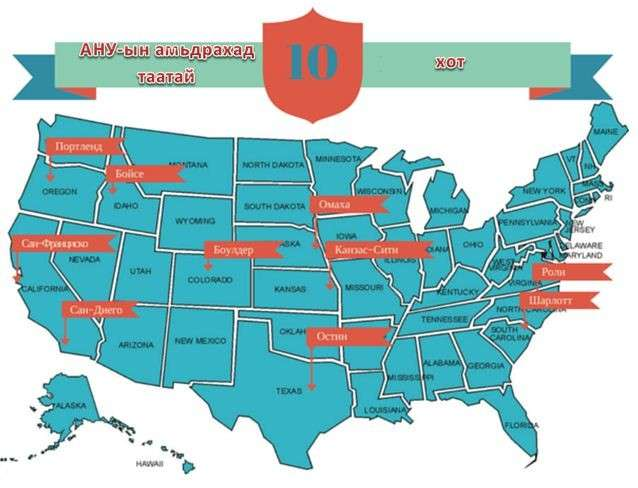
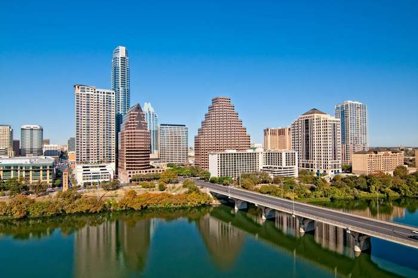
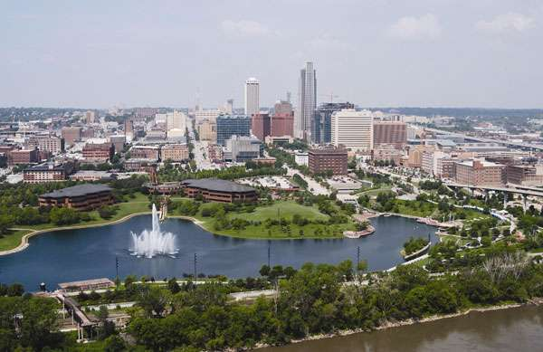
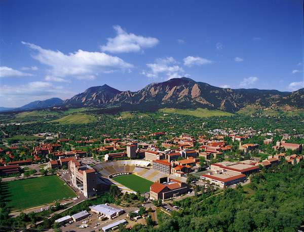
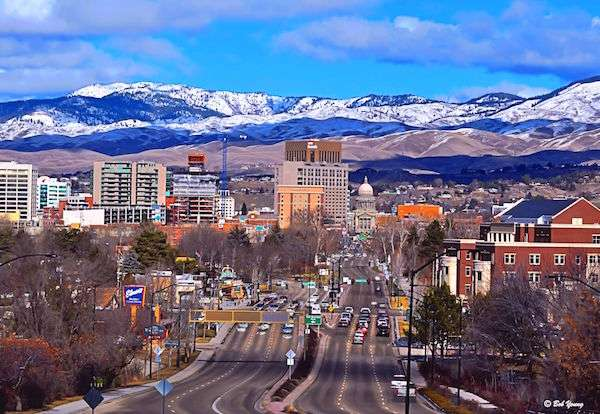
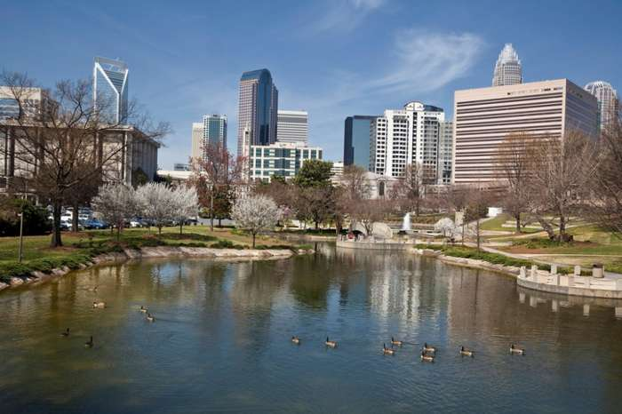
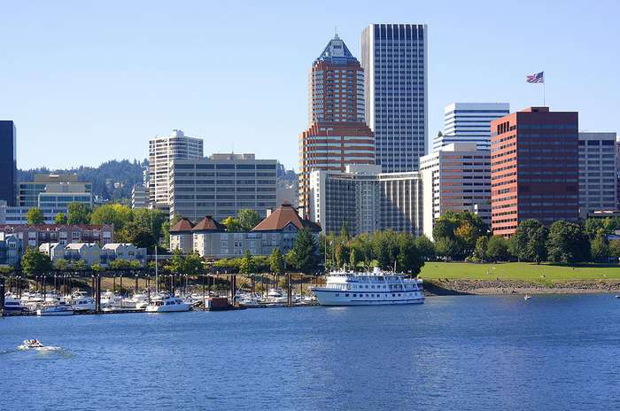
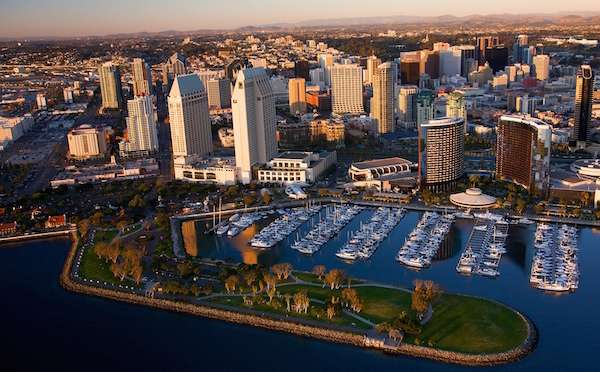
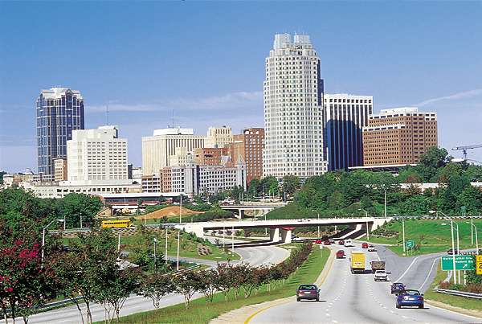

# Америкийн, амьдрахад таатай 10 хот

Америкийн хотууд, хоорондоо их ялгаатай, нэгээс нөгөөд нь очих бүрт, архитектур, хүн ам, мөнгө санхүүгийн бодлого, техник технологийн хөгжилөөрөө, илт ялгарч гайхаш төрүүлж байдаг. Хүмүүсийн хувьд хамгийн чухал байдаг, цаг агаарын нөхцөл, татварын хэмжээ, дундач цалин, хүн амын нягтрал, үл хөдлөх хөрөнгийн үнэлгээ, байрны түрээсийн үнэ, тайван аюулгүй байдал зэрэг үзүүлэлтээр энэ хотуудыг амьдрахад таатай хотууд гэж онцолж үздэг байна.

#### Техас мужийн Остин хот

“Амьд хөгжмийн нийслэл” хэмээн нэрлэгддэг энэхүү хотод, ажилгүйдэл бараг байхгүй. Мөн ашиг орлогын татвар гэж байдаггүй. 8 колледж, их, дээд сургуультай. 830 000 хүн амтай. Жилийн 224 өдөр нь нарлаг, хамгийн хүйтэн нэг дүгээр сард дундачаар, 4 градус орчим сэрүүн байдаг. Ажилын олдоц сонголт сайнаас гадна, зайнаас ажиллах ажил олгодог үзүүлэлтээр улсдаа дөрөвт ордог. Хүн амын нягтшил, 1 м2 –д 1 207 хүн оногддог. Хүн амын 84.7% дээд, дунд боловсролтой.

---

#### Небраска мужийн Омаха хот

Ажилгүйдлийн түвшин бага, нэг хүнд оногдох жилийн дундач орлого 53 000$. 12 колледж, их дээд сургууль байдгаас залуу хүмүүсийн сонирхолыг татдаг. Амьдралын өртөг улсын дундач хэмжээнээс 11% хямд байдаг. Орон сууцны дундач үнэ 129 000$. Байрны түрээсийн дундач үнэ, ердөө л, 715$. Жилийн 214 өдөр нарлаг, цэвэр сайхан агаартай, эмчилгээ, эмнэлгийн салбар нь гайхалтай хөгжсөн, 100 000 хүнд 326 эмч оногддог. Урлаг соёл өндөр хөгжсөн хотуудын тоонд ордог.

---

#### Колорадо мужийн Боулдер хот

Алдарт Rocky Mountains уулсын бэлд, Денвер хотоос хэдхэн милийн зайд орших Боулдер хот, байгалийн сайхныг бишрэгчидийг, байгалийн үзэсгэлэнгээрээ дууддаг хот юм. Дэлхийн хэмжээний цанын бааз оршдог бөгөөд, явган аялал, дугуйн аялал, уулын спорт сонирхогчидын хуран цуглардаг газар. Хүн ам 100 000. Нэг хүний жилийн дундач орлого, 65 000$. Ихэнхи оршин суугчид нь, шинжлэх ухаан технологийн салбарт ажилладаг. Амьдралын өртөг 39.4%-р бусад хотуудаас өндөр. Хүн амын дундач нас 30, учираас залуусын хот гэж үздэг. Улсын хэмжээнд, ногоон байгууламжаараа 30-д ордог.

---

#### Айдахо мужийн Бойсе хот

214 000 хүн амтай, нэг хүний жийлийн дундач орлого 50 960$. Татварын хэмжээ харьцангуй бага. Жилийн 206 өдөр нарлаг, идэвхитэй амрах нөхцөлөөр бүрэн хангагдсан, үүнд, цана, аялал, дугуйн аялал, завьтай аялал ордог. Орон сууцны үнэ хямд, 191 500$. Гэмт хэрэгтэй тэмцэж үр дүнд хүрсэн тайван хот.

---

#### Калифорния мужийн Сан-Франциско хот

Хүн амын нягтшил өндөр. 820 000 хүн амтай мөн дагуул суурингуудад нь715 000 хүн амьдардаг. Нийтийн тээврийн хэрэгсэл ихтэй, зөөлөн уур амьсгалтай, дэлхийн хэмжээний музей, дээд зэрэглэлийн ресторанууд оршдог. 20 их, дээд сургууль, колледжуудтай, амьдрахад таатай газар гэж үздэг. Хотын хүн амын ихэнхи нь ганц бие байдаг нь сонирхол татдаг. Нэг хүний жилийн дундач орлого 75 000$ буюу улсын хэмжээнд өндөрт ордог ч, амьдралын өртөг өндөртэй хот юм. Байр дундачаар 650 000$, худалдааны татвар 8.5%, ашиг орлогын татвар 9.3% байдаг.

---

#### Хойд Каролин мужийн Шарлотт хот

Duke Energy, Lowe’s и Family Dollar банкуудын төв офисууд оршдогоос, хөрөнгө санхүүгийн хүчирхэг төв болон хөгжжээ. 1 600 000 хүн амтай. Үл хөдлөх хөрөнгийн татвар харьцангуй бага, дундач байрны үнэ 190 000$. Мэрэгжлийн сагсан бөмбөг, хөл бөмбөгийн багуудтай. Жилийн 218 өдөр нь нарлаг.

---

#### Миссури мужийн Канзас-Сити хот

Gugle компани энэ хотыг ультра-өндөр хурдны интернетээр хангадаг. 450 000 хүн амтай. Нэг хүний жилийн дундач орлого хэдийгээр бага, 44 436$ боловч, амьдралын өртөг хямд. Байр 162 000$. Байрны түрээс 725$. Хүнсний бүтээгдэхүүн улсынхаа дундач үнээс хямд байдаг.

---

#### Орегон мужийн Портленд хот

Улсдаа, сайхан бие галбиртай хүмүүсийн эзлэх хувиар хоёрт, сайхан хоол хүнс сонирхогчидын сонголтоор мөн хоёрт ордог. Амтлаг хоолтой ресторануудаараа алдаршсан. 550 000 хүн амтай. Наранд шарлагын газар, уулын аялалын бааз гээд идэвхитэй амралтад зориулагдсан хот. Нийтийн тээврийн хөгжил нь улс орондоо загвар болохуйц хот. Хур тундас их буудаг, голдуу бүрхэг байдаг.

---

#### Калифорния мужийн Сан-Диего хот

Энэ хот, цаг уурын нөхцөлөөр хамгийн сайн хотуудын нэгэнд зүй ёсоор ордог. Жилийн 266 өдөр нарлаг, өдрийн дундач температур 21 градус. Номхон далайн эргийн энэ хот, нэр алдартай олон музей, дээд зэрэглэлийн ресторан баруудаараа алдартай. Нэг хүний жилийн дундач орлого 62 000$. Байрны дундач үнэ 392 000$.

---

#### Хойд Каролин мужийн Роли хот

Мэдээллийн хүчирхэг агентлаг Блумберг, Роли хотыг амьдрахад хамгийн таатай хот гэж зүгээр нэрлээгүй нь лавтай. Энэ хот туршилт судалгааны гурвалжин /Роли, Дарем, Чапел-Хилл/ гэж алдаршдаг. Ажлын байр элбэгтэй, ажилгүйдлийн түвшин бага. Нэг хүний дундач орлого 53 370$. Энэ хотод нэртэй North Carolina State University, Duke, и University of North Carolina в Чапел-Хилл их сургуулиуд оршдог. Дөрвөн улиралтай.
