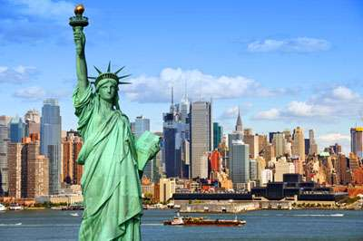

# Америкийн тухай сонирхолтой баримтууд

Америкт ерөнхийдөө амьдрал тайван нэгэн хэмийн гэмээр, ихэнхи америкчууд ажил гэр, гэр ажил гэсэн горимоор амьдарна. Дэд бүтэц нь орон даяар зөв тархацтай хөгжсөн. Нийгэм нь нийгмийн хамгаалал шаардлагатай хэн болгонд, мөн шаардлагагүй хүмүүст ч хүрч ажиллаж чаддаг. Цалингийн түвшин өндөр, гэхдээ хамгийн гол нь орлогоосоо татвараа өгөхөө огт мартаж болохгүй нөхцөлтэй. Америк хэдийгээр үүсэн байгуулагдсанаас хойшхи хугацааны хувьд урт биш ч, хөгжин цэцэглэж чадсан хөгжингүй, соёлт улс юм. Сүүлийн жилүүдэд энэ улсын визний журам чангарч, аялалын виз олголт багассан хэдий ч, энэ улсыг сонирхох, аялах хүмүүсийн тоо улам өссөөр байгаа бөгөөд аялах хүсэлтэй хүмүүс болоод аялах боломж нь бүрдсэн азтай хүмүүст ачаагаа баглахаасаа өмнө уншаад, мэдээд авчихад илүүдэхгүй сонирхолтой баримтуудыг хүргэе.

1. Америкийн далбааны загварыг 1958 онд, 17 настай Роберт Хефт гэгч сурагч гэрийн даалгавартаа хийсэн гэнэ. Энэ даалгавартаа 4 авч байсан нь сонин. 13 судал нь, тухайн үед нэгдсэн 13 колони улсыг илэрхийлдэг\
2. 1956 онд, In God We Trust /Бид бурханд итгэдэг/ гэсэн үг албан ёсны уриа нь болсон бөгөөд энэ уриа иргэний дайны үеэс хэрэглэгдэж ирсэн ба, америкийн бүх мөнгөн дэвсгэртүүд дээр бичигдсэн байдаг аж.\
3. Америкийн чинээлэг, баян хүмүүс баярхаж, баянаа харуулахыг хүсдэггүй. Энгийн дэлгүүрээс авсан джинс, пүүз өмсөхийг шившигт тооцдоггүй. Янз бүрийн үнэт эдлэл, бөгж, гинжээр өөрийгөө гацуур мод шиг чимэхийг тэнэгт тооцдог. Харин америкийн хар арьстангууд ийм зүйлээр гоёх нь их\
4. Гэрлэлтээ бүртгүүлсэн хосуудын 8 орчим хувь нь интернэтээр танилцсан байдаг гэнэ.\
5. Америкчуудын 74% бурханд итгэдэг, 42% нь хий үзэгдэл байдаг гэдэгт, 24% нь хүн дахин төрдөг гэдэгт итгэдэг.\
6. Америкийн Арканзас, Мэриленд, Миссисипи, Хойд Каролин, Өмнөд Каролин, Теннеси, Техас гэсэн 7 мужид, бурханд үл итгэгчидийг төрийн албан тушаалд томилдоггүй. Энэ нь үндсэн хуулиар нь хориглогдсон байдаг гэнэ.\
7. Америкийн ихэнхи гэр бүл өрхийн нийт орлогын 48% орчимыг улсаас нийгмийн дэжлэг туслалцаа хэлбэрээр авч байдаг бөгөөд төлж буй татвараас нь илүү орлого тусламж улсаас өгч байдаг\
8. Америкийн сургалтын дундач төлбөр 28 000$ байгаа бөгөөд энэ нь 1978 оноос хойш 900% өссөн байгаа аж\
9. Америкт дээд боловсролтой 100 мянга гаруй гудамжны цэвэрлэгч, 300 мянгаад зөөгч, мөн 375 мянган дээд боловсролтой хүн кассаар ажилладаг\
10. Ажил эрхлэгсдийн 40 гаруй хувь нь, амьдралынхаа эцсийн мөчийг хүртэл ажиллана гэж төлөвлөдөг \
11. Конгрессд саятангууд хамгийн их хувийг эзэлдэг\
12. Америкийн газар нутагт цагийн 6 бүс үйлчилдэг\
13. Америкчууд жинхэнэ хөдөлмөрчид. Тэдний хувьд өглөөний 6 цагт ажилдаа ирэх, ойрой үдэш болтол ажиллах ердийн хэрэг\
14. Шүдээ гарган сайхан инээмсэглэх асуудал америкт сайн харилцааны дүрэм мэт хэрэгждэг. Хүн бүрт инээмсэглэж хандах ёстой. Үгүй бол нийгэмшээгүйд бүр түүнээс ч муугаар тооцогдох магадлалтай\
15. Бүсгүйчүүдийг үдийн хоолонд даах гэсэн ойлголтыг доромжлол гэж хүлээж авах магадлалтай байдаг. Америк эмэгтэйчүүд урт удаан хугацааны турш, тэгш эрхийн төлөө тэмцэлдсээр ирсэн бөгөөд аливаад даалгах тун дургүй. Төлбөр тооцоог тэнцүү хувааж хийдэг. Тэд, 1920 онд анх сонгох сонгогдох эрхээ олж авсан аж.\
16. Замын хөдөлгөөний дүрэм хамгийн чангад орно. Авилга өгөх гэж оролдох ч хэрэггүй. Зөрчсөн л бол олон долоон үггүй баривчилах хүртэл асуудал наад захынх\
17. Америкт, насанд хүрснээс хойш эцэг эхтэйгээ удаанаар амьдрахыг ичгүүрт тооцдог. Тиймээс хүүхдүүд насанд хүрмэгцээ байр хөлслөн бие дааж амьдарч эхэлдэг.\
18. Америкийн ажилгүйдэл ажил олдохгүйгээс болдоггүй. Хүүхдийн асаргааны мөнгө дундач цалинтай тэнцдэг учираас, ажил хийх хүсэлгүй хүмүүс үүнийг ашиглан амьдардагтай холбоотой\
19. Шүүхээр шийдвэрлүүлдэг асуудлуудын дийлэнх нь татвар төлөөгүй, бултсан хэргүүд байдаг\
20. Филадельфи хот нь, америкийн хамгийн анхны нийслэл бөгөөд грекээр “Ахан дүүсийн хайр” гэсэн үг аж\
21. 20 сая америкчууд дугуйтай зөөврийн байшинд амьдардаг\
22. Манхеттены Чайнатаунд дэлхийн бөмбөрцөгийн баруун гэгдэх хэсэгт амьдарч буй хүмүүсээс олон, хятад хүн амьдардаг гэнэ\
23. Пентагоны барилга, дэлхийн хамгийн том засаг захиргааны барилга\
24. Та үүнийг уншиж байх үед америкийн зам дээр 125 сая авто машин явж байгаа\
25. Америкчууд гэртээ гуталтайгаа явдаг. Учир нь гудамж нь их цэвэрхэн байдаг байна.\
26. Америкчууд их чөлөөт хандлагатай хүмүүс. Тэднийг хаа нэгтээ гутлаа тайлж орно уу гэвэл буруугаар хүлээж авна. Харин, гудамжинд гэгээн цагаан өдрөөр усны хувцастай хагас нүцгэн явах, хачин содон хувцаслахыг огт тоохгүй. Тоож харах ч үгүй.\
27. Татварын байгууллага нь хамгийн нарийн нягт ажиллагаатай улс. Татварын асуудалтай хүмүүсийг хэн ч байсан олж, задгай мөнгө хүртэл төлүүлдэг
