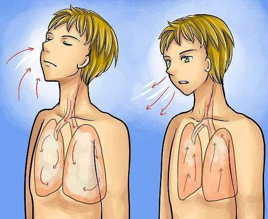
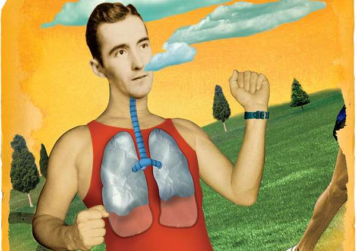

# Амьсгал ба  эрүүл мэнд

Хүн энэ ертөнцөд зөв амьсгалж мэндэлдэг боловч амьдрах явцдаа буруу амьсгалж сурдаг. Энэ нь хувь хүний сэтгэлийн хөөрлийн онцлогтой холбоотой байдаг аж. Эцэг эх нь хүүхдээ багад нь “Битгий орилоод бай!” гэж зандрахаас эхэлдэг. Үүний хариуд хүүхэд уйлахаа байж, амьсгалаа барьдаг. Хүүхэд уйлахгүйг хичээж, хоёр мөрөө унжуулж хүзүү цээжнийхээ булчинг чангалдаг. Аливаа сэтгэлийн хөдөлгөөнийг дарах нь булчинг агшааж, энэ нь амьсгалаа хязгаарлахад хүргэдэг байна. Хүн нас биед хүрэх тусмаа хүчтэй цочролд ордог учраас амьсгалаа барих тохиолдол ихэсдэг. Ер нь сэтгэлийн хөдөлгөөнөө тэр болгон ил гаргахгүй гэж хичээснээс болж амьсгалаа байнга хязгаарлаж, эцэст нь буруу амьсгалж сураад сүүлдээ тэр нь дасал болдог. Ийнхүү амьсгалах нь хүний сэтгэл санааны эрүүл мэндэд муугаар нөлөөлдөг бөгөөд сэтгэлээр унах үед зөв амьсгалж байх нь бачимдлыг дарах, мөн эрүүл мэндэд нөлөөлөх сөрөг үр дагаврыг арилгах арга болдог байна.

Сэтгэл мэдрэлийн эмч Александр Лоуэн сэтгэлийн хөөрлийг түгжигдмэл байдалд байлгах нь зөв амьсгалахад саад болдгийг судалжээ. Мэдрэлийн ядаргаа болон шизофрени өвчний үеийн сэтгэлийн бачимдал нь хүн яаж амьсгалж байгаатай нь холбоотой байдгийг энэ эрдэмтэн судалгаагаар нотолжээ. Шизофренитэй хүн цээжний дээд хэсгээрээ голдуу амьсгаа авдаг бол мэдрэлийн ядаргаанд орсон хүн өрцний хэсгээрээ өнгөц амьсгалдаг байна. Зөв амьсгалж сурснаар олон өвчин илааршиж болдог болохыг доктор Лоуэн өөрийн судалгаагаар мөн нотолсон бөгөөд буруу амьсгалах нь бидний сэтгэл мэдрэлийн эрүүл мэндэд сөрөг нөлөөлдөг болохыг тогтоожээ.\
“Зөв амьсгалах эрдмийг эзэмшсэн хүн элсэн дээр мөрөө гаргахгүй явж чадна” гэсэн Хятадын эртний үг байдаг бөгөөд зөв амьсгалах нь амьдрахуйн хүч, тэсвэр хатуужлыг нэмэгдүүлдэгийг хятадууд эртнээс мэддэг байжээ. “Зөв амьсгалж сурсан хүний хөл ядардаггүй” гэж одоо ч үздэг байна. Зөв амьсгалдаг эсэхээ шалгахын тулд амьсгалын зуршилдаа үнэлгээ өгөх дараах асуултуудыг өөртөө тавиарай. Та яаж амьсгалж буйгаа сайтар ажигла. Хамраараа эсвэл амаараа амьсгалж байна уу? Хамраараа амьсгалах нь зөв байдаг ба амьсгалж буй агаар хамраар орж шүүгдэн, бүлээсч чийгшсэн байдалтай организмд ордог байх ёстой. Хуруугаараа хоёр хамрын нүхээ ээлжлэн таглаж, хамарт чинь амьсгалахад чинь саад болох зүйл байгаа эсэхийг шалгаж байх хэрэгтэй байдаг. Мөн минутад хэд амьсгалж буйгаа тоолоод үз. Минутад 16-20 хүртэл амьсгалж байвал хэвийн гэж үзнэ. Тайван байхдаа хэр гүн амьсгалж байна вэ? Өнгөцхөн, дунд зэрэг, гүн алинаар амьсгалж байна вэ? Амьсгалахад өөр дагалт чимээ шуугиан гарч байна уу? гэдгийг анзаараарай. Цээжнийхээ дээд хэсэг, сүврэг болон гэдэсний хөдөлгөөнийг мөн ажигла. Амьсгаа авч гаргахад юу мэдрэгдэж байна вэ? Зөв амьсгалж буй үед цээж оволзож мэдэгдэхгүй. Харин хэвлийн хана амьсгал авахад түнхийж, гаргахад суларч байх ёстой. Эдгээр амьсгалын дадал болон амьсгалаа хянах аргууд нь, зөв амьсгалж сурах эхний гараа тань болж өгөх юм.
