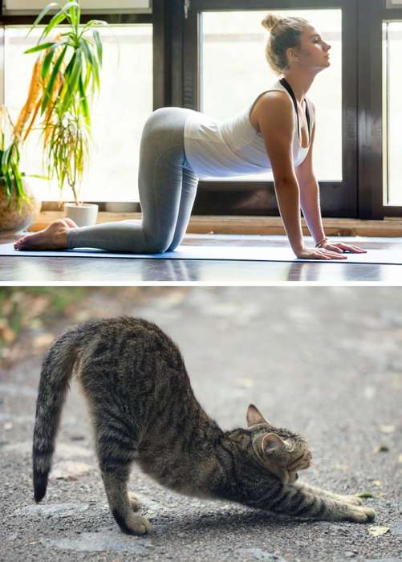
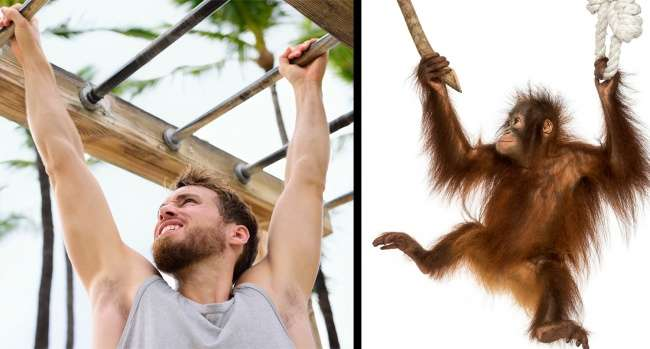
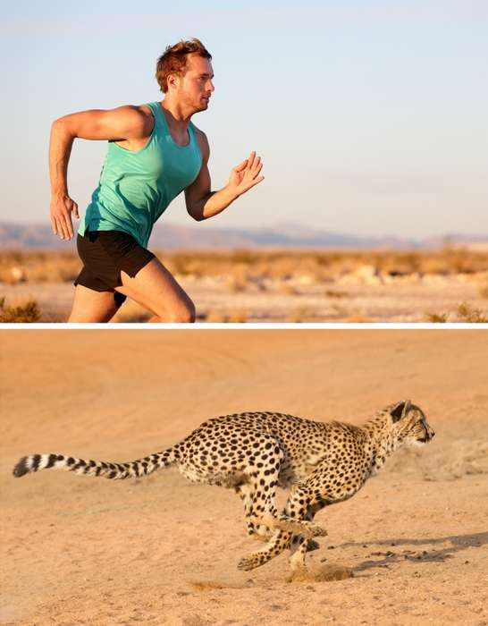
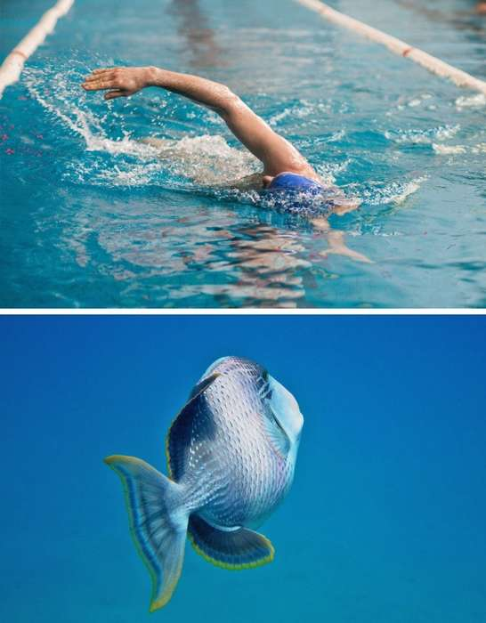
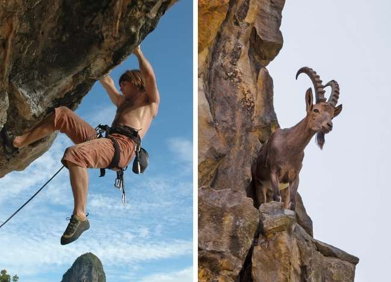
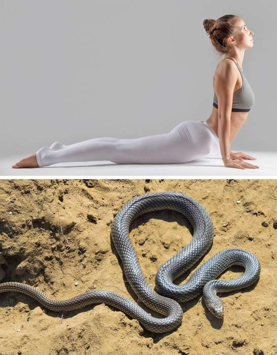
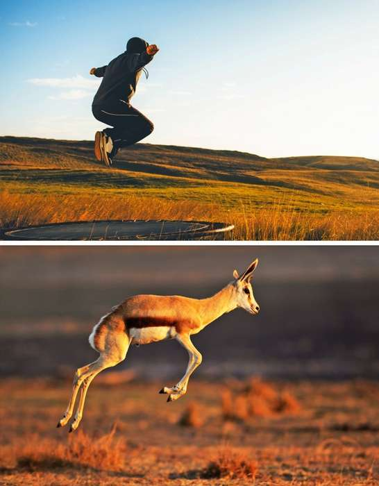

# Амьтдаас сурууштай зүйлс

Эрүүл аж төрж, бие галбираа сайхан байлгахыг хүсвэл, амьтдын төрлөхийн байгаллаг хөдөлгөөн, ааш аягийг дуурайн хийж сурвал, биеийн тамирын дасгал сургуулилттай адил үр дүнтэй байдаг гэнэ. Амьтад, ер нь хэвийн хэмжээндээ байж, элдэв өвчинд өртдөггүй нь, тэдний хөдөлгөөний хэвшилтэй холбоотой байдаг аж.

Муур шиг суниаж бай. Энэ нь йогийн хамгийн энгийн боловч ашигтай хөдөлгөөнд ордог. Ийнхүү суниаж байх нь, нурууны асуудлуудыг шийдэж, үе мөчний хөдөлгөөн, уян хатан байдлыг өсгөж, булчин шөрмөсөө чангалж, дотор эрхтэний цусан хангамжийг сайжруулна.

---

Нохой шиг баяр баясгалантай бай. Нохой амьдралын баяр баясгалант чанараараа амьтдын дунд нэгд ордог. Тэд, амьдралын хором бүрээс, юу ч бодохгүйгээр баяр баясгалан, ханамж авч чаддаг.

---

Сармагчин шиг авирч асдаг бай. Бага байхдаа бид, сармагчин шиг л асч авирахын түүс болж байдаг ч харамсалтай нь өсч томрон энэ байдлаа орхидог. Хойд Флоридын эрдэмтэд, хүн өдөрт хоёр цаг орчим модонд авирах, аливаа зүйлээс зүүгдэх зэрэг хөдөлгөөнүүдийг хийхэд, ой тогтоолт сайжирч, оюуны чадвар сайжирдаг болохыг туршилтаар нотолсон байна. Асч, авирах хөдөлгөөн нь, булчин шөрмөсийг дасгалжуулахаас гадна тархи оюуныг хөгжүүлдэг аж.

---

Гепард шиг гүйдэг бай. Гепард, ан олзоо барихын тулд, өдөрт 120 км/цагийн хурдтай гүйж чаддаг. Гүйлт бол эрүүл мэндэд маргаангүй ашиг тустай зүйл болохыг мэдэхгүй хүн үгүй биз ээ.

---

Загас шиг сэлдэг бай. Сэлэлт, бие галбирыг сайхан болгож, эрч хүчтэй байлгадаг. Чихрийн шижинтэй хүмүүсийг, цусан дах сахарын хэмжээг нь тогтворжуулах зорилгоор, долоо хоногт 3-с доошгүй сэлэлтээр хичээллэх, сэлэхийг зөвлөдөг.

---

Янгир шиг уул хаданд авирах нь, булчин шөрмөсөө хөгжүүлэх, тархи оюунаа мөн хөгжүүлэх сайхан дасгал болдог гэнэ. Хаданд авирахыг аюул эрсдэлтэй гэж үздэг, гэтэл, хөл бөмбөг, сагсны спортоос аюулгүй гэсэн судалгаа гарсан байна.

---

Могой шиг мушгиралдах хөдөлгөөн хийж бай. Энэ хөдөлгөөн, хэвлийн гүний булчин, нурууны булчинг чангалж, нойр булчирхай, гэдэс, бөөрний үйл ажиллагааг сайжруулдаг йогын дасгал юм.

---

Могой шиг мушгиралдах хөдөлгөөн хийж бай. Энэ хөдөлгөөн, хэвлийн гүний булчин, нурууны булчинг чангалж, нойр булчирхай, гэдэс, бөөрний үйл ажиллагааг сайжруулдаг йогын дасгал юм.

---

Гөрөөс шиг үсэрч харайдаг бай. Гөрөөс 10 метр хүртэл урттай харайж чадна. Ингэж харайхыг уриалаагүй ч, бага байхдаа дээс, резин тоглодог байснаа мартаагүй гэж найдаж байна. Хүүхэд байсан шигээ, өдөрт 5-хан минут яагаад дээс тоглож болохгүй гэж? Ясны сийрэгжилтээс өөрийгөө хамгаалах сайхан арга гэнэ.
