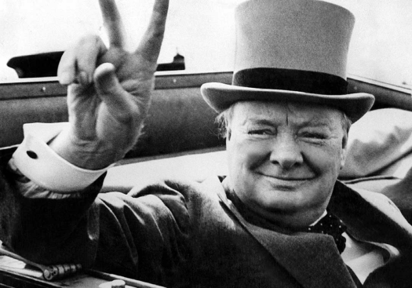

# Амжилт бол алдаануудаа урам зоригоо гээхгүйгээр давах чадварт оршдог

Амжилтыг аливаа зүйлийн оргилд хүрэхийг хэлнэ гэж үздэг бөгөөд харин амжилт нь асар их хүсч буй зүйлээ олон шалгуурыг давсны үр дүнд олж авдаг зүйл болохыг тэр бүр мэддэггүй. 50 жилийн өмнө Уинстон Черчилль өөрийн нэгэн ярилцлагадаа, амжилтыг ийнхүү тодорхойлсон нь, өнөө хир амжилт хэмээх ойлголтын хамгийн сайн тодорхойлолт гэж тооцогдсоор байдаг. Тэрээр, “Амжилт бол алдаануудын хоорондох үеийг урам зоригтой давах чадвар” гэсэн аж. Амьдрал, тэр дундаа идэвхитэй амьдрал алдаануудаар дүүрэн, эдгээр нь туршлага, чадвар өгдөг бөгөөд хамгийн гол нь урам зоригоо гээхгүй амьдарснаар амжилтад хүрдэг болохыг товч, тодорхой харуулсан энэ үг, сэтгэлийн тэнхээтэй амьдрах, аливаа бүтээгүй болоогүй зүйлийг хэт хүндээр хүлээж авахгүй байх, хэцүү байдлаас гарах чадвартай байхыг заадаг. Робин С Шарм-н “Яг адил нэг өдрүүдийг давтсан 75 жилийг амьдрал гэж хэлж болох уу?” гэсэн үг ч мөн, амжилт нь уналт босолтоос бүрддэг болохыг харуулдаг. Амжилтын мөн чанар нь, унаад босох чадвар, мөн унаж босчихоод, биеэ сэгсрээд хөгжилтэй ая хөнгөхөн аялан, сэдлээ хөдөлгөн, юу ч болоогүй юм шиг цааш хөдлөхөд оршдог гэнэ.

