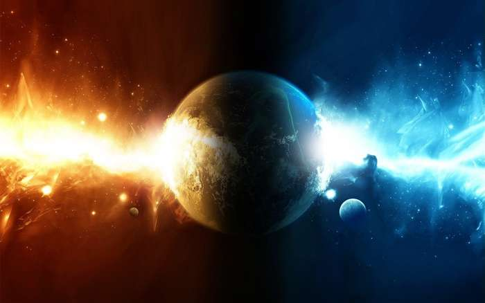

# Амжиж энергээ, аваарай

11 сарын 11, -энэ жилийн хамгийн өндөр энергитэй өдөр гэнэ. Энэ өдрийн 11 цаг 11 минутад асар хүчтэй, энергийн урсгал бий болох бөгөөд, яг энэ үед, хамаг сайхан хүслүүдээ бодитоор төсөөлж, хүсч буй амжилт, амьдралаа даатгаарай.

Хувийн нандин сайхан хүслүүдээсээ хальж, мөн бусдад ч хамгийн сайныг хүсээрэй. Таны зүрх сэтгэл, энэ үед эв эе, эрүүл энх, хайр, аз жаргалын хүслээр дүүрэн байг. Чин зүрхнээсээ гэгээ таттал баяртайгаар,талархал дүүрэн, энэ хормуудыг өнгөрүүлээрэй..\
11 цаг 11 минутад, дэлхий, Персейн одны аймагт шилжих бөгөөд, агуу их өөрчлөлтийн хаалгаар ордог. \
12:12, Персейн галт хаалгаар орсноор, хүн төрөлхтөн, хувьслын шинэ шулуунд орох юм байна. \
Бүх зүйл мөнх биш. Хуучин бүхэн халагдаж шинэ зүйлээр солигддог. Ирээдүй бол бүтээгч энергийн зөв ашиглалт бөгөөд, бидний ДНК, сансрын эерэг нөлөөллийн үйлчлэл дор, орон зай хоорондын генийн идэвхжилд ордог гэж үздэг байна.

Ийнхүү, шинэ, хүчирхэг, сансрын лугшилтын олгох боломжийг, шинэ ухамсар, сэтгэлгээний түвшинд хүлээн авч, ирээдүйгээ сайхнаар бүтээхэд ашиглаарай.
