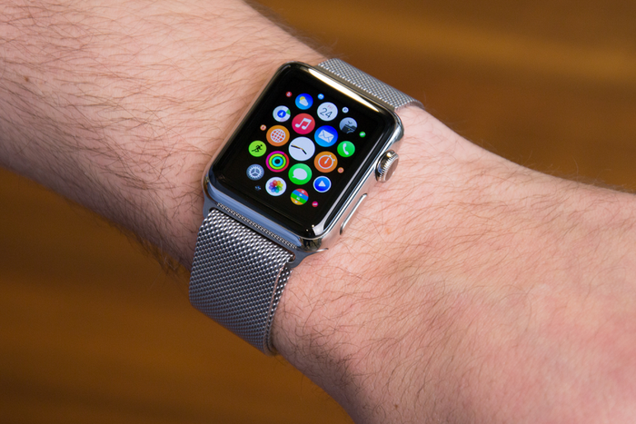
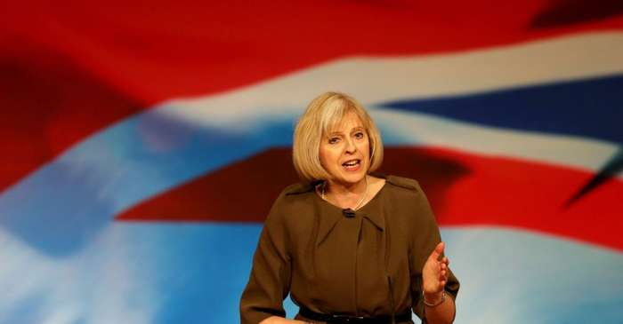

# Англид, сайд нараа, Apple Watch “ухаалаг цагийг” хуралдааны үед хэрэглэхийг хоригложээ

Английн засгийн эрх баригчид, оросын хакеруудаас болгоомжилж байна.

Засгийн газрын хуралдааны үед хэрэглэх нь, оросын хакеруудын халдлагад өртөн, сонсох төхөөрөмжийн хэмжээнд ашиглагдах боломжтой гэж үзсэний үүднээс хориглолоо гэж The Daily Telegraph мэдээлжээ. “Оросууд бүгдийг эвдэн, халдахыг оролдож байна”гээд, 2016 оны зун, ерөнхий сайдаар Тереза Мэйг томилогдсоны дараа уг хоригийг тавьсан гэсэн байна.

Өмнөх, ерөнхий сайд Дэвид Кэмероны үед, засгийн газрын нилээд гишүүд, уг “ухаалаг цагийг” зүүдэг байжээ.
