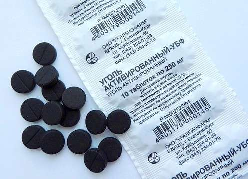
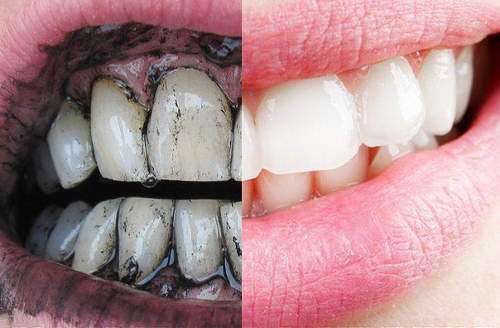
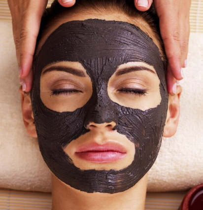

# Аптекийн “идэвхжүүлсэн хар нүүрс”-ийг гоо сайханд... / гэдэс дүүрэхэд хэрэглэдгээрээ танил болсон эм/

Идэвхжүүлсэн нүүрс нь, органик гаралтай хор, хорт бодис, бохирдолыг соронз мэт татаж авдаг гайхалтай чанартай.

Тийм ч учраас хордсон организм, хоолны хордлогын үед хэрэглэж ирсэн бөгөөд биеийг хорт бодисуудаас цэвэрлэдэг. Мөн тураах үйлчилгээ үзүүлдэг гэх нь ч бий. Цэвэрлэгдсэн организм турахаас өөр яахав... гэхдээ үүнийг өдөр тутам хэрэглэж болохгүй гэдгийг санах хэрэгтэй. Хоргүйжүүлэлтийг байнга хийж болохгүй шүү дээ.

---

Энэхүү эм нь хор тайлах, бие цэвэрлэхээс гадна арьсанд гүн цэвэрлэгээний үйлчилгээ үзүүлдэг. Ялангуяа тослог, нүхжилттэй арьсанд хамгийн сайн тохирно. Мөн шүд цайруулахад ашигладаг.\
Шүд цайруулахад, сойзондоо оо шахаад, түүнийгээ нунтагласан “хар нүүрсэндээ” дүрж шүдээ угаана. Амаа усаар сайтар зайлах хэрэгтэй. Долоо хоногт 1-2 удаа хэрэглэнэ.

---

Нүүр цэвэрлэх маска. Бүх арьсанд тохирно. Үйлчлэл нь гоо сайхны “шавар”-н маскатай дүйцдэг. Орц:\
1 цайны халбага нунтагласан “идэвхжүүлсэн нүүрс”\
1 цайны халбага зуун настын шүүс\
1 цайны халбага ус\
1 чимх далайн давс\
Сайтар хольж, нүүрэндээ нимгэн түрхээд, хатмагц угаана. Энэ маска арьсны нүх сүвийг цэвэрлэж, илүүдэл тос, бохирдолыг сайн цэвэрлэдэг.
