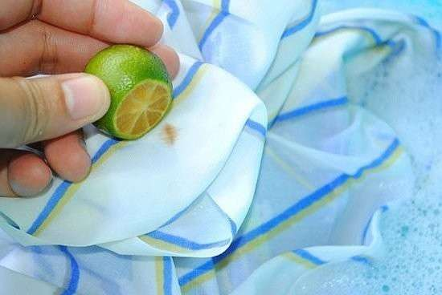

# Арилгахад хэцүү толбуудыг ч арилгах хялбар аргууд

Хайртай хувцас, хэрэглэлүүд дээр тогтсон толбыг арилгаж болохгүйгээс, хаяхаас аргагүй болох хичнээн харамсалтай байдаг билээ. Тэгвэл дараах ашигтай зөвлөгөө таныг, энэ байдлаас гаргаж, энгийн, хялбар, гарын доорхи зүйлсээр толбо арилгах эдгээр аргууд нь олон эзэгтэй нарт тус болох юм.

-Зайрмагнаас тогтсон толбыг, тухайн зүйлээ 10 минут орчим хүйтэн усанд дэвтээгээд, сав суулга угаагч шингэнээс багахан нэмж, араа нь угаана\
-Тосны шинэхэн толбыг нунтаг давс дээр нь асгаж үрэхэд арилна. Харин удсан толбыг нашатырны спиртээр арилгана\
-Нэг стакан усанд 4 ширхэг нухаж нунтагласан аспирин хийж хутгаад, тухайн толбоо үүгээрээ норгож 2 цаг орчим байлгаад угаана\
-Жимснээс тогтсон толбыг, 1 литр сүүнд, 2 хоолны халбага нимбэгийн шүүс нэмж, үүн дотроо толботой эдлэлээ 2 цаг орчим дэвтээгээд савандаж угаана\
-Нүүрний / шингэн пудра/ кремны толбыг, сахлын крем дээр нь түрхэж 20 минут орчим байлгаад угаахад арилна\
-Юунаас тогтсон нь мэдэгдэхгүй толбыг, ширүүвтэр үстэй сойзоор үрээд, хүүхдийн нойтон салфеткаар арчиж, С 30 градусын усанд угаах хэрэгтэй\
-Шоколад, төрөл бүрийн жимснээс тогтсон толбыг, нимбэгийг шахаж шүүсийг нь гаргаад, адил хэмжээний уксустай хольж гоо сайхны хөвөнд шингээн тэр хэсэгт нь арчина\
-Кетчупнаас тогтсон толбон дээр уксус хэд хэдэн удаа дусааж, үрж арчина
