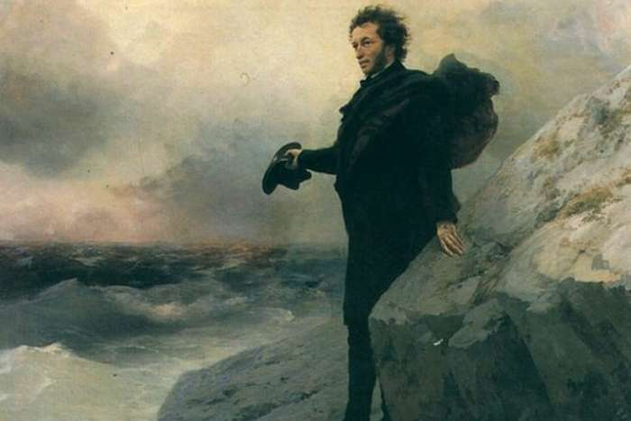
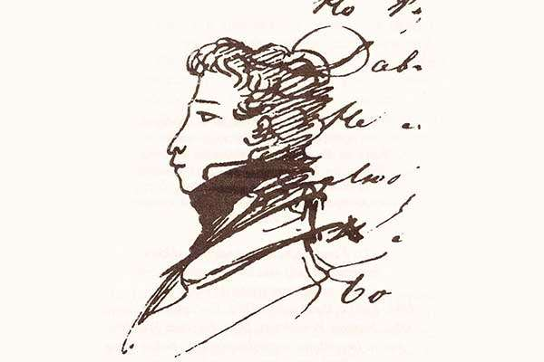

# А.С.Пушкин

Бид, өөртөө хайргүй хүнийг хайрлаж

Өөртөө хайртай хүнийг үл тооно

Бид үзэн ядаж байв ч үнсэж чаддаг хуурамч

Бид хүсэл эрмэлзэлгүй ч амьдарсаар байдаг дорой

Бид хүсээгүй зүйлээ ч зөвшөөрч л байдаг мунхаг

Бид хараан зүхэж, түүнийгээ бас хүлээн зөвшөөрнө

Бид хайртай гэж мөнхөд худал хэлж, түүнийгээ мартна бас хэлсээр л байдаг

Бид юуг ч үл тоомсорлоно

Нүдний гал цог, харцанд хариулах чадваргүй

Бид өөрсдийн сэтгэл, мэдрэхүйгээр харамсаж гэмшилгүй гамгүй тоглон

Хайрлуулахыг үргэлжид хүсэх ч, өөртөө хайргүй хүнийг хайрлаж буйгаа үргэлж мартан

Хайрладаг хүмүүсээ үйгүйсгэсээр хөнөөнө

