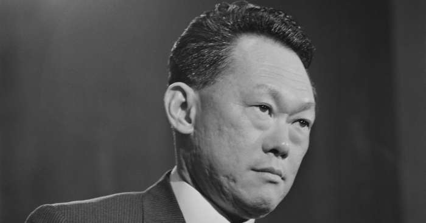

# Авлигыг устгаж, дээрэмчидээс ангижирсан Сингапурын түүх

2017 онд, Сингапур улс нь, Transparency intrnationals авлигын түвшин тогтоох олон улсын байгууллагын судалгаагаар, авлигатай амжилттай тэмцэж чадсан улсуудын эхний 10-т багтаж, 7-р байрт орсон бөгөөд азийн орнуудаас эхний 10-т орсон ганц орноор шалгарчээ. Авлигатай тэмцэх, авлигыг устгах асуудлыг амжилтад хүргэхэд, 1959-1990 онуудадСингапурын ерөнхий сайд байсан Ли Куан Ю гол үүрэг гүйцэтгэсэн гэж үздэг бөгөөд , дараах 5 хүчин зүйлийн тусламжтайгаар гүйцэтгэсэн гэдгийг Informate peru байгууллага судлан тогтоож, авлигатай тэмцэх загвар болгохын тулд олны хүртээл болгон нийтэлсэн байна. Сингапурын энэхүү системийг, олон улсын зах зээлд өндөр байр суурь эзлэх замаа тавьсан гайхалтай жишээ, мөн эдийн засгийн бодит хөгжил дэвшилд хүргэсэн амжилттай хэрэгжсэн социализмын нэгэн хэлбэр гэж үзсэн нь сонин. Бусад улс орнууд, Сингапурын жишээг үлгэр болгон хэрэгжүүлж болохгүй гэж үү?

1. Авлигад цэг тавих ажиллагаа\
Сингапур, 1965 онд Малайзаас салан тусгаарлах үедээ ард түмнийх нь олонхи нь ядуу зүдүү амьдралтай, нийтдээ авлигад идэгдсэн улс байсан бөгөөд энэ үед, Ли Куан Ю –“Хэрэв улс орноороо авлигаас салъя гэвэл, та бүхэн гэр бүлийн гишүүд, мөн найз нөхдөө ч шоронд явуулахад бэлэн байх хэрэгтэй” гэж шийдэмгийгээр зарлаж тунхагласан байдаг. Эхний арга хэмжээ нь, өөр бусад ашиг орлого хайлгахгүйн үүднээс, төрийн албан хаагчидын цалин нэмсэн бөгөөд төдийлөн үр дүн харагдахгүй байсанд, авлигын холбоо сүлбээг илрүүлэх гэнэтийн шалгалтыг удаа дараа явуулах, авлигын тохиолдлуудыг зогсолтгүй мөрдөж олон нийтэд мэдээлж байх эрхийг хэвлэл мэдээллийн хэрэгслүүдэд өгч ашиглах тусгай хөтөлбөрийг хэрэгжүүлж эхлэн, мөн мөрдөн байцаах байгууллагуудад төрийн албан хаагчид болон тэдгээрийн хамаарал бүхий этгээдүүд болох гэр бүл, хамаатан садан, найз нөхдийнх нь хүртэл дансыг, дээд байгууллагын заавар зөвшөөрөлгүйгээр шууд шалгаж байх онцгой бүрэн эрхийг олгосон байна. Авлигатай холбогдсон этгээдийг ажил, албан тушаал, тэтгэвэр тэтгэлэг, бүхий л хөнгөлөтүүдээс хугацаагүй хасах шийдвэр гаргаснаар, нилээд хэдэн сайдууд, үйлдвэрчиний эвлэлийн ажилтнууд шоронд оржээ. 1989 онд, авлигад холбогдсоны торгуулийг 10.0-с 100.0 сингапур доллар болгон өсгөжээ.\
2. Шүүхийн шинэчлэлт\
Сингапур нь, хүн амд ногдох цаазын ялын хэмжээгээрээ дээгүүр ордог улсуудын нэг юм. Ялангуяа хар тамхи, хүн амины хэргээр маш их цаазын ял хэргэлсэн байдаг. Өөр бусад гэмт хэргүүдийг урт хугацаагаар хорих, саваадах зэргээр шийтгэдэг. Энэхүү шийтгэлүүд харгис хэрцгий хэмээн гайхагддаг боловч, сингапурчууд энэ асуудал дээр хоёр хуваагдаж, цаазын ялаар буруугүй хүнийг шийтгэчихвэл засашгүй алдаа болох талтай, харин саваадах шийтгэлийг ихэд дэмждэг гэнэ. Сингапурын эрүүгийн хууль хэт хатуу мэт боловч, юуг болох, юуг болохгүй вэ гэдгийг хүмүүсийн ухамсарт суулгаж өгөх асуудлыг юуны түрүүнд тавьдаг нь харагдаж байдаг. Дүүжлэн хороох цаазын ял, хорих ял, саваадах бие мах бодын шийтгэл, эд хөрөнгийг нь хураах, өндөр торгууль ногдуулдаг зэрэг нь энэхүү улс оронд хууль, дэг журмыг барихад зориулагддаг болохыг ард иргэддээ ойлгуулж чадсан нь гайхалтай юм.\
3. Ажлын байр\
Маогийн хийсэн соёлын хувьсгал Хятадаас гадаадын хөрөнгө оруулагчидыг үргэхэд хүргэж, тэд Гонконг, Тайвань, Сингапурт анхаарлаа хандуулах болсноор 60-д оны сүүлээр анхны үйлдвэрүүд баригдаж эхлэн, 70-д онд анхны электрон бараанууд үйлдвэрлэгдэж, 80-д он гэхэд Сингапур дэлхийн технологийн бүтээгдэхүүний төв болон хувирав. Хөрөнгө оруулагчидын үйл ажиллагаанд төр оролцохгүй байх нөхцөлүүдийг бүрдүүлэхэд ихэд чармайдаг байсан, мөн хямд ажиллах хүч, бага татвар оногдуудлаг байсны ачаар гадаадын хөрөнгө оруулагчид цутгаж эхэлсэн гэж хэлж болно. Ли Куан Ю, -“Бид хөрөнгө оруулагчидыг дэмжихээс гадна, үйлдвэрлэлээ эхлүүлэхэд нь туслахын тулд нүдээ өгөхөөс буцахгүй ажилладаг байлаа. Гэхдээ, бидний үйл ажиллагаа тэднийг эрхлүүлэхэд биш, харин залуу сингапурчуудаа гадаадын компанид ажиллуулан туршлагажуулж, эн тэнцүү өрсөлдөх чадвартай өөрийн үндэсний компаниудыг байгуулах чадвартай болгоно гэсэн зорилго тавьсан юм. Учир нь, томоохон үйлдвэр барих, үндэсний компани байгуулах мөнгөтэй, туршлагатай хүмүүс тэр үед манайд байгаагүй. Тиймээс, бид залуусаа технолог, маркетинг, удирдлагын салбарт ийм аргаар бэлтгэн, эдгээр залуус маань үндэснийхээ үйлдвэрлэлийг босгох залуу мэргэжилтэнгүүд болох юм гэж тооцоолсон“ гэж ярилцлага өгсөн байдаг.\
4. Боловсролын шинэчлэл\
1960-д оны эцсээр Сингапур, ажилгүйдлийн эсрэг тэмцэх тэмцэлдээ гадаадын компаниудыг улс орондоо оруулснаар амжилттай ашигласан. Үүний зэрэгцээ, гадаадын компаниудад ажилладаг бүхий л ажиллагсдадаа хувийн сахилга баттай байх, цаг барьдаг байх, хариуцлагатай байх, өндөр чанартай бүтээгдэхүүн үйлдвэрлэхэд суралцахыг хатуу шаарддаг байлаа. Түүнчилэн сургалтын системээ өөрчилөн, ерөнхий эрдмийн хичээлүүдийн зэрэгцээ, бие даан шинжлэн судлах, шийдвэр гаргахад сургах, сурах бичгээс авах мэдлэгээс гадна илүү гүн гүнзгий бодож сургах сургалтад түлхүү анхаарсан хөтөлбөрүүд боловсруулав. Сингапурын эдийн засгийн хөгжлийн салбар дах инноваци, үр бүтээлтэй үйл ажиллагааны зөвлөлийн ерөнхийлөгч асан Филипп Йо, -“Бидэнд, эртний түүх, уран зохиолын мэргэжилтнүүдээс илүүтэй шинжлэх ухаан технологийн мэргэжилтнүүд онцгой хэрэгтэй байна. Тэд үүний үрээр хангалуун амьдрах болно” гэж үргэлжид ард иргэддээ ярьдаг байсан нь, өнөөдөр биелэлээ олсон юм. \
5. Улсын үйлдвэрүүдийг байгуулсан\
Засгийн газраас үүсгэн байгуулсан анхны компаниудын нэг нь, эдүгээгийн Singapore Airlines юм. Улсын нислэгийн компанийн ерөнхий захирал асан Лим Чен Бен, -“Бид энэ компанийг нэр төр, байр суурийн үүднээс байгуулаагүй, харин мөнгө олохын тулд байгуулсан. Тиймээс, алдагдалтай ажилласан тохиолдолд эргэлзээ тээнэгэлзээгүй хаах байлаа. Гэхдээ тийм зүйл болоогүй” гэж бахархан дурссан байдаг. Энэхүү нислэгийн компани үйлчилгээний аргачлалын хувьсгал хийсэн бөгөөд зорчигчидийг дайлах ундаа, хоол, мөн суудлын тав тухаас эхлээд чихэвчний дуугаралт хүртэл, бүх зүйлсийг нарийвчилан тооцож шинэчлэсэн гэдэг. Үүний үрээр зуу зуун ажлын байр бий болгож, мөн дэлхийн тэргүүлэх хэмжээний нислэгийн компани болгон хөгжүүлж чадсан аж.
