# Авто зурхай

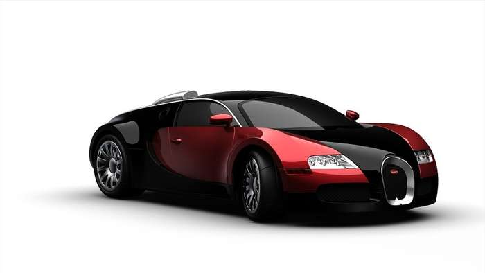

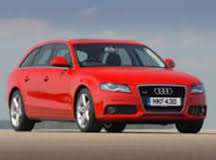

#### Хонь

Энэ ордныхонд нийт ослын 6.6%- оногдно. Машин барихдаа чөлөөтэй, аюулгүйн хамгийн дээд хэмжээнд багтсан зүрх зоригтой маневруудыг хийдэг. Машины шил, гэрэл, дуу зэрэгт их ач холбогдол өгдөг. Ер нь найдвартай жолооч. Хажууд нь зорчиж буй хүний хувьд, очих газраа хүрэхээсээ өмнө буух гээгүй л бол, жолоогоо барихад нь оролцож хэрэггүй. Сонирхдог машин: Хурдан давхих дургүй ямар “хонь” байхав? Түүнд улаан өнгийн Феррари өгөөд үз, ер нь спорт машин зохино.

---

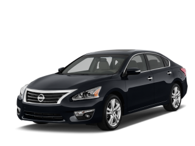

#### Үхэр

Автын ослын 6.2% -г үхрийнхэн хийдэг. Сайн авто уралдаанч болохсон. Авто зам бүрийг уралдааны зам шиг боддог. Замын гэрлэн дохио тэдний хувьд уралдааны гарааны улаан туг гэсэн үг. Гайхалтай нь, тэд хол ойр яваад ирэхдээ “ багахан сэвтэй” ирдэг. Хажууд нь яваа хүн хажуугаас нь жоохон нудраад явбал, түүнийг багахан дарж, өөрөө ч тайван явах болно. Түүний машин: Үхрийнхэн жинтэй, найдвартай, амьдралд хэрэгтэй машинд дуртай тул “Форд” “Опель” зүгээр.

---

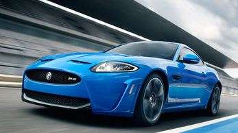

#### Ихэр

Ихрийнхэн авто ослын 9.2% -г хийдэг. Тэд машин барихдаа түрэмгий, хурд хэтрүүлнэ, нэг эгнээнээс нөгөө рүү огцом шилжнэ, болох болохгүй газар гүйцэж түрүүлнэ. Хамгийн золбоотой жолооч, эргэх дохио болон бусад дохио түүний хувьд тоглоом, сигналтай ч мөн л тоглож өгнө. Маш сайн реакцтай.Хажууд нь зорчигч, түүнд “ сансраас хянадаг болчихсон гэнэ лээ” гэж сануулаад л явахаас өөр аргагүй. Түүний машин “Ауди”.

---

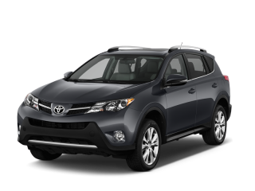

#### Мэлхий

Машин барих нь тэр өдрийн сэтгэл санааны байдлаас шалтгаалдаг. Ослын 8.8% тэдэнд оногдно. Тэд яг амьдрал дээр байдаг шигээ машинаа барьдаг. Тухайн өдрийн сэтгэл санааны байдлаасаа шалтгаалан хурдан давхина, эсвэл гэлдэрнэ. Гэвч эрсдэлтэй байдалд орвол маш өөртөө итгэлтэйгээр байдлаас гардаг. Ер нь тэд тайван, хүлээцтэй жолооч. Хажууд нь явж байгаа хүн түүнд замын хөдөлгөөнд оролцогч гэдэг нь зөвхөн машинууд биш мөн явган зорчигчид ч ордогийг сануулахад гэмгүй. Тэд аюулгүйн бүс, дэр зэрэгт ач холбогдол өгдөг мөн ямар ч тохиолдолд даатгалд даатгуулдаг. Мэлхийнүүдэд найдвартай “”Вольксваген” таалагддаг.

---

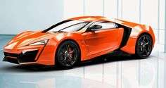

#### Арслан

Барагтай авто осол гаргадаггүй. Өөдрөг арслангууд, “”хааз”-аа гишгээд уйтгараа зайлуулая л гэнэ. Гудамж бол түүний эзэмшил л гэсэн үг, өөрийнхөө ур чадварыг гайхуулж олны хүндэтгэл хүлээх нь тэднийх. Тиймээс ч олны анхаарал татсан машинд дуртай. Хамт явах хүн нь суумагцаа л түүнийг магтах хэрэгтэй. Романтик арслан итали машин сонгоно, хэрэв дээд зиндааных бол “Кадиллак” авна.

---

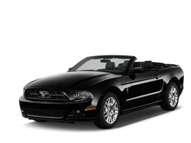

#### Охин

Автын осол таригчдын 9-д ордог. Амьдрал дээр нягт нямбай мэт боловч бусад жолооч нар аймаар, жолооны ард замбараагүй аашилна. “Явган гарцны зураасууд машин явах давуу эрхтэй зүйл байх аа”, “автын осол уу, хүн бүртэй л тохиолдож л байдаг ш дээ” гэх мэт хэнэггүй. Хажууд нь сууж яваа хүнд, -ер нь наад жолооч оо сольсон нь дээр. “Тоёота” “Хонда” “Киа” дунд эргэлднэ.

---

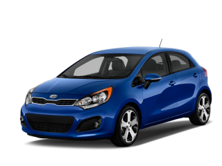

#### Жинлүүр

Авто ослын 6.1% тэдэнд оногдно. Сэтгэл санааны тэнцвэртэй, бусад жолооч нартай харьцуулахад жолооны дүрмийг онолынх нь дагуу мөрддөг ганцхан дутагдалтай тал бий шөнө явахдаа мөрөөдөлдөө автагдчих гээд байдаг. Хажууд нь зорчигч, байнга ярьж хөөрч бэлэн байдалд явах хэрэгтэй. Элит машинд дуртай. “Ролс-Ройс”

---

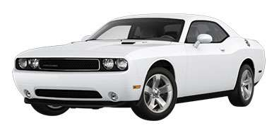

#### Хилэнц

Хилэнцийнхэн авто ослын 6,8%-г хийдэг. Тэд машин сайн барьдаг. Тэд хөдөлгөөний дүрмийг маш сайн мэддэг ба тоормозлох зайгаа хүртэл тооцоолох чадвартай. Төгс жолооч. Даатгалын компаниудын мөрөөдлийн жолооч. Түүний хажууд нь сууж байгаа хүмүүс зүгээр л түүнд итгэх хэрэгтэй. “Порше” “BMW” тэднийх.

---

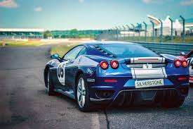

#### Нум

6.8% осол гаргана. Хурдтай, гүйцэж түрүүлэх эгнээгээр байнга явдаг. Бусад жолооч нарт хараал урсгах дуртай. Хэрэгтэй үед, оновчтой шийдвэр гаргах авъяастай. Хажууд нь зорчигч хамт нийлээд хараал урсгаад явах хэрэгтэй. Үнэтэй машинд дуртай. Бусдын өмнө нүүр улайхааргүй машин сонгодог.

---

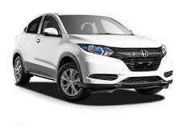

#### Матар

Ордууд дундаа осол гаргалтаар тэргүүлнэ. Замын хөдөлгөөний дүрмийг ягштал баримтлана. Зүүн гар талын захын эгнээгээр бусад жолооч нарт үлгэр дууриал болохоор явдаг. Хажууд нь яваа хүн нүдээ аниад тайван юм бодоод явах хэрэгтэй. сонгодог хэлбэрийн машинуудад дуртай.”Фольксваген”

---

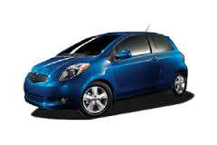

#### Хумх

Хумхынхан, сахилгагүй, дүрэм зөрчдөг. Сайнгүй жолооч. Тойрог дээр осол гаргачих гээд байдаг. Өөрийнхөө машинаас овор хэмжээ багатай машинуудад дээрэлхүү. Арвич хямгач, түлш зарцуулалтаа байнга хянадаг. Хажууд нь яваа хүн тэвчээртэй сонин уншаад явсан ч болно. Сонин чамин машинд дуртай. Ер нь аль болох хурдны үзүүлэлтийг сонирхон сонгоно.

---

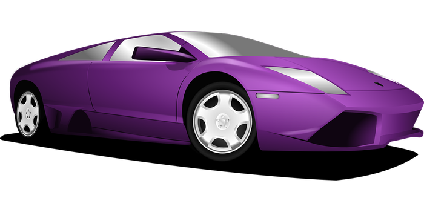

#### Загас

Замын тэмдгүүдийг анзаараагүйгээс осол гаргадаг. 8.4% осол тэдэнд оногдно. Амьдралд зөөлөн ханддаг шигээ мөн машиндаа ч тэгж хандана. Маш удаан хугацаагаар машин барьж явах асуудлыг тайван хүлээж авдаг. Тэднийг авралын сахиусан тэнгэр байнга хамгаалж байдаг. Хажууд нь яваа хүн, нервтэхгүй, үглэхгүй явах. Хэрэв удаан явлаа гэж хэлвэл загас жолооч баярлаж хүлээж аваад тоохгүй. Маш чамин нэртэй тансаг машинд дуртай. Болвол хөх ягаан өнгөтэй. “Бугати” “Бентли”
